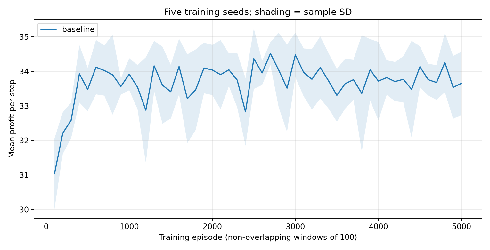
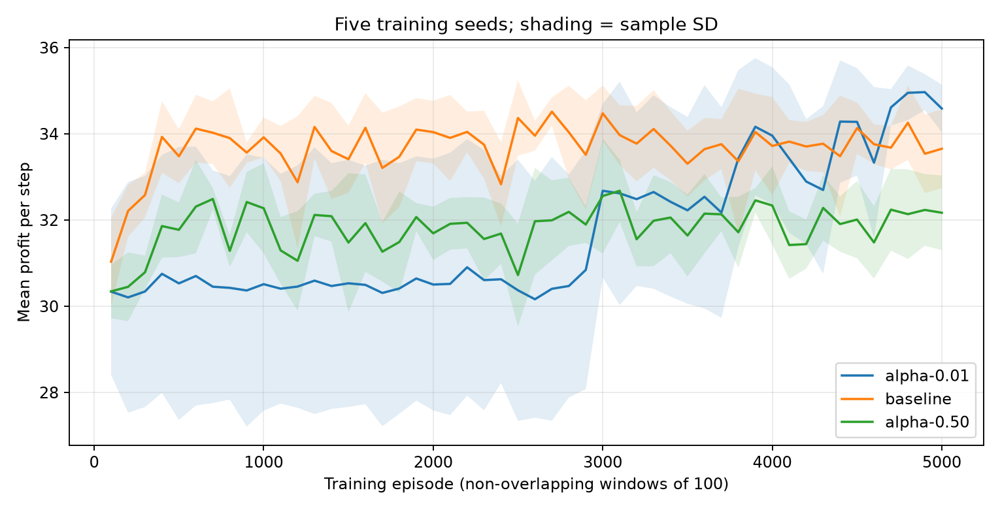
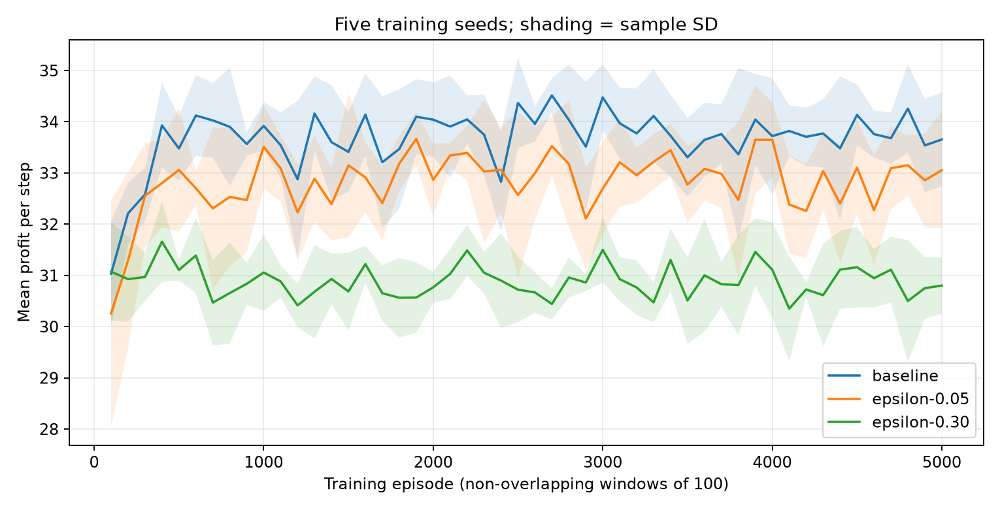

# HỌC VIỆN CÔNG NGHỆ BƯU CHÍNH VIỄN THÔNG

KHOA CÔNG NGHỆ THÔNG TIN 1

## ASSIGNMENT 02 – INTELLIGENT SYSTEM DEVELOPMENT

Học phần: Phát triển các hệ thống thông minh

Giảng viên hướng dẫn: Thầy Trần Đình Quế

Sinh viên thực hiện: Giáp Minh Hiếu

Mã sinh viên: B23DCCN299

Hà Nội – 2026

<!-- pagebreak -->

## Thiết lập và quy trình thực nghiệm

### Phạm vi triển khai

Mã bắt đầu từ agent02_code.tex do đề cung cấp. Dù có đuôi .tex, nội dung file là Python. Thực nghiệm giữ nguyên môi trường, cập nhật Q, xử lý terminal và chuỗi RNG huấn luyện của mã này, tách thành các module nhỏ và bổ sung đo lường. Chỉ **một RL học với một đối thủ luật cố định**, không phải hai RL cùng học. Không dùng LLM hay GPU.

| Tham số | Giá trị |
|---|---|
| Huấn luyện mỗi lượt | 5.000 episode × 20 bước = 100.000 bước |
| Đánh giá mỗi policy | 500 episode × 20 bước = 10.000 bước |
| Alpha và gamma chuẩn | 0,10 và 0,90 |
| Exploration chuẩn | max(0,02; 0,20 × 0,995^episode), episode bắt đầu 0 |
| Giá gốc và chi phí | P = 10; C = 5; giảm giá chuẩn 20% |
| Seed baseline | Môi trường 42; RL 10042; đánh giá 500042 |
| Seed lặp độc lập | 11, 22, 33, 44, 55; seed RL = seed + 10000 |

### Các phép so sánh A đến E

A/B chạy baseline, lưu reward từng episode, tổng reward tích lũy, Q-table và đếm hành động. C so sánh alpha 0,01; 0,10; 0,50. D so sánh lịch chuẩn với epsilon cố định 0,05 và 0,30. C/D giữ các tham số còn lại và bộ seed như nhau. Mỗi cấu hình đều chạy đủ ngân sách, không chọn seed tốt nhất.

E đánh giá policy RL đã đóng băng trong trận RL-vs-rule; sau đó đánh giá policy luật trong trận rule-vs-rule riêng. Hai trận dùng cùng demand và cùng uniforms theo từng khách hàng. Lấy tổng các Bernoulli độc lập tạo đúng phân phối Binomial(N,p), đồng thời tránh việc nhánh lấy mẫu khác nhau làm lệch chuỗi demand giữa policy. Seed đánh giá bằng seed huấn luyện + 500000, RNG doanh số bằng seed đánh giá + 1000000.

Không cập nhật Q, không exploration trong đánh giá; tie chọn argmax chỉ số nhỏ nhất. Huấn luyện vẫn dùng random tie như mã gốc. Đây là thay đổi quy trình đánh giá có chủ đích; không kỳ vọng tái tạo số của hàm evaluate_pair nguyên bản. SD trong bảng tổng hợp là SD mẫu giữa **5 seed**, ddof=1. Vùng tô trên đồ thị cũng là SD giữa seed, không phải khoảng tin cậy.

Q9 đổi mức giảm giá thành 5%, giữ phần khác. Đo riêng policy baseline chuyển sang môi trường mới và policy huấn luyện lại ở môi trường mới, cùng so với luật. Tổng cộng **31 lượt huấn luyện đầy đủ**: baseline seed 42 và 6 cấu hình × 5 seed.

<!-- pagebreak -->

## Mô hình và hai cách ra quyết định

### Câu 1 Agent và môi trường

Hai người bán là hai agent, cùng tương tác trong một thị trường. Tại bước t, agent i quan sát s_i(t) = (d_t, c_i(t)), với d thuộc {0,1} là nhu cầu thấp/cao và c là hành động của đối thủ ở bước trước. Có bốn quan sát cục bộ và hai hành động: a = 0 không giảm giá, a = 1 giảm giá. Hai agent chọn đồng thời, không được nhìn hành động hiện tại của bên kia trước khi chọn.

Mỗi bên có xác suất chuyển đổi p_i = clip(0,30 + 0,25d + 0,15a_i − 0,10a_j; 0,05; 0,95). Khi d = 0 có N = 10 khách tiềm năng; d = 1 có N = 20. Doanh số S_i được lấy mẫu Binomial(N,p_i). Reward là lợi nhuận r_i = S_i × [10(1 − δa_i) − 5]. Sau bước, hành động hiện tại trở thành lịch sử; nhu cầu mới được lấy độc lập, hai giá trị có xác suất bằng nhau. Mỗi episode đặt lịch sử hai bên về 0.

Đây là hệ đa agent vì reward của một bên phụ thuộc hành động của bên kia, và hành động hôm nay thay đổi quan sát ngày sau của đối thủ. Nhu cầu chung không làm hai tác nhân trở thành một: mỗi bên có policy và lợi nhuận riêng. Mô hình mô tả cạnh tranh qua môi trường, không có giao thức trao đổi thông điệp hay phối hợp LLM.

### Câu 2 Học từ kinh nghiệm và theo luật

| Khía cạnh | Q-learning | Agent theo luật |
|---|---|---|
| Quyết định | Epsilon-greedy theo Q(s,a) | If-else từ d và c |
| Kinh nghiệm | Cập nhật Q từ reward và trạng thái kế | Không cập nhật tham số |
| Thích nghi | Có thể học lại nếu tiếp tục tương tác | Cần người sửa luật |
| Tính toán | Lưu 8 Q-value; cần ngân sách tương tác | Vài phép kiểm tra điều kiện |
| Giải thích | Xem Q và policy; phụ thuộc dữ liệu học | Dễ kiểm tra từng nhánh |

Luật chuẩn: nhu cầu thấp thì không giảm; nhu cầu cao chỉ giảm nếu đối thủ đã giảm ở bước trước. Nó không tối ưu hóa trực tiếp reward. Q-learning thử hành động rồi ước lượng return; huấn luyện có chi phí dù suy luận với bảng nhỏ rất rẻ.

Luật phù hợp khi chương trình khuyến mãi phải tuân thủ điều kiện cố định, ít dữ liệu và cần quyết định dễ kiểm tra. RL phù hợp hơn khi có simulator đáng tin cậy, nhiều tương tác và cần điều chỉnh trước thay đổi nhu cầu, với ràng buộc giá và rủi ro rõ ràng. Đây là tình huống thiết kế, không phải kết luận hiệu quả kinh doanh từ mô phỏng nhỏ này.

<!-- pagebreak -->

## Cập nhật Q và mục tiêu lợi nhuận

### Câu 3 Ý nghĩa và phép tính Q learning

Q(s,a) ước lượng tổng reward chiết khấu khi chọn a tại s rồi tiếp tục theo policy. Với bước chưa kết thúc, TD target = r + gamma × max Q(s′,a′). Hiệu TD = target − Q(s,a). Cập nhật Q mới = Q cũ + alpha × hiệu TD. Alpha quyết định mức tiếp nhận bằng chứng mới, gamma quyết định trọng số tương lai.

Với Q cũ = 4; alpha = 0,1; r = 6; gamma = 0,9; max Q kế = 5:

**Bước 1** Target = 6 + 0,9 × 5 = 10,5.

**Bước 2** Hiệu TD = 10,5 − 4 = 6,5.

**Bước 3** Q mới = 4 + 0,1 × 6,5 = **4,65**.

Giá trị tăng 0,65 vì mục tiêu mới cao hơn ước lượng cũ. Đây là ví dụ số giả định của đề để minh họa phép cập nhật; kết quả thực nghiệm được báo riêng. Ở bước terminal, target = r, không bootstrap. Bảng không có biến thời gian còn lại nên đang dùng cùng Q cho các vị trí khác nhau trong episode hữu hạn; không xem đây là lời giải tối ưu chính xác theo horizon.

### Câu 5 Giảm giá và hàm reward

Không giảm giá: biên lợi nhuận mỗi đơn = 10 − 5 = **5**. Giảm 20%: giá bán = 10 × 0,8 = 8; biên lợi nhuận = 8 − 5 = **3**. Giảm giá tăng xác suất mua 0,15 nhưng giảm 40% biên lợi nhuận mỗi đơn. Tăng doanh số chưa đảm bảo tăng tổng lợi nhuận.

| Nhu cầu d | Hành động đối thủ hiện tại b | E[r không giảm] | E[r giảm 20%] |
|---|---|---|---|
| 0 | 0 | 10 × 0,30 × 5 = 15 | 10 × 0,45 × 3 = 13,5 |
| 0 | 1 | 10 × 0,20 × 5 = 10 | 10 × 0,35 × 3 = 10,5 |
| 1 | 0 | 20 × 0,55 × 5 = 55 | 20 × 0,70 × 3 = 42 |
| 1 | 1 | 20 × 0,45 × 5 = 45 | 20 × 0,60 × 3 = 36 |

Đáng chú ý, ở nhu cầu thấp khi đối thủ giảm giá, giảm giá cũng có lợi tức thời cao hơn 0,5. Vì vậy không được nói không giảm giá luôn trội ở mọi trạng thái. Hành động còn ảnh hưởng phản ứng của đối thủ ở bước sau; bảng trên chưa tính return dài hạn.

Nếu reward đổi thành số đơn bán, agent sẽ có động lực giảm giá thường xuyên hơn vì bỏ qua biên lợi nhuận. Có thể bổ sung chi phí đổi giá, giới hạn tồn kho hoặc chi phí thu hút khách; mỗi thay đổi phải nêu đơn vị và đánh giá lại. Tối ưu một reward sai mục tiêu có thể tạo hành vi không có lợi cho doanh nghiệp.

<!-- pagebreak -->

## Kết quả baseline và đánh giá policy

### Câu 6 Tính reward trung bình

Baseline huấn luyện 100.000 bước, seed 42. RL thu tổng 3.345.548, trung bình **33,45548 mỗi bước**; đối thủ luật thu 3.283.930, trung bình **32,83930**. Trong huấn luyện RL còn exploration và Q còn thay đổi, vì vậy các số này không đại diện trực tiếp cho chất lượng policy greedy cuối cùng.

| Giai đoạn và agent | Tổng reward | Số bước T | Reward/T | Không giảm / giảm |
|---|---|---|---|---|
| Training RL | 3345548 | 100000 | 33,45548 | 82476 / 17524 |
| Training đối thủ luật | 3283930 | 100000 | 32,83930 | 91677 / 8323 |
| Eval RL trong RL-vs-rule | 349185 | 10000 | 34,91850 | 10000 / 0 |
| Eval đối thủ trong RL-vs-rule | 349315 | 10000 | 34,93150 | 10000 / 0 |
| Eval luật trong rule-vs-rule riêng | 349185 | 10000 | 34,91850 | 10000 / 0 |

Phép tính ví dụ: R_RL_eval = 349185 / (500 × 20) = **34,9185**. Đối thủ trong cùng trận nhận 34,9315 vì có chuỗi Bernoulli khác; không dùng chênh lệch này làm so sánh cùng vai trò. So sánh công bằng ở vai trò focal là **RL 34,9185 và luật 34,9185**, trong hai trận riêng với cùng nguồn ngẫu nhiên.

### Q table và policy sau baseline

| Trạng thái (d,c) | Q không giảm | Q giảm | Greedy |
|---|---|---|---|
| (0,0) | 228,3024 | 178,8494 | 0 |
| (0,1) | 177,9920 | 207,2051 | 1 |
| (1,0) | 246,8799 | 235,2338 | 0 |
| (1,1) | 211,4198 | 242,9629 | 1 |

Hai trạng thái có c = 1 chọn giảm giá, nhưng trong đánh giá episode bắt đầu lịch sử [0,0], RL chọn 0 ở cả hai trạng thái c = 0 và luật không tự khởi phát giảm giá. Do đó các trạng thái c = 1 không xuất hiện trên quỹ đạo này. Policy ghi trong bảng khác policy luật ở một số trạng thái, nhưng hành động thực tế của hai policy vẫn giống nhau.

Khi cả hai luôn chọn 0, lợi nhuận kỳ vọng mỗi bước = 0,5 × 15 + 0,5 × 55 = **35**. Số đo 34,9185 gần giá trị này nhưng không phải bằng chứng hội tụ. Nhiều seed cho biết độ nhạy khởi tạo và nhiễu; phạm vi vẫn giới hạn trong simulator và ngân sách đã chọn. Bảng nhiều seed được trình bày ở phần learning rate và exploration.

<!-- pagebreak -->

## Quan sát quá trình học

### Thí nghiệm B Reward theo cửa sổ



Đường thể hiện trung bình của seed 11, 22, 33, 44, 55. Mỗi điểm tổng hợp 100 episode, tức 2.000 bước cho từng seed. Vùng tô là ±1 SD mẫu giữa seed. Cách tính cho một cửa sổ: tổng reward của 100 episode chia (100 × 20), sau đó lấy trung bình giữa seed.

Với baseline seed 42, trung bình 100 episode đầu là **31,9210**, 100 episode cuối là **33,5690**. SD reward mỗi episode sau khi chia 20 ở 1.000 episode cuối là **5,2144**. Đây là độ dao động theo episode của một lượt chạy, khác SD giữa seed. Số cuối cao hơn số đầu 1,6480; quan sát này phù hợp với cải thiện trong lượt chạy đó nhưng chưa chứng minh hội tụ hay tổng quát hóa.

### Reward tích lũy và cách diễn giải

Tổng reward tích lũy cuối huấn luyện là 3.345.548 cho RL và 3.283.930 cho đối thủ luật. Chuỗi đầy đủ được tính bằng tổng lũy kế reward từng episode; đồ thị bổ sung lưu ở results/baseline-cumulative.png và dữ liệu gốc trong baseline-seed-42-training.csv.

Tổng tích lũy tăng vì reward trong cấu hình chuẩn không âm; chỉ một đường tích lũy tăng chưa chứng minh agent học tốt hơn. Cần xem độ dốc và reward/bước cùng đánh giá đóng băng. Training RL đạt 33,45548, còn greedy evaluation 34,91850; khác biệt vừa liên quan exploration vừa liên quan Q thay đổi và mẫu đánh giá, không thể quy toàn bộ cho một nguyên nhân từ một lần đo.

<!-- pagebreak -->

## Learning rate và độ ổn định

### Câu 7 So sánh ba learning rate



| Cấu hình | Train | SD cuối | Eval mean ± SD | Giảm giá eval |
|---|---|---|---|---|
| alpha 0,01 | 31,7145 | 5,0805 | 35,0728 ± 0,1456 | 0,00% |
| alpha 0,10 | 33,6779 | 5,2181 | 35,0728 ± 0,1456 | 0,00% |
| alpha 0,50 | 31,8184 | 5,4449 | 33,7930 ± 1,8390 | 20,02% |
| Luật đánh giá riêng | Không học | — | 35,0728 ± 0,1456 | 0,00% |

Bảng dùng cùng 5 seed huấn luyện và cùng protocol đánh giá 10.000 bước mỗi seed. Train là reward/bước trên toàn bộ 5.000 episode, lấy trung bình giữa seed. Cột dao động là trung bình SD episode/bước trong 1.000 episode cuối của từng seed. Eval là mean ± SD mẫu giữa seed. Tỷ lệ giảm giá lấy từ đánh giá greedy.

Reward đánh giá lần lượt là alpha-0.01: 35,0728; baseline: 35,0728; alpha-0.50: 33,7930. Alpha 0,50 có SD giữa seed 1,8390 so với 0,1456 ở alpha 0,10; mean thấp hơn 1,2798. Hai trong năm seed alpha 0,50 chọn giảm giá khi nhu cầu thấp và mất lợi nhuận so với luật cùng seed. Đây là dấu hiệu nhạy với seed ở cấu hình này, không chứng minh mọi learning rate lớn đều kém.

Về cơ chế, alpha = 0,01 điều chỉnh 1% hiệu TD mỗi bước nên làm mượt nhiễu nhưng cập nhật chậm. Alpha = 0,50 thay nửa khoảng cách đến target ở mỗi lần quan sát nên nhạy với reward ngẫu nhiên và target bootstrap. Alpha = 0,10 nằm giữa hai mức. Khi dùng alpha cố định và epsilon còn sàn, Q vẫn có thể dao động; không giả định hội tụ chỉ từ số episode lớn.

Sự khác nhau giữa reward trên đường học và đánh giá cuối cho thấy không nên chỉ nhìn một điểm cuối để chọn learning rate. SD reward cũng chịu ảnh hưởng nhu cầu và doanh số ngẫu nhiên, không phải thước đo thuần túy của độ dao động Q. Để kết luận về ổn định Q cần ghi thêm Q theo thời gian và độ thay đổi policy, ngoài dữ liệu đang có.

<!-- pagebreak -->

## Exploration và exploitation

### Câu 4 Vai trò của epsilon greedy

Trong huấn luyện, với xác suất epsilon agent chọn hành động ngẫu nhiên; còn lại chọn hành động có Q cao nhất. Khi có hai hành động, nhánh random vẫn có thể chọn hành động greedy nên tỷ lệ hành động không greedy không nhất thiết bằng epsilon. Khi Q bằng nhau, mã huấn luyện phá hòa ngẫu nhiên; đánh giá dùng argmax xác định và không khám phá.



| Cấu hình | Train | SD cuối | Eval mean ± SD | Giảm giá eval |
|---|---|---|---|---|
| Lịch chuẩn | 33,6779 | 5,2181 | 35,0728 ± 0,1456 | 0,00% |
| Cố định 0,05 | 32,8239 | 5,3290 | 34,5651 ± 1,0424 | 8,16% |
| Cố định 0,30 | 30,8870 | 4,8943 | 28,8672 ± 3,8254 | 50,16% |
| Luật đánh giá riêng | Không học | — | 35,0728 ± 0,1456 | 0,00% |

Reward đánh giá ba cấu hình lần lượt là baseline: 35,0728; epsilon-0.05: 34,5651; epsilon-0.30: 28,8672. Epsilon cố định 0,30 thấp hơn baseline 6,2056 reward/bước trong đánh giá greedy. Tắt exploration sau huấn luyện không bảo đảm sửa được policy cuối kém: agent vẫn hành động theo Q đã học. Sự khác biệt reward training bao gồm chi phí thử hành động và phản ứng của đối thủ.

Lịch chuẩn epsilon_k = max(0,02; 0,20 × 0,995^k) chạm sàn khoảng episode k = 460. Hai cấu hình cố định giữ đúng 0,05 và 0,30 suốt 5.000 episode. Các tham số alpha, gamma, giá, nhu cầu, seed và ngân sách giữ như nhau. Khi đánh giá, cả ba đều tắt exploration để so policy đã học thay vì trộn thêm chi phí khám phá.

Khám phá quá nhiều có thể làm mất lợi nhuận tức thời do thường xuyên thử giảm giá không phù hợp, đồng thời kích hoạt phản ứng của đối thủ. Ngừng quá sớm có thể khiến một hành động kém được thử bị đánh giá thấp, khiến agent mắc kẹt với Q nhiễu. Mức epsilon tối ưu còn phụ thuộc alpha, số bước và độ quan sát của trạng thái; bảng này chỉ kiểm tra ba cấu hình cụ thể.

<!-- pagebreak -->

## Tương tác đa agent và tính không dừng

### Câu 8 Đối thủ thay đổi bài toán học như thế nào

Hành động hiện tại của đối thủ xuất hiện trực tiếp trong xác suất mua: nếu đối thủ chuyển từ 0 sang 1 trong cùng điều kiện, p của mình giảm 0,10. Ví dụ mình không giảm giá và nhu cầu cao: p từ 0,55 còn 0,45, lợi nhuận kỳ vọng từ 55 còn 45. Sau bước, hành động đó trở thành c trong quan sát tiếp theo. Agent không thấy trước hành động hiện tại mà chỉ thấy lịch sử.

Hành động của mình hôm nay cũng thay đổi quyết định đối thủ ngày sau. Theo luật chuẩn, nếu nhu cầu kế tiếp cao, đối thủ giảm giá khi mình vừa giảm giá. Vì vậy tối ưu reward không chỉ xét lợi nhuận tức thời. Khi reset hai bên về 0, policy luật đấu luật sẽ duy trì toàn 0: không có bên nào khởi phát phản ứng dây chuyền.

### Vì sao independent Q learning có thể khó

Nếu cả hai RL cùng cập nhật policy, phân phối reward và trạng thái kế mà mỗi bên gặp sẽ đổi theo quá trình học của bên kia. Một Q-value học từ dữ liệu cũ có thể không còn phản ánh đối thủ hiện tại. Trong trường hợp này giả định môi trường dừng của phân tích Q-learning thông thường khó áp dụng; còn có thể xảy ra dao động chiến lược và đuổi theo policy lẫn nhau.

Thực nghiệm ở đây giữ đối thủ luật cố định nên không đo trực tiếp độ không dừng do hai learner. Không được dùng đường học trong bài làm bằng chứng rằng huấn luyện đồng thời hai RL đã ổn định. Các biến động đang quan sát còn có thể đến từ nhu cầu ngẫu nhiên, doanh số và exploration.

### Một thay đổi thực nghiệm để khảo sát

Chạy hai nhánh với cùng seed, ngân sách và cấu hình: nhánh A một RL học với luật cố định; nhánh B hai RL cùng học. Lưu checkpoint mỗi 250 episode và đánh giá đóng băng với bộ đối thủ chuẩn gồm luật, luôn giảm và luôn không giảm. Đo reward, tần suất đổi policy và reward khi đối đầu các checkpoint cũ của đối thủ. Dùng các seed chưa tham gia điều chỉnh tham số. Đây là thiết kế đề xuất, chưa chạy trong bộ số liệu hiện tại.

### Giới hạn trạng thái cục bộ

Quan sát (d, hành động trước của đối thủ) không chứa hành động trước của chính agent, trong khi biến này ảnh hưởng luật của đối thủ hiện tại. Các lịch sử khác nhau có thể trùng một quan sát nhưng dẫn đến reward khác nhau. Do đó không bảo đảm quan sát bốn trạng thái có tính Markov. Bổ sung lịch sử của mình và thời gian còn lại là cải tiến hợp lý trước khi tăng độ phức tạp thuật toán.

<!-- pagebreak -->

## Giới hạn và kiểm tra độ nhạy

### Câu 9 Hạn chế của mô phỏng

Thứ nhất, công thức chuyển đổi là giả định minh họa, không được fit từ thị trường. Hai bên lấy doanh số riêng nên tổng số đơn có thể lớn hơn N; N không phải một kho khách độc quyền được chia giữa người bán. Mô hình không xét hàng tồn, ngân sách, nhiều mức giá hay khách mua lặp lại.

Thứ hai, demand độc lập và đồng xác suất sau mỗi bước nên không có mùa vụ, quán tính hay tác động quảng cáo. Reset lịch sử về [0,0] làm một số trạng thái không xuất hiện khi đánh giá policy nhất định. Kết quả tốt trên phân phối khởi đầu này chưa đảm bảo xử lý được mọi lịch sử cạnh tranh.

Thứ ba, quan sát bốn trạng thái bỏ thiếu lịch sử hành động của mình và horizon; đối thủ cố định chỉ là một kiểu hành vi. Ngân sách 5.000 episode và 5 seed còn nhỏ, alpha cố định nên không có bảo đảm hội tụ từ thực nghiệm. Không sử dụng các giới hạn này để suy đoán lợi nhuận triển khai thực tế.

### Thay đổi đã triển khai Giảm giá 5 phần trăm

Trong config discount-0.05, δ từ 0,20 xuống 0,05; giá khi giảm = 9,5 và biên lợi nhuận = 4,5. Khi đối thủ không giảm: nhu cầu thấp cho E[r giảm] = 10 × 0,45 × 4,5 = 20,25 so với 15; nhu cầu cao cho 20 × 0,70 × 4,5 = 63 so với 55. Lợi ích tức thời của giảm giá thay đổi rõ rệt; phản ứng đối thủ vẫn cần được tính đến.

| Policy và môi trường | Eval mean ± SD | Tỷ lệ giảm giá |
|---|---|---|
| RL baseline tại 20% | 35,0728 ± 0,1456 | 0,00% |
| RL transfer 20% sang 5% | 35,0728 ± 0,1456 | 0,00% |
| RL retrain tại 5% | 36,9318 ± 0,4339 | 76,42% |
| Luật tại 5% đánh giá riêng | 35,0728 ± 0,1456 | 0,00% |

Ở mức giảm 5%, RL huấn luyện lại đạt 36,9318 ± 0,4339. Chênh lệch trung bình so với policy baseline chuyển sang cùng môi trường là 1,8590 reward/bước. Đây là độ nhạy đã đo với thay đổi reward margin, không phải bằng chứng agent baseline tự thích nghi sau khi đóng băng.

Transfer dùng policy đã học ở mức 20% rồi đánh giá đóng băng tại mức 5%, không cập nhật. Retrain dùng đủ 5.000 × 20 bước ở mức 5%, sau đó đánh giá riêng cùng seed. Luật không được sửa theo reward mới. Tất cả số trong bảng là reward/bước và mean ± SD mẫu của cùng 5 seed; mức giảm giá của mô hình khác tỷ lệ hành động giảm giá của agent.

Đường học hai mức giảm giá được lưu trong results/robustness.png và hiển thị trong notebook. Các cấu hình dùng cùng năm seed; dữ liệu reward từng episode đi kèm cho phép kiểm tra khác biệt giữa quá trình học và policy đóng băng cuối cùng.

<!-- pagebreak -->

## Đề xuất agent và phép kiểm chứng tốt hơn

### Câu 10 Thiết kế cải tiến

Đề xuất trước hết sửa biểu diễn trạng thái thay vì thay ngay bằng mạng sâu. Trạng thái gồm nhu cầu hiện tại, hành động trước của đối thủ, hành động trước của mình, số bước còn lại, mức giảm giá áp dụng và trạng thái tồn kho nếu mô hình có tồn kho. Khi chỉ bổ sung hai hành động trước và thời gian, có thể vẫn dùng bảng nhỏ. Nếu quan sát đối thủ nhiễu hoặc bị trễ, bổ sung belief hoặc lịch sử ngắn được định nghĩa rõ.

Hành động ban đầu vẫn là {không giảm, giảm theo mức cho phép}; có thể mở rộng thành các mức 0%, 5%, 10%, 20% sau khi kiểm tra mô hình giá. Reward là lợi nhuận sau giá vốn, trừ chi phí thay đổi giá và chi phí tồn kho, với giới hạn giá bán không dưới giá vốn. Tránh thưởng doanh số đơn thuần nếu mục tiêu là lợi nhuận.

Phương pháp cơ sở là Q-learning theo horizon với trạng thái đầy đủ hơn, learning rate giảm theo số lần thăm và exploration theo lịch được chọn trên validation. Có thể thử Double Q-learning để giảm thiên lệch max; so sánh riêng từng thay đổi để biết thành phần nào đóng góp. Cần giữ một policy an toàn theo luật để giới hạn hành động khi thiếu dữ liệu.

### Kế hoạch đánh giá độ bền vững

Giữ ngân sách tương tác ngang nhau cho agent đề xuất, Q-learning tham chiếu và luật. Chia seed điều chỉnh tham số với seed kiểm tra cuối; không chọn policy chỉ vì nó tốt trên seed kiểm tra. Đánh giá cả reset [0,0] lẫn lịch sử khởi đầu 00, 01, 10, 11 và báo kết quả theo từng nhóm, tránh che khuất các trạng thái không được thăm.

Thử các mức giảm giá, demand độc lập và demand có tính bền, các đối thủ luật, luôn giảm, luôn không giảm và RL checkpoint đã đóng băng. Dùng ít nhất 20 seed kiểm tra mới, báo reward/bước, regret so với oracle phù hợp mô hình, tỷ lệ giảm giá, phân vị lợi nhuận thấp, vi phạm ràng buộc và ngân sách tính toán. Dùng cùng demand và sales uniforms để so sánh ghép cặp; tính chênh lệch theo seed và khoảng tin cậy của chênh lệch.

Gọi agent cải tiến bền vững hơn chỉ khi lợi ích giữ được trên nhiều nhóm dịch chuyển, không chỉ một trung bình gộp, và không làm tăng vi phạm hay rủi ro vượt mức đã xác định. Cần ablation lần lượt bỏ lịch sử của mình, bỏ biến thời gian và bỏ cơ chế an toàn để xác định tác dụng từng thành phần.

**Phân biệt phạm vi:** agent cải tiến và thử hai RL cùng học là đề xuất thiết kế. Phần đã triển khai, chạy và lưu kết quả trong bài là agent tham chiếu, đánh giá riêng, các cấu hình alpha/epsilon và kiểm tra mức giảm giá 5%.

<!-- pagebreak -->

## Mã Python thiết yếu

### Chọn hành động và cập nhật Q

Các trích đoạn dưới lấy từ file reference_core.py của bài làm, phát triển từ Python trong agent02_code.tex. Q có kích thước (2,2,2). Mọi reward thực nghiệm được tạo bằng thực thi; không điền số kỳ vọng thay kết quả lấy mẫu.

```python
def act(self, state, explore=True):
    demand, competitor_previous_action = state
    if explore and self.rng.random() < self.epsilon:
        return int(self.rng.integers(0, 2))
    values = self.q[demand, competitor_previous_action]
    best_actions = np.flatnonzero(np.isclose(values, np.max(values)))
    return int(self.rng.choice(best_actions))
```

```python
def learn(self, state, action, reward, next_state, terminal=False):
    demand, competitor_previous_action = state
    next_demand, next_competitor_action = next_state
    old_value = self.q[demand, competitor_previous_action, action]
    if terminal:
        target = reward
    else:
        best_future_value = np.max(self.q[next_demand, next_competitor_action])
        target = reward + self.gamma * best_future_value
    self.q[demand, competitor_previous_action, action] = (
        old_value + self.alpha * (target - old_value))
```

### Agent theo luật

```python
def act(self, state):
    demand, competitor_previous_action = state
    if demand == 0:
        return 0
    elif demand == 1 and competitor_previous_action == 1:
        return 1
    else:
        return 0
```

Mã đầy đủ nằm trong code/reference_core.py; điều phối thí nghiệm trong code/agent02_experiment.py; đánh giá common random numbers trong code/evaluation.py; xuất dữ liệu và hình trong code/results_io.py. Notebook đi kèm chứa toàn bộ mã trong một file, tự chạy đủ 31 lượt thí nghiệm từ kernel mới, tạo bảng, Q-table và biểu đồ.

<!-- pagebreak -->

## Tách huấn luyện và đánh giá trong mã

### Môi trường và reward

Đây là phần tính chuyển đổi, doanh số và lợi nhuận từ phương thức step của môi trường. Hai hành động đã được chọn trước khi gọi step.

```python
conversion = (0.3 + 0.25 * self.demand + 0.15 * own_action
              - 0.1 * competitor_action)
conversion = float(np.clip(conversion, 0.05, 0.95))
sales = int(self.rng.binomial(customers, conversion))
effective_price = self.config.price * (
    1.0 - self.config.discount_rate * own_action)
profit_per_sale = effective_price - self.config.unit_cost
profit = sales * profit_per_sale
rewards.append(float(profit))
```

### Nguồn ngẫu nhiên chung khi đánh giá

```python
def make_tape(config, seed):
    shape = (config.evaluation_episodes, config.steps_per_episode)
    demand = np.random.default_rng(seed).integers(0, 2, size=shape)
    sales = np.random.default_rng(seed + 1_000_000).random(
        (*shape, 2, max(config.low_demand_customers, config.high_demand_customers)))
    return demand, sales
```

Mỗi khách hàng có một uniform độc lập; khách mua khi uniform < p. Với N khách, tổng số lần mua có luật Binomial(N,p). Trong các trận riêng, giữ cùng uniforms cho cùng vai trò và cùng demand giúp chênh lệch ít bị nhiễu hơn. Hai người bán vẫn có uniforms riêng, không nhận doanh số giống hệt nhau chỉ vì cùng p.

Hàm evaluate tạo đối thủ luật mới, đặt lịch sử về [0,0] mỗi episode, dùng argmax từ Q đã học, ghi từng reward và đếm hành động. Không có lời gọi learn trong hàm này; cuối hàm kiểm tra Q trước và sau giống hệt nhau. CSV/JSON lưu tổng reward, reward/bước, số bước, số hành động và reward theo episode để kiểm tra lại phép cộng.

### Cách chạy và kiểm chứng

```text
python -m pip install -r requirements.txt
python code/agent02_experiment.py
python code/test-experiment.py
python notebook/build-notebook.py
python report/assemble-report.py
python report/render-report.py
```

Các lệnh chạy từ thư mục agent02. Chương trình benchmark chạy đủ 31 lượt; notebook cũng chứa toàn bộ mã và chạy đủ 31 lượt, không cần file Python, JSON hay hình có sẵn bên ngoài. Python 3.14.6, NumPy 2.4.6 trên Windows là môi trường đã thực thi. Phiên bản cụ thể của các gói được lưu trong results/environment.json.

<!-- pagebreak -->

## Kết luận và tài liệu tham khảo

### Kết luận

Thực nghiệm đã triển khai hai kiểu quyết định, chạy baseline, kiểm tra đường học, ba learning rate, ba exploration và phép so sánh policy đóng băng trong các trận riêng. Tất cả cấu hình chạy trên cùng bộ 5 seed; baseline chuẩn có thêm seed 42. Câu 9 bổ sung thay đổi mức giảm giá từ 20% sang 5%, tách rõ transfer với retrain.

Ở giảm giá 20%, RL baseline và luật đánh giá riêng đều đạt 35,0728 ± 0,1456 reward/bước trên 5 seed. Khi giảm giá 5% và huấn luyện lại, RL đạt 36,9318 ± 0,4339. Vì vậy việc chọn hành động phụ thuộc mạnh vào biên lợi nhuận và hành vi đối thủ; cần kiểm tra cả thay đổi mô hình lẫn quy trình đo.

Kết quả phản ánh sự tương tác giữa reward, biểu diễn trạng thái, đối thủ và quy trình đánh giá. Trong mô hình nhỏ, luật phù hợp có thể cạnh tranh tốt với RL. Q-learning có cơ chế học từ phản hồi nhưng không tự bảo đảm policy tối ưu hay thích nghi nếu không tiếp tục cập nhật. Đánh giá đóng băng cho biết chất lượng policy cuối ở phân phối đã chọn; training còn exploration trả lời một câu hỏi khác.

### Tái lập và kiểm tra

Dữ liệu gồm JSON cho từng seed, CSV reward theo episode, bảng tổng hợp và hình dựng từ các kết quả đó. Kiểm thử kiểm tra phép cập nhật Q, terminal, luật, chuyển trạng thái đồng thời, reward, phân phối doanh số, kết quả đánh giá so với oracle độc lập, bất biến Q và tính tái lập. Có đối chiếu chính xác với mã gốc ở 100 episode. Không thay kết quả nhiễu bằng kết quả lý thuyết để làm đẹp báo cáo.

Tên PDF nộp bài là **agent02_CT_04_hieugm.pdf**, theo mẫu agent01 và quy ước tên của đề. Gói hỗ trợ chứa notebook đã thực thi, HTML, mã Python, dữ liệu kết quả và Markdown báo cáo chỉnh sửa được.

### Tài liệu tham khảo

[1] Intelligent System Development. Laboratory Experiment 02 Reinforcement-Learning-Based Agents versus Rule-Based Agents. Năm học 2026–2027. File đề assignment_Agent02_due_29.10.pdf trong bộ ASIGNMENT-AGENT_02. Nguồn yêu cầu, công thức và cấu hình thực nghiệm; mục 7–10.

[2] Mã giảng viên cung cấp. agent02_code.tex và agent02_complementary_code.pdf trong cùng bộ đề. Nguồn môi trường, Q-learning và luật. Bài làm bổ sung đánh giá riêng, common random numbers, nhiều seed cho mọi cấu hình và kiểm tra độ nhạy.

[3] Naeem M., Rizvi S. T. H., Coronato A. A Gentle Introduction to Reinforcement Learning and Its Application in Different Fields. IEEE Access, 2020. DOI 10.1109/ACCESS.2020.3038605. Bản PDF kèm đề. Tham khảo nền tảng reward, policy và exploration.

[4] Developing Multiagent Systems A Practical Tutorial with Python and PyTorch. Tài liệu môn học slide_multiAgent_system_20.10.2026.pdf. Tham khảo mô hình nhiều agent tương tác qua môi trường. Các số liệu và kết luận thực nghiệm trong báo cáo được tính từ mã của bài làm.
