# PROJECT01 - HỆ ĐA AGENT HỖ TRỢ BỆNH ĐÁI THÁO ĐƯỜNG

Giáp Minh Hiếu - B23DCCN299 - CT01 - Nhóm04

# CHƯƠNG 1. BÀI TOÁN VÀ PHẠM VI THỰC HIỆN

## 1.1. Mục tiêu của Project01

DiaCare là nguyên mẫu học thuật về hệ đa agent hỗ trợ tìm hiểu bệnh đái tháo đường. Đề tài kết hợp hai nhánh: Knowledge Base từ Web/PDF, Knowledge Graph và RAG; dữ liệu Diabetes trong cơ sở dữ liệu để huấn luyện, so sánh Deep Learning. Báo cáo trình bày kết quả thực nghiệm và cách các thành phần phối hợp thành ứng dụng.

Tài liệu project_architecture_multiagent_diabet_v1.pdf do giảng viên cung cấp định nghĩa bảy agent cốt lõi, giao tiếp có cấu trúc và quy trình tạo báo cáo. Đây là đặc tả kiến trúc; không quy định số bộ dữ liệu hoặc mô hình. Ma trận bốn cohort, sáu loại mô hình, ba seed là phần mở rộng thực nghiệm để có so sánh rõ ràng.

Đầu vào gồm cohort, đầy đủ đặc trưng đúng schema và câu hỏi tùy chọn. Đầu ra gồm dự đoán, kết quả luật, bằng chứng truy xuất, giải thích, nguồn và giới hạn. Các thành phần được giữ riêng để người xem biết thông tin đến từ mô hình, luật hay tài liệu.

## 1.2. Kết quả chính và cách đếm

| Thành phần | Kết quả và ý nghĩa |
|---|---|
| Dữ liệu học có giám sát | 4 cohort độc lập: CDC, Hospital, Pima, Early Stage |
| Loại mô hình | 6: Logistic Regression, Random Forest, Histogram Gradient Boosting, MLP hai tầng, MLP ba tầng, Residual MLP |
| Deep Learning | 3 kiến trúc nhiều tầng ẩn; seed là lần khởi tạo, không là loại kiến trúc mới |
| Ma trận | 4 × 6 = 24 tổ hợp dataset-model; mỗi tổ hợp 3 seed, tổng 72 lượt thật |
| Tái sử dụng | Giữ nguyên artifact CDC/Hospital đã triển khai; benchmark mới lưu riêng |
| Tri thức | Web, PDF tiếng Việt và thẻ có nguồn; KG được xây dựng mới và xuất Cypher |
| Điều phối | 7 agent cốt lõi, request_id xuyên suốt, trạng thái và phiên bản |
| Nâng cấp mã 2.1 | Retrieval tối đa 3 lượt, review/sửa tối đa 1 lần, timing từng call và registry công nghệ |
| Sản phẩm | Notebook độc lập, FastAPI, Docker, báo cáo, hướng dẫn bảo vệ |

Hai cohort nhỏ bổ sung giúp quan sát độ nhạy khởi tạo và tác động của dữ liệu ít. Chúng không làm tăng bằng chứng kiểm định của cùng một mô hình vì nhiệm vụ, feature và quần thể khác nhau. Không cộng mọi hàng thành một tập huấn luyện chung.

## 1.3. Điều chỉnh so với giả định của kiến trúc mẫu

Kiến trúc mẫu giả định đã có DL và Neo4j KG. Hai mô hình CDC/Hospital đã tồn tại; người học xác nhận chưa có Neo4j hoặc DB_diabet.cypher. Bài thực hiện tái sử dụng DL hiện có và xây KG từ đầu. Cypher bàn giao là kết quả mới của project, không là kho tri thức có sẵn của giảng viên.

Vinmec là nguồn bài viết sức khỏe cho KB/RAG. Bài viết công khai cung cấp văn bản, không cung cấp ma trận bệnh nhân có nhãn để thay cho bốn cohort. Không gọi bài viết là dữ liệu bệnh nhân Vinmec để train DL. PDF kiến trúc 11 trang không nêu bắt buộc dùng Vinmec; nguồn này được bổ sung theo trao đổi với người học.

## 1.4. Giới hạn sử dụng

Đây là nguyên mẫu giáo dục và nghiên cứu. Điểm sigmoid chưa được hiệu chuẩn thành xác suất bệnh cá nhân tại Việt Nam. Hospital dự đoán tái nhập viện dưới 30 ngày ở người có đái tháo đường; đây không phải phát hiện bệnh mới. CDC dùng nhãn gộp tiền đái tháo đường/đái tháo đường theo nguồn binary.

Hệ thống không chẩn đoán xác nhận, kê thuốc hoặc tự điều chỉnh liều. Luật minh họa cần chuyên gia thẩm định trước khi dùng thật. RL chỉ mô phỏng cách trình bày. Citation đúng ID hoặc URL chứng minh truy vết, chưa chứng minh mọi phát biểu được nguồn hỗ trợ đầy đủ.

## 1.5. Cách kiểm chứng

Các số liệu Chương 3-4 lấy từ artifact thực. 72 lượt nằm tại results/benchmark/full; manifest nguồn, SQL và split tại results/benchmark/database-manifest.json; hash bảo toàn mô hình cũ tại results/benchmark/legacy-preservation.json. Chương 5 mô tả corpus/graph/RAG; Chương 6 mô tả luật và báo cáo; Chương 7 hướng dẫn notebook, kiểm thử và triển khai.

Bằng chứng ngày 05/11/2026 là lịch sử phiên bản cũ. Kết quả kiểm tra của phiên bản nào chỉ áp dụng cho phiên bản đó. Trạng thái bản nâng cấp phải đối chiếu verification mới nhất, không suy ra từ việc URL cũ vẫn truy cập được.

Bản 2.1 thay đổi hành vi agent và mã giao diện, đồng thời đồng bộ notebook. Phần mới được kiểm qua agent-upgrade-cases.json, agent-upgrade-evaluation.json, agent-upgrade-pytest.json và notebook-agent-upgrade-verification.json. Registry /api/capabilities nối từng phương pháp với source symbol, endpoint và demo; feature_usage của request cho biết phần đã thực sự chạy.

## 1.6. Câu hỏi nghiên cứu và tiêu chí hoàn thành

Đề tài đặt ba câu hỏi. Thứ nhất, các mô hình Deep Learning có đem lại lợi ích so với baseline đơn giản trên cùng dữ liệu bảng hay không? Câu trả lời dựa trên bảng so sánh từng cohort ở Chương 4, bao gồm cả trường hợp baseline cạnh tranh hoặc tốt hơn. Thứ hai, có thể kết hợp dự đoán, luật và tài liệu mà vẫn truy vết được nguồn của từng kết quả không? Câu trả lời được thể hiện bằng hợp đồng agent, report có cấu trúc và một request chạy thật. Thứ ba, hệ thống phản ứng thế nào khi dữ liệu sai hoặc dịch vụ ngoài không khả dụng? Cần quan sát luồng dừng sớm, trạng thái degraded và đường fallback cụ thể.

| Mã | Yêu cầu thực hiện | Tiêu chí kiểm chứng |
|---|---|---|
| YC01 | DB cung cấp dữ liệu cho DL | Có bảng SQLite, SQL, split và nguồn/hash trong manifest |
| YC02 | So sánh mô hình có kiểm soát | Cùng cohort/split, fit tiền xử lý trên train, chọn bằng validation |
| YC03 | KB/KG và RAG có provenance | Chunk truy được URL/page; relation có evidence; phân biệt cache và Neo4j |
| YC04 | Phối hợp bảy agent | Một request_id, message có trạng thái, report tách các loại thông tin |
| YC05 | Xử lý lỗi có thể quan sát | Input sai dừng trước DL; dependency lỗi không tạo score giả |
| YC06 | Có sản phẩm chạy lại được | Notebook, API, Docker, hướng dẫn và hồ sơ kiểm chứng theo phiên bản |

Đây là tiêu chí kỹ thuật của nguyên mẫu. Một bộ kiểm chức năng đạt không trả lời được câu hỏi về hiệu quả điều trị, tính công bằng hoặc độ an toàn khi triển khai lâm sàng. Phần kết luận vì vậy tách đóng góp kỹ thuật khỏi các bằng chứng còn thiếu.

## 1.7. Người sử dụng và tình huống sử dụng

Người học có thể chọn một cohort, nhập vector minh họa và quan sát các agent tạo báo cáo. Người xem đánh giá cách kết nối các thành phần qua trace, không dùng các giá trị điền sẵn như hồ sơ của bản thân. Người kiểm tra kỹ thuật có thể mở nguồn, xem phiên bản model, chạy notebook hoặc đối chiếu API để tái lập kết quả.

Ba tình huống chính gồm: tạo báo cáo kết hợp model và câu hỏi; tra cứu tri thức có nguồn; xem bảng benchmark và graph. Luồng tạo báo cáo là điểm tích hợp chính của kiến trúc bảy agent. Luồng chat giữ cơ chế hỏi đáp của phiên bản trước; nó không thay thế bằng chứng cho luồng báo cáo. Không có đăng nhập bệnh viện, nhập hồ sơ định danh hoặc tích hợp bệnh án trong phạm vi bài.

## 1.8. Phương pháp và cách tổ chức báo cáo

Bài thực hiện theo thứ tự: xác định nhiệm vụ/nhãn; kiểm kê và làm sạch nguồn; lưu DB và cố định split; huấn luyện baseline cùng DL; xây corpus và graph; tích hợp agent qua hợp đồng; đánh giá từng thành phần và kiểm tra toàn luồng. Kết quả ML là thực nghiệm đã lưu ngày 06/11/2026. Các ví dụ bổ sung cho bản nộp lại ghi ngày chạy riêng, không đổi ngày hoặc trình bày các lượt cũ như thực nghiệm mới.

Chương 2 giải thích Agent/MAS và ánh xạ sang mã nguồn. Chương 3 mô tả dữ liệu, SQL và ngăn rò rỉ. Chương 4 trình bày mô hình, chỉ số và sai số. Chương 5 giải thích tri thức, graph, retrieval và generation. Chương 6 theo dõi báo cáo/luật/RL qua ví dụ cụ thể. Chương 7 tập hợp tái lập, kiểm chứng, giao diện, triển khai và kết luận. Phụ lục cung cấp bảng đối chiếu và điểm vào mã nguồn để người đọc kiểm tra độc lập.


# CHƯƠNG 2. KIẾN TRÚC HYBRID MULTIAGENT SYSTEM

## 2.1. Agent và hệ đa agent trong phạm vi đề tài

Agent phần mềm nhận thông tin từ môi trường, xử lý theo mục tiêu và tạo hành động hoặc kết quả. Wooldridge và Jennings mô tả các đặc tính thường dùng để nhận diện agent: tự chủ, tương tác với agent khác, phản ứng với môi trường và hành vi hướng mục tiêu. Đặc tính này là cơ sở phân tích thiết kế, không có nghĩa mọi hàm xử lý hoặc mọi lớp Python đều tự động trở thành agent có năng lực suy luận độc lập. Nguồn: [Wooldridge và Jennings, Intelligent Agents: Theory and Practice](https://www.cs.ox.ac.uk/people/michael.wooldridge/pubs/ker95/subsubsectionstar3_1_1_1.html).

Trong DiaCare, môi trường quan sát gồm request API, trạng thái model, kết quả truy xuất và trạng thái phụ thuộc. Hành động của agent là trả dữ liệu đã kiểm tra, chạy suy luận, phát cảnh báo, lấy evidence hoặc tạo giải thích. Mục tiêu chung là tạo báo cáo có thể truy vết; mỗi vai trò chỉ nhận phần thông tin cần cho nhiệm vụ. Ví dụ, Prediction không sửa luật, còn Explanation không huấn luyện lại mạng hoặc đổi ngưỡng phân lớp.

Mức tự chủ của nguyên mẫu còn giới hạn. Coordinator quyết định thứ tự gọi theo một quy trình hữu hạn; các agent chuyên biệt thực hiện thuật toán đã định nghĩa khi được gọi. Hệ thống chưa có agent tự đặt mục tiêu dài hạn, thương lượng, lập kế hoạch mở hoặc chạy liên tục trong tiến trình riêng. Vì vậy, cách gọi chính xác là kiến trúc đa agent theo vai trò, được điều phối tập trung theo đặc tả của môn học. Đóng góp nằm ở phân trách nhiệm, hợp đồng giao tiếp, phối hợp nhiều phương pháp AI và khả năng kiểm tra từng bước.

Các phương pháp có vai trò khác nhau: Deep Learning học hàm dự đoán từ dữ liệu; luật biểu diễn điều kiện minh bạch; KG/RAG tìm tri thức có nguồn; LLM diễn đạt kết quả đã tổng hợp. Agent không đồng nghĩa với LLM: Data, Rule và Monitoring dùng xử lý xác định; chỉ Explanation có thể gọi dịch vụ sinh ngôn ngữ. RL là mô phỏng tùy chọn, không điều khiển bảy vai trò cốt lõi.

## 2.2. Sáu lớp hệ thống

Sáu lớp gồm giao diện; API và xử lý dữ liệu; điều phối; agent chuyên biệt; model và knowledge; đánh giá/audit. Các agent chạy trong một tiến trình Python, giao tiếp qua object có cấu trúc. Cách triển khai này hỗ trợ kiểm thử và theo dõi; chưa là agent phân tán độc lập qua message broker.

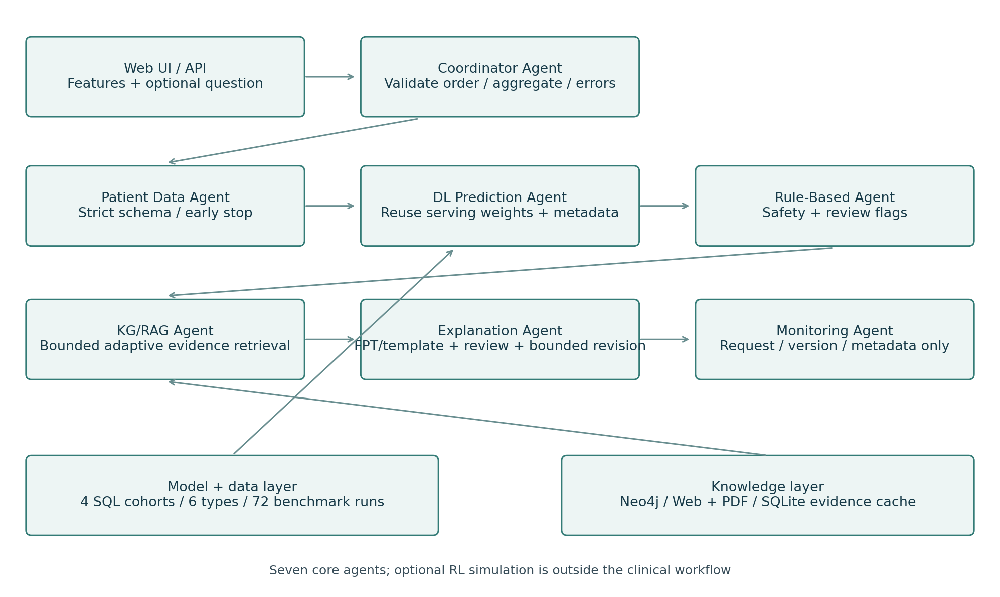

SQLite huấn luyện chứa raw/prepared và split, chỉ dùng cục bộ. SQLite cache tri thức chứa tài liệu/chunk/quan hệ công khai. Neo4j lưu graph; trọng số DL nạp từ artifact. Không huấn luyện lại tại request.

## 2.3. Mô hình trừu tượng và trạng thái hệ thống

Đặc tả kiến trúc, mục 4 ở trang PDF 5-6, biểu diễn hệ đa agent bằng M = (A, S, O, C, F). Các thành phần được ánh xạ vào nguyên mẫu như sau:

| Ký hiệu | Ý nghĩa trong DiaCare | Hiện thực |
|---|---|---|
| A | Tập bảy vai trò cốt lõi | Data, DL, Rule, KG/RAG, Coordinator, Explanation, Monitoring |
| S | Trạng thái của một yêu cầu và kết quả trung gian | Context, prediction, rules, evidence, explanation |
| O | Quan sát cấp cho từng vai trò | Feature/schema, câu hỏi, output model, inventory phụ thuộc |
| C | Cơ chế trao đổi kết quả có cấu trúc | AgentResult, Context.emit, danh sách messages |
| F | Quy tắc điều phối, tổng hợp và kết thúc | ReportWorkflow.run, structured_report, _finish |

S không phải một cơ sở dữ liệu bệnh án dùng chung. Context tạo mới cho từng request, giữ request_id, thời điểm bắt đầu và message; các biến kết quả nằm trong lượt thực thi workflow. Model và corpus có thể được nạp lại để tái sử dụng giữa các request, nhưng hệ thống không học từ feature người dùng gửi lên. Cách tách này giúp phân biệt trạng thái thực thi tạm thời với artifact mô hình và kho tài liệu đã chuẩn bị.

Mỗi agent được mô tả bằng ánh xạ Ai: Xi → Yi. Chẳng hạn, DL ánh xạ feature hợp lệ sang score, nhãn và metadata; KG ánh xạ câu hỏi sang danh sách evidence; Monitoring ánh xạ metadata thực thi sang bản ghi audit. F kết hợp các output nhưng giữ prediction, rule_results và retrieved_evidence ở các trường riêng. Đây là tổng hợp thông tin theo hợp đồng, không cộng score truy xuất với score DL thành một xác suất bệnh mới.

Mô hình trừu tượng giải thích ranh giới thay thế thành phần. Khi đổi thuật toán retrieval, đầu ra evidence vẫn phải giữ ID, văn bản và nguồn; khi đổi dịch vụ LLM, prediction và rule_results vẫn có nghĩa như trước. Khả năng thay thế phụ thuộc việc giữ contract và kiểm thử tương ứng, không chỉ giữ tên class.

## 2.4. Bảy agent và hợp đồng đầu vào, đầu ra

| Agent và mã nguồn | Đầu vào | Đầu ra chính |
|---|---|---|
| Patient Data: PatientDataAgent, roles.py | Dataset, feature, glucose và unit tùy chọn | Xác nhận hợp lệ, số/thứ tự feature; hoặc lỗi schema, kiểu, miền, thiếu giá trị |
| DL Prediction: DLPredictionAgent, predict.py | Dataset và feature đã qua kiểm tra | Score, nhãn, threshold, task, metadata/version; nạp model và scaler tương ứng |
| Rule-Based: RuleBasedAgent, rules.py | Câu hỏi, prediction, glucose/unit | Safety, rule_id, lý do, nguồn và review flags |
| KG/RAG: KnowledgeAgent, adaptive.py | Câu hỏi | Evidence có nguồn, inventory và retrieval gồm attempts, lý do, lượt chọn hoặc từ chối |
| Coordinator: ReportWorkflow, workflow.py | Yêu cầu tổng hợp | Status, report hoặc error, request_id, messages và audit |
| Explanation: ExplanationAgent, reporting.py | Câu hỏi, prediction, rules, evidence | Answer, generation, citations và quality; kiểm duyệt/sửa có giới hạn |
| Monitoring: MonitoringAgent, roles.py | Context và trạng thái workflow | Metadata audit, version, mốc thời gian; write_status khi bật ghi file |

Coordinator không thay thuật toán của agent khác. Prediction suy luận; KG tìm tài liệu; Explanation dùng kết quả đã có. Có thể thay retriever hoặc LLM mà không đổi schema dự đoán. Số lần message không phải số loại agent, vì Coordinator có thể phát nhiều sự kiện trong một request.

Trạng thái của vai trò và trạng thái toàn workflow có ý nghĩa khác nhau. Data phát ok hoặc invalid; DL phát ok hoặc error; Rule phát flagged khi có cờ; KG có thể ok, degraded, error hoặc skipped. Explanation công bố trạng thái sinh thực tế; Monitoring có thể degraded khi ghi audit thất bại. Coordinator dùng started và aggregated để đánh dấu hai mốc điều phối. Workflow trả completed, degraded, validation_error, dependency_error hoặc mức safety tương ứng. Không diễn giải mọi message khác ok là một yêu cầu đã thất bại hoàn toàn.

Đường dẫn trong bảng rút gọn theo thư mục: agent ở app/agents, model ở app/ml, retrieval/generation ở app/knowledge. Contract được kiểm ở tests/test_workflow.py; các tình huống model, audit và dependency lỗi được kiểm ở tests/test_failure_paths.py. Tên lớp triển khai KnowledgeAgent phát tên vai trò KGRAGAgent trong message; đây là cùng một vai trò truy xuất, không phải hai agent khác nhau.

## 2.5. Hợp đồng giao tiếp và cách đọc thời gian

Message có request_id, agent, status, payload, evidence, model_version, elapsed_ms, duration_ms và decision. Phiên bản nhận diện model hoặc agent; request_id liên kết toàn bộ cùng yêu cầu. Payload tùy chức năng; decision ghi hành động và lý do điều phối.

```json
{"request_id":"ma-tu-sinh", "agent":"DLPredictionAgent",
 "status":"ok", "payload":{"dataset":"cdc"},
 "evidence":[], "model_version":"legacy-1.0", "elapsed_ms":12.5,
 "duration_ms":10.2, "decision":{"action":"inference"}}
```

Ví dụ minh họa cấu trúc, không phải đo độ trễ. Monitoring mặc định chỉ ghi metadata, không vector sức khỏe, câu hỏi hoặc khóa API.

Trường elapsed_ms trong Context.emit là thời gian tích lũy từ lúc tạo Context đến lúc phát message. Bản 2.1 bổ sung duration_ms của message, đo bằng perf_counter ngay trước/sau call trong ReportWorkflow. Nó bao gồm công việc nội bộ của call, chẳng hạn các lượt retrieval hoặc review; không phải hiệu hai mốc elapsed_ms. Bước skipped có duration_ms bằng 0. duration_ms ở cấp audit vẫn là tổng thời gian tới lúc tạo audit. Không cộng các mốc tích lũy để tính latency; một lượt minh họa cũng chưa là benchmark tải hoặc SLA.

Luồng thường có tám message: Coordinator bắt đầu, Data, DL, Rule, KG, Coordinator tổng hợp, Explanation và Monitoring. Như vậy có bảy loại agent. Context.emit giới hạn tối đa 12 message để chặn luồng vượt ngân sách; giới hạn max_steps=8 trong Context.send thuộc trace của các API cũ. Hai cơ chế cùng có request context nhưng không nên dùng số bước của luồng chat để suy ra số agent hoặc số message của report.

## 2.6. Luồng chính, nhánh lỗi và dừng sớm

API nhận cohort và feature. Coordinator tạo request_id, gọi Data. Nếu schema/giá trị sai, trả validation_error trước DL, Rule và KG. Nếu hợp lệ: DL suy luận; Rule đánh giá; KG lấy evidence; Coordinator tổng hợp; Explanation tạo báo cáo; Monitoring ghi metadata.

Luồng hữu hạn có trace. Cảnh báo nguy cấp và yêu cầu vượt phạm vi được luật ưu tiên để LLM không trì hoãn hoặc ghi đè thông báo an toàn. Điểm dự đoán nghiên cứu không phủ quyết cảnh báo luật; tài liệu giáo dục không là quan sát của cá nhân.

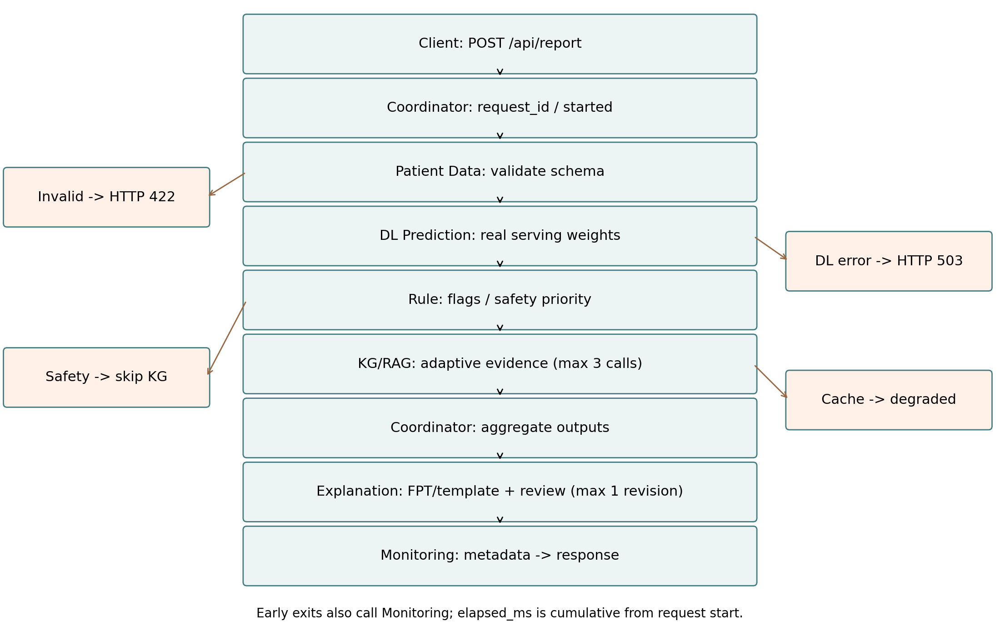

Mã giả dưới đây tóm tắt ReportWorkflow.run và _finish; chi tiết điều kiện hợp lệ nằm trong schema và validator của từng cohort.

```text
Tạo Context; phát Coordinator: started
Kiểm câu hỏi, feature, glucose và unit
Nếu sai: phát Data: invalid; audit; trả validation_error
Phát Data: ok
Chạy DL bằng artifact đã lưu
Nếu lỗi: phát DL: error; audit; trả dependency_error
Phát DL: ok; chạy Rule; phát kết quả và flags
Nếu Rule có safety:
    Evidence rỗng; phát KG: skipped
Ngược lại:
    Truy xuất thích ứng tối đa ba lượt; kiểm provenance
    Thiếu Neo4j: dùng cache, đánh dấu degraded
    Lỗi truy xuất: evidence rỗng, đánh dấu error
Phát Coordinator: aggregated
Explanation nhận prediction, rules và evidence
    Có safety: trả nội dung safety_rule
    Không safety: generator, review, sửa extractive tối đa một lần
Tạo structured_report, uncertainty và conflicts
Chọn trạng thái workflow theo safety và phụ thuộc
Monitoring tạo audit; trả report, messages và status
```

Nhánh safety vẫn chạy sau DL theo thứ tự của đặc tả. Khi đã có safety, KG bị bỏ qua và Explanation trả thông điệp của luật, không gọi LLM. Với đầu vào sai, DL không chạy; với model không nạp được, không sinh score thay thế. Nếu lỗi chỉ ảnh hưởng tri thức hoặc giải thích, các kết quả đã có vẫn được giữ để người đọc xem riêng và nhận biết phần suy giảm.

## 2.7. Lỗi và dự phòng

DL lỗi thì trả dependency_error, không tạo score giả. Thiếu Neo4j/kết nối lỗi thì dùng cache và nêu backend. Thiếu FPT, lỗi API hoặc citation không hợp lệ thì dùng template có nhãn. Không gọi template là output đã sinh bằng LLM.

Fallback giúp demo cục bộ, không là bằng chứng Neo4j production. Health/catalog công bố model, inventory, graph và LLM configuration; bằng chứng gọi API thật được ghi riêng với metadata an toàn.

API ánh xạ validation_error sang HTTP 422 và dependency_error sang HTTP 503. Report hoàn tất hoặc degraded vẫn có thể trả HTTP 200, vì client cần đọc trạng thái nghiệp vụ trong JSON. Do đó, chỉ thấy HTTP 200 chưa đủ kết luận mọi dịch vụ ngoài hoạt động. Nếu AUDIT_LOG_PATH không ghi được, report đã tạo không bị loại; message Monitoring nêu lỗi và workflow completed được chuyển thành degraded.

## 2.8. Phạm vi của các endpoint

Endpoint /api/report là lối vào quy trình bảy agent được mô tả trong chương này. Nó yêu cầu chọn cohort và feature đúng schema, có thể thêm câu hỏi hoặc glucose. Kết quả thể hiện đầy đủ prediction, luật, evidence, explanation và metadata. Đây là endpoint cần dùng để minh họa tích hợp theo tài liệu kiến trúc.

Endpoint /api/chat giữ luồng hỏi đáp tri thức của phiên bản trước. Trace có các vai trò Safety, Retrieval, Policy, Education và Critic; policy mô phỏng chọn cách trình bày. Chat không yêu cầu vector feature và không chạy DL dự đoán trong mỗi câu hỏi. Endpoint /api/predict chỉ phục vụ suy luận model và trace rút gọn; nó không tạo báo cáo KG/RAG tổng hợp. Ba endpoint dùng chung một số tài nguyên nhưng không có cùng hợp đồng đầu ra hoặc cùng số bước. Mã ánh xạ nằm trong app/main.py và app/agents/coordinator.py.

GET /api/capabilities đọc registry tại app/capabilities.py: phương pháp, vai trò, source symbol, endpoint, demo và giới hạn. implemented cho biết có mã; configured cho biết cấu hình phụ thuộc; feature_usage của từng report mới cho biết phần đã thực sự chạy. Vì vậy, registry không biến cấu hình FPT hoặc Neo4j thành bằng chứng gọi thành công.

## 2.9. Ranh giới dữ liệu và bảo mật

API không nhận SQL/Cypher tùy ý. Query graph dùng tham số. Corpus ingest trước, không tải URL tùy ý từ request. Nội dung nguồn là dữ liệu hỗ trợ, không được thực thi như chỉ thị.

FPT key và Neo4j password chỉ ở môi trường/.env bị ignore. Raw/database chứa patient_nbr phục vụ split không vào Git/image/ZIP. Artifact state_dict nạp weights_only=True; không pickle toàn bộ object mô hình. Audit ra file chỉ bật khi cấu hình rõ đường dẫn.

## 2.10. Quyền ghi trạng thái và điều khiển nội bộ bản 2.1

Outer workflow giữ bảy vai trò và tám message thông thường. Hai controller mới nằm trong KG/RAG và Explanation, không làm tăng số agent core. Quyền đọc/ghi dưới đây được công bố trong AGENTS của registry; đây là phân trách nhiệm trong mã, chưa là cơ chế phân quyền hệ điều hành.

| Vai trò | Đọc | Ghi / quyết định | Công cụ chính |
|---|---|---|---|
| Data | Dataset, feature, glucose/unit | Validated, thứ tự feature; cho phép hoặc dừng | validate_features |
| DL | Feature hợp lệ, serving artifact | Prediction hoặc dependency_error | Predictor.predict |
| Rule | Câu hỏi, prediction, glucose/unit | Rules; cho truy xuất hoặc safety_override | check |
| KG/RAG | Câu hỏi, corpus, ontology | Evidence/retrieval; nhận, thử tiếp hoặc từ chối | AdaptiveRetrieval.run |
| Coordinator | Request và output trung gian | Request_id, status, messages, report | ReportWorkflow.run |
| Explanation | Question, prediction, rules, evidence | Explanation/quality; đạt, sửa hoặc từ chối | generate, review_and_revise |
| Monitoring | Metadata thực thi | Audit; không ghi feature/câu hỏi/key | MonitoringAgent.run |

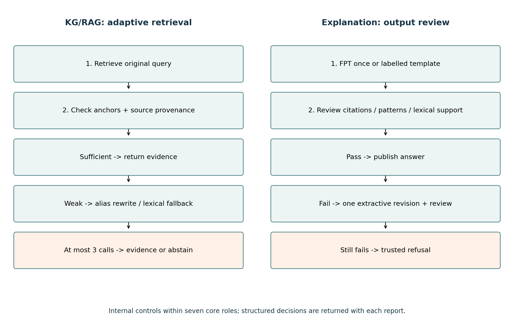

Ngân sách là tối đa ba lần gọi retrieve và tối đa một lần sửa extractive, không phải số lượt bắt buộc. Nếu lượt đầu đủ điều kiện thì dừng. Review không gọi LLM lần hai. decision_trace giữ hành động/lý do của các vai trò; retrieval.attempts và quality.attempts giải thích các quyết định bên trong. Quyết định nội bộ được tự động hóa trong phạm vi rõ, chưa là lập kế hoạch mở hoặc tác tử phân tán tự chủ.


# CHƯƠNG 3. BỐN COHORT VÀ CƠ SỞ DỮ LIỆU HUẤN LUYỆN

## 3.1. Nguồn và nhiệm vụ

| Cohort | Dòng nguồn / sạch | Feature | Nhãn |
|---|---:|---:|---|
| CDC BRFSS 2015 | 253.680 / 226.342 | 21 | Binary gộp tiền đái tháo đường/đái tháo đường |
| Hospital 130-US | 101.766 / 101.763 | 10 | Tái nhập viện dưới 30 ngày |
| Pima | 768 / 768 | 8 | Tested positive/negative, phụ nữ Pima từ 21 tuổi |
| Early Stage | 520 / 251 | 16 | Positive/Negative, Sylhet Hospital Bangladesh |

CDC lấy từ UCI891, bản binary của Alex Teboul khai báo CC0. Hospital UCI296 và Early Stage UCI529 có CC BY 4.0. Pima lấy từ ARFF OpenML37, metadata ghi licence Public, original owner NIDDK. Không tự đổi giấy phép Pima thành CC0.

Endpoint Pima UCI cũ không tải được. UCI34 là AIM94 time-series khác, không dùng thay thế. ARFF OpenML được đối chiếu toàn bộ 768 hàng, tám feature, nhãn và thứ tự với CSV đã có; MD5 khớp metadata. URL/hash ở data/README.md và manifest.

## 3.2. CDC và Hospital

CDC loại nhóm vector có nhãn mâu thuẫn rồi giữ một bản/vector còn lại. Làm sạch trước split ngăn cùng vector qua train và test. Nhóm mâu thuẫn có thể chứa bản sao nên không cộng số duplicate và số mâu thuẫn để suy ra kích thước sạch.

Hospital loại ba dòng gender Unknown/Invalid. Split theo patient_nbr ngăn các lượt của cùng người giao train/validation/test. ID chỉ tạo nhóm, không trong X, trọng số hoặc API. Mười feature được chọn mang thông tin khi ra viện; không diễn giải là dự báo ngay lúc nhập viện. Chia nhóm chưa kiểm chứng bệnh viện mới hoặc dữ liệu tương lai.

## 3.3. Pima: zero-coded missing

Glucose, BloodPressure, SkinThickness, Insulin, BMI bằng 0 được coi là missing theo giao thức bài. Median tính chỉ trên train rồi dùng nguyên vẹn cho validation/test/inference. Pregnancies bằng 0 vẫn hợp lệ. Không xóa mọi hàng có số 0 và không lấy median toàn tập vì sẽ thay quần thể hoặc rò rỉ test.

Pima có 768 dòng, không phát hiện duplicate/conflict trong kiểm kê. Cohort chỉ gồm một nhóm phụ nữ lịch sử nên không suy rộng mặc nhiên cho nam giới, người trẻ hoặc dân số Việt.

## 3.4. Early Stage: vì sao 520 còn 251?

Nguồn 520 dòng có 269 dòng trùng hoàn toàn; sau dedup còn 251 vector, gồm 173 dương và 78 âm. Không có feature-group mâu thuẫn nhãn. Giữ 520 rồi split ngẫu nhiên dễ làm cùng vector lọt test và tăng điểm thiếu tin cậy.

Tuổi thật trong CSV 16-90, khác mô tả ngắn 20-65 trên trang nguồn. Schema dựa kiểm kê thật và ghi khác biệt. Test chỉ 38 dòng; một vài dự đoán đổi làm metric thay đáng kể, không xem AUC cao là bằng chứng mạnh về tổng quát hóa.

## 3.5. SQLite dùng thật trong huấn luyện

database.py đọc/tải CSV và lưu raw_cdc, raw_hospital, raw_pima, raw_early cùng provenance. datasets.py SELECT bảng raw để làm sạch/chia, fit median/mean/std train, rồi ghi prepared_<dataset> với split_order. load_prepared() SELECT từng split; mảng nhận từ query trực tiếp cấp mọi vòng fit.

```sql
SELECT split, COUNT(*) AS rows, SUM(target) AS positives
FROM prepared_early GROUP BY split;
SELECT Glucose, BMI, Age, target FROM prepared_pima
WHERE split='train' ORDER BY split_order LIMIT 5;
```

Benchmark không đọc NPZ cũ để giả lập database. NPZ đầu ra giữ nhãn/score hoặc hệ số nhỏ để kiểm metric. CSV dễ mở Excel; NPZ giữ nhiều mảng đúng dtype và nén. Định dạng không quyết định thuật toán.

## 3.6. Chia tập và tiền xử lý

| Cohort | Train | Validation | Test | Giao thức |
|---|---:|---:|---:|---|
| CDC | 158.439 | 33.951 | 33.952 | Vector sạch, split cố định |
| Hospital | 71.583 | 15.055 | 15.125 | Không giao nhóm bệnh nhân |
| Pima | 537 | 115 | 116 | Stratified, median train |
| Early Stage | 175 | 38 | 38 | Dedup trước stratified split |

Split seed 42; model seed 42/43/44. Đổi model seed không tạo ba test mới. Mean/std fit train và áp cùng thứ tự feature. Checkpoint chọn validation ROC-AUC; ngưỡng chọn validation F1; đóng băng trước đo test. Không lựa mô hình phục vụ bằng test.

## 3.7. Provenance và giới hạn

Manifest lưu URL, hash, số dòng, SQL, split và thống kê. Raw/database chỉ ở máy cục bộ, bị loại khỏi phát hành. Bốn cohort khác nguồn/nhãn/quần thể, không gộp thành một nhiệm vụ và không là bốn tập external validation của một model.

Bài viết Vinmec và PDF Việt giúp truy xuất tài liệu Việt, không thay tập bệnh nhân Việt có nhãn. Trước dùng thực cần quyền dữ liệu, kiểm định ngoài miền, hiệu chuẩn, đánh giá theo nhóm và chuyên gia y tế.

## 3.8. Tên và thứ tự feature khi suy luận

Đặc tả yêu cầu ghi rõ feature/order, không chỉ số lượng cột. Bốn danh sách dưới theo đúng metadata serving và app/ml/schema.py. API nhận object theo tên; validate_features tạo vector theo SCHEMAS và Predictor kiểm thứ tự đó khớp metadata trước khi tạo tensor. Không dựa vào thứ tự khóa JSON người dùng gửi.

```text
CDC (21):
HighBP, HighChol, CholCheck, BMI, Smoker, Stroke,
HeartDiseaseorAttack, PhysActivity, Fruits, Veggies,
HvyAlcoholConsump, AnyHealthcare, NoDocbcCost, GenHlth,
MentHlth, PhysHlth, DiffWalk, Sex, Age, Education, Income

Hospital (10):
time_in_hospital, num_lab_procedures, num_procedures,
num_medications, number_outpatient, number_emergency,
number_inpatient, number_diagnoses, AgeGroup, Gender

Pima (8):
Pregnancies, Glucose, BloodPressure, SkinThickness,
Insulin, BMI, DiabetesPedigreeFunction, Age

Early Stage (16):
Age, Gender, Polyuria, Polydipsia, sudden weight loss,
weakness, Polyphagia, Genital thrush, visual blurring,
Itching, Irritability, delayed healing, partial paresis,
muscle stiffness, Alopecia, Obesity
```

CDC Age là mã nhóm 1-13, không phải tuổi tính theo năm; Sex dùng 0=Nữ, 1=Nam; GenHlth là mã 1-5. Hospital AgeGroup dùng nhóm 1-10; các biến đếm phản ánh một đợt nằm viện hoặc lịch sử năm trước. Pima Age là tuổi thật; Glucose là feature của cohort, không tự đồng nhất với trường glucose tùy chọn phục vụ luật của API. Early có Age thật, Gender 0/1 và 14 biến triệu chứng Có/Không mã 1/0; tên trường có dấu cách phải giữ nguyên trong JSON.

Miền nhập, kiểu integer/float, nhãn và coding đầy đủ nằm trong feature_specs của models/<cohort>/metadata.json, đồng thời được công bố qua GET /api/catalog. Bản mô hình kèm preprocessing chứa mean/std và median khi áp dụng. Sai tên, thiếu/thừa cột hoặc giá trị không nguyên cho trường nguyên sẽ bị từ chối; giá trị 1.0 vẫn có thể hợp lệ vì bằng một số nguyên. API không tự lấp feature thiếu. Riêng zero-coded missing của Pima là quy ước tiền xử lý đã được định nghĩa, khác với thiếu khóa JSON.


# CHƯƠNG 4. DEEP LEARNING VÀ BENCHMARK SO SÁNH

## 4.1. Sáu cấu hình chốt trước

Ba mô hình cổ điển cung cấp baseline tuyến tính và phi tuyến. Ba mạng neural khảo sát độ sâu và kết nối residual trên cùng feature/split. Không thay hyperparameter theo điểm test. Seed mô hình 42,43,44 được áp cho mọi loại; bộ chia dữ liệu giữ cố định seed 42.

| ID | Kiến trúc / cấu hình full |
|---|---|
| logistic | Logistic Regression, C=1, max_iter=1000 |
| random_forest | 100 cây, max_depth=12, min_samples_leaf=5, n_jobs=2 |
| hist_gradient_boosting | 100 iteration, max_depth=6, early_stopping=False |
| mlp2 | Input → 64 ReLU Dropout 0.15 → 32 ReLU Dropout 0.10 → 1 logit |
| mlp3 | Input → 64 ReLU Dropout 0.15 → 32 ReLU Dropout 0.10 → 16 ReLU → 1 logit |
| resmlp | Input projection 32, hai residual block gồm hai linear 32 mỗi block, output 1 |

Mạng trả logit khi học, dùng BCEWithLogitsLoss; suy luận áp sigmoid. Residual block có shortcut cộng đầu vào với phép biến đổi rồi ReLU. Cả ba là mạng nhiều tầng ẩn; không dùng ba seed để tuyên bố có chín kiến trúc DL.

## 4.2. Ngân sách huấn luyện và lựa chọn

Adam learning_rate 0.001, weight_decay1e-5. CDC/Hospital tối đa 25 epoch, batch 2048; Pima/Early tối đa 100 epoch, batch 32. Patience 10 theo validation ROC-AUC, chỉ cập nhật checkpoint khi AUC tăng hơn1e-5. Sau nạp checkpoint tốt nhất, chọn threshold đạt F1 cao nhất trên validation rồi mới tính score/test metric.

Ba mạng được học từ đầu trong benchmark riêng. Hai model phục vụ CDC/Hospital đã có từ phiên bản trước vẫn được tái sử dụng, không bị thay bằng model mới có test đẹp hơn. Pima/Early là cohort mới nên chọn DL phục vụ theo validation AUC trong chín run neural/cohort; không dùng test chọn.

## 4.3. Chỉ số và cách diễn giải

ROC-AUC đo thứ hạng score. AP là Average Precision theo scikit-learn, không phải diện tích hình thang PR-AUC. F1, sensitivity, specificity và accuracy được tính tại ngưỡng validation; confusion matrix theo nhãn[0,1]. Luôn đọc prevalence và always-negative baseline khi lệch lớp.

Brier là trung bình squared error score-label, chưa chứng minh hiệu chuẩn lâm sàng Việt. Mean ± SD dùng sample SD ba seed trên một split, không là khoảng tin cậy quần thể. SD0 có thể do thuật toán xác định, không chứng minh hết bất định.

<!-- BENCHMARK_START -->

<!-- pagebreak -->

## 4.4. Kết quả CDC BRFSS

Các giá trị là test mean ± SD ba seed; ngưỡng từng run chọn trên validation.

| Model | ROC-AUC | AP | F1 | Brier |
|---|---:|---:|---:|---:|
| HGB | 0,8270 ± 0,0000 | 0,4386 ± 0,0000 | 0,4767 ± 0,0000 | 0,1018 ± 0,0000 |
| Logistic | 0,8206 ± 0,0000 | 0,4156 ± 0,0000 | 0,4685 ± 0,0000 | 0,1038 ± 0,0000 |
| MLP2 | 0,8277 ± 0,0003 | 0,4382 ± 0,0011 | 0,4778 ± 0,0011 | 0,1016 ± 0,0001 |
| MLP3 | 0,8277 ± 0,0004 | 0,4385 ± 0,0006 | 0,4783 ± 0,0001 | 0,1016 ± 0,0000 |
| Random Forest | 0,8247 ± 0,0001 | 0,4352 ± 0,0004 | 0,4771 ± 0,0023 | 0,1022 ± 0,0000 |
| ResMLP | 0,8271 ± 0,0001 | 0,4358 ± 0,0013 | 0,4783 ± 0,0002 | 0,1018 ± 0,0000 |

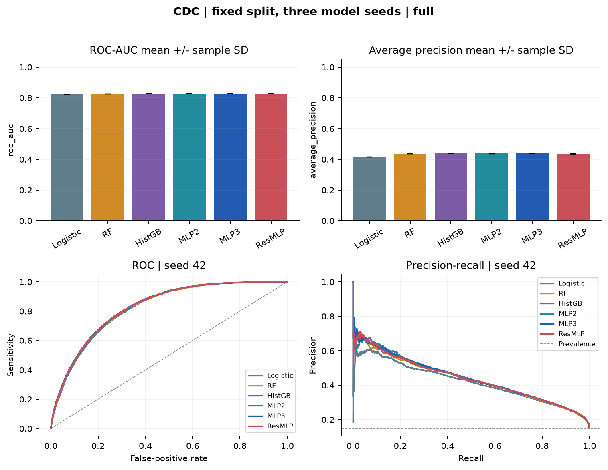

<!-- pagebreak -->

## 4.5. Kết quả Hospital

Các giá trị là test mean ± SD ba seed; ngưỡng từng run chọn trên validation.

| Model | ROC-AUC | AP | F1 | Brier |
|---|---:|---:|---:|---:|
| HGB | 0,6296 ± 0,0000 | 0,1820 ± 0,0000 | 0,2441 ± 0,0000 | 0,0961 ± 0,0000 |
| Logistic | 0,6285 ± 0,0000 | 0,1849 ± 0,0000 | 0,2396 ± 0,0000 | 0,0961 ± 0,0000 |
| MLP2 | 0,6341 ± 0,0007 | 0,1858 ± 0,0009 | 0,2470 ± 0,0015 | 0,0959 ± 0,0000 |
| MLP3 | 0,6348 ± 0,0012 | 0,1866 ± 0,0004 | 0,2498 ± 0,0020 | 0,0958 ± 0,0000 |
| Random Forest | 0,6249 ± 0,0011 | 0,1781 ± 0,0017 | 0,2446 ± 0,0028 | 0,0963 ± 0,0001 |
| ResMLP | 0,6330 ± 0,0024 | 0,1856 ± 0,0005 | 0,2466 ± 0,0021 | 0,0959 ± 0,0000 |

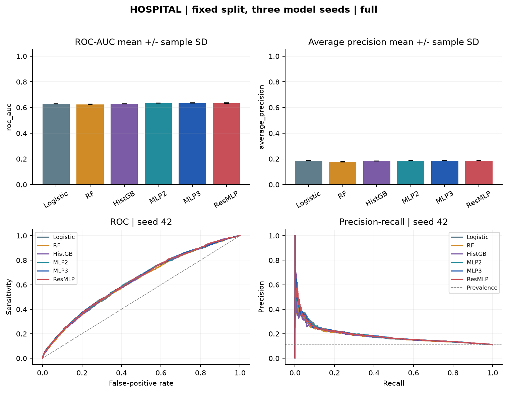

<!-- pagebreak -->

## 4.6. Kết quả Pima

Các giá trị là test mean ± SD ba seed; ngưỡng từng run chọn trên validation.

| Model | ROC-AUC | AP | F1 | Brier |
|---|---:|---:|---:|---:|
| HGB | 0,8104 ± 0,0000 | 0,7280 ± 0,0000 | 0,6458 ± 0,0000 | 0,1921 ± 0,0000 |
| Logistic | 0,8624 ± 0,0000 | 0,7832 ± 0,0000 | 0,7292 ± 0,0000 | 0,1493 ± 0,0000 |
| MLP2 | 0,8550 ± 0,0229 | 0,7675 ± 0,0357 | 0,6934 ± 0,0114 | 0,1629 ± 0,0231 |
| MLP3 | 0,8653 ± 0,0049 | 0,7866 ± 0,0048 | 0,7189 ± 0,0213 | 0,1521 ± 0,0022 |
| Random Forest | 0,8357 ± 0,0026 | 0,7660 ± 0,0043 | 0,6826 ± 0,0196 | 0,1585 ± 0,0018 |
| ResMLP | 0,8608 ± 0,0117 | 0,7848 ± 0,0148 | 0,7145 ± 0,0116 | 0,1524 ± 0,0060 |

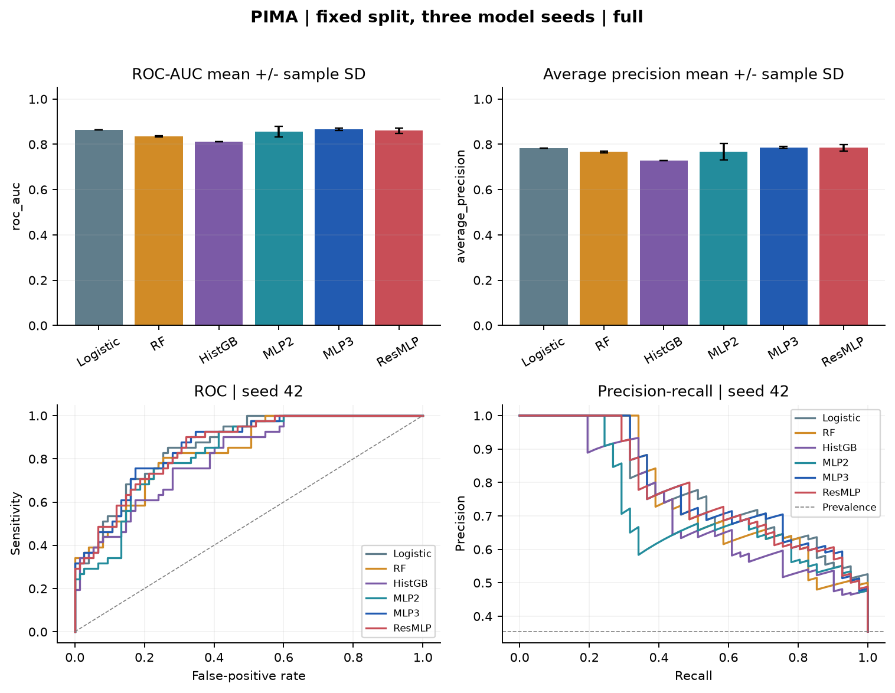

<!-- pagebreak -->

## 4.7. Kết quả Early Stage

Các giá trị là test mean ± SD ba seed; ngưỡng từng run chọn trên validation.

| Model | ROC-AUC | AP | F1 | Brier |
|---|---:|---:|---:|---:|
| HGB | 0,9519 ± 0,0000 | 0,9801 ± 0,0000 | 0,9091 ± 0,0000 | 0,0908 ± 0,0000 |
| Logistic | 0,9487 ± 0,0000 | 0,9781 ± 0,0000 | 0,9020 ± 0,0000 | 0,1036 ± 0,0000 |
| MLP2 | 0,9241 ± 0,0385 | 0,9660 ± 0,0224 | 0,8770 ± 0,0526 | 0,1679 ± 0,0682 |
| MLP3 | 0,9081 ± 0,0837 | 0,9589 ± 0,0397 | 0,8782 ± 0,0750 | 0,1632 ± 0,0683 |
| Random Forest | 0,9615 ± 0,0000 | 0,9841 ± 0,0003 | 0,9140 ± 0,0104 | 0,0921 ± 0,0011 |
| ResMLP | 0,9391 ± 0,0400 | 0,9733 ± 0,0212 | 0,9020 ± 0,0151 | 0,0855 ± 0,0307 |

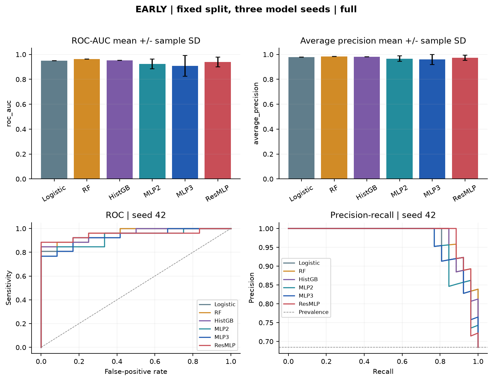

<!-- BENCHMARK_END -->

## 4.8. Tổng hợp quan sát

CDC: ba mạng và HGB cho ROC-AUC gần nhau quanh 0,827; chênh lệch giữa MLP2/MLP3 rất nhỏ. Không có cơ sở kết luận độ sâu hơn luôn tốt hơn từ ba seed một split. AP quanh 0,44 cho thấy bài toán khó hơn con số accuracy riêng lẻ có thể gợi ý.

Hospital: ROC-AUC mọi mô hình chỉ quanh 0,625-0,635 và AP quanh 0,178-0,187. Mạng không giải quyết hoàn toàn bài toán tái nhập viện với mười feature hiện tại. Cần bổ sung thông tin, thiết kế thời điểm dự báo rõ và kiểm định theo thời gian/bệnh viện; không giấu kết quả thấp.

Pima: logistic có ROC-AUC 0,8624; MLP3 trung bình 0,8653±0,0049, MLP2 dao động lớn hơn. Đây là ví dụ baseline đơn giản vẫn cạnh tranh trên dữ liệu bảng nhỏ. Không chọn architecture vì test cao nhất rồi trình bày như lựa chọn có trước.

Early: Random Forest có ROC-AUC trung bình 0,9615, nhưng test chỉ 38 dòng. Các mạng dao động đáng kể giữa seed, MLP3 SD khoảng 0,0837. AUC cao ở một cohort nhỏ không chứng minh tốt hơn CDC/Hospital, vì nhãn/quần thể/test khác nhau.

## 4.9. Tái sử dụng artifact và chi phí

11 artifact mô hình/kết quả cũ của CDC/Hospital được đối chiếu SHA256 và giữ nguyên. serving CDC/Hospital dùng model_version legacy-1.0; Pima/Early dùng 2.0-db-benchmark. Pima chọn MLP2 seed 42 theo validation AUC 0,8387; Early chọn ResMLP seed 42 theo validation AUC 0,9744. Đây là lựa chọn validation, khác bảng test mean/SD.

72 run được thực thi thật trên CPU Linux với Python 3.12.16, torch 2.15.0+cpu, NumPy 2.5.4, pandas 3.1.1, scikit-learn 1.9.1. Tổng các thời gian fit+evaluate ghi theo run là 145,588 giây. Đây không gồm mọi thời gian tải nguồn, build container và kiểm thử.

Lượt đầu đã hoàn thành 54 run nhưng bước copy artifact Pima gặp lỗi cập nhật timestamp trên Windows bind-mount. Sửa copy2 thành copyfile chỉ sao nội dung, xác minh hash/nhãn 54 run, rồi chạy tiếp 18 run Early. Giá trị 23,449 giây của invocation resume không phải thời gian train 72 run. execution-history.json lưu rõ hai pha.

## 4.10. Artifact và khả năng tái lập

Mỗi run giữ config, seed, checkpoint/history khi phù hợp, SQL source/hash, threshold, metric và score validation/test. Neural weights lưu state_dict; logistic giữ coefficient/intercept trong NPZ. Cây RF/HGB không đóng gói để tránh artifact lớn; cần refit bằng cùng config/seed/data để tái tạo model, còn score test đã lưu để tính lại metric.

Các hình so sánh biểu diễn metric theo cohort. Báo cáo không tạo leaderboard gộp AUC của bốn nhiệm vụ. Đánh giá thêm bootstrap, calibration, temporal/external validation và kiểm định khác biệt là hướng phát triển, chưa được tuyên bố đã làm.

## 4.11. Từ vector đầu vào đến nhãn nghiên cứu

Với mỗi feature, giá trị thiếu được xử lý theo giao thức của cohort, sau đó chuẩn hóa bằng trung bình và độ lệch chuẩn train. Một lớp ẩn thực hiện biến đổi affine rồi phi tuyến; dropout chỉ hoạt động khi train. Gọi z là logit đầu ra, score s là sigmoid và t là ngưỡng đã chọn trên validation:

$$h^{(l)}=\mathrm{ReLU}(W^{(l)}h^{(l-1)}+b^{(l)})$$

$$s=\sigma(z)=\frac{1}{1+e^{-z}},\qquad \hat y=\mathbf{1}[s\geq t]$$

Khi train, BCEWithLogitsLoss nhận trực tiếp logit để tính binary cross-entropy ổn định số học. Công thức dưới là dạng tương đương theo score, không phải một phép sigmoid bổ sung trước hàm loss trong mã:

$$L=-\frac{1}{n}\sum_{i=1}^{n}\left[y_i\log s_i+(1-y_i)\log(1-s_i)\right]$$

Trong app/ml/network.py, MLP2 và MLP3 khác nhau ở một tầng 16 chiều; ResMLP cộng shortcut tại các block 32 chiều. app/ml/training.py thực hiện lựa checkpoint theo validation ROC-AUC; app/ml/benchmark.py điều phối ma trận và lưu artifact. Ngưỡng phân lớp được chọn sau bước đó bằng validation F1. Hai phép chọn có mục đích khác nhau: AUC đánh giá thứ hạng, còn F1 phụ thuộc một ngưỡng. Test chỉ được dùng ở bước đánh giá cuối.

## 4.12. Đọc confusion matrix và sai số

Quy ước hàng là nhãn thật 0/1, cột là nhãn dự đoán 0/1: TN và FP ở hàng đầu, FN và TP ở hàng sau. Precision trả lời có bao nhiêu nhãn dự đoán dương là đúng; sensitivity đo tỷ lệ nhãn thật dương được phát hiện; specificity đo tỷ lệ nhãn thật âm được giữ đúng. Công thức và định nghĩa chỉ số đối chiếu tài liệu scikit-learn trong danh mục tham khảo.

$$\mathrm{Precision}=\frac{TP}{TP+FP},\qquad \mathrm{Sensitivity}=\frac{TP}{TP+FN}$$

$$\mathrm{Specificity}=\frac{TN}{TN+FP},\qquad F_1=\frac{2TP}{2TP+FP+FN}$$

<!-- SERVING_ANALYSIS_START -->

Bảng dưới lấy đúng bốn artifact phục vụ; mỗi hàng là một run, không là mean ba seed.

| Cohort / model | TN / FP / FN / TP | Sensitivity | Specificity | F1 |
|---|---|---:|---:|---:|
| cdc / MLP3 legacy | 23758 / 5164 / 1827 / 3203 | 0,6368 | 0,8215 | 0,4782 |
| hospital / MLP3 legacy | 10340 / 3110 / 990 / 685 | 0,4090 | 0,7688 | 0,2505 |
| pima / mlp2 seed 42 | 58 / 17 / 11 / 30 | 0,7317 | 0,7733 | 0,6818 |
| early / resmlp seed 42 | 8 / 4 / 1 / 25 | 0,9615 | 0,6667 | 0,9091 |

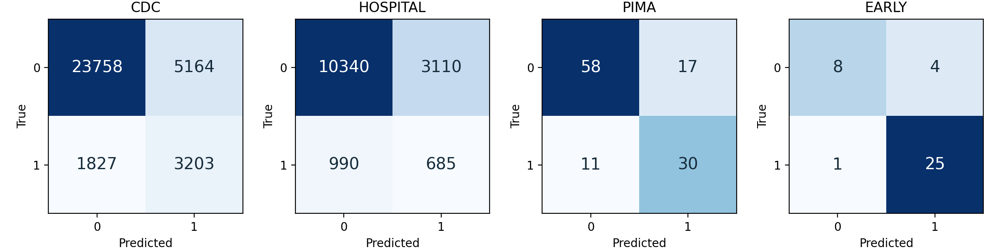

Nguồn: results/cdc-training.json, hospital-training.json và hai record benchmark pima/mlp2-seed42.json, early/resmlp-seed42.json. CDC/Hospital là kết quả legacy; không thay bằng run benchmark khác.

<!-- SERVING_ANALYSIS_END -->

Ví dụ Pima MLP2 seed 42 là artifact được chọn để phục vụ bằng validation, không phải run có test cao nhất. Test gồm 75 nhãn âm và 41 nhãn dương: TN=58, FP=17, FN=11, TP=30. Vì vậy precision=30/47=0,6383, sensitivity=30/41=0,7317, specificity=58/75=0,7733 và F1=60/88=0,6818. Mười một nhãn dương bị bỏ sót cho thấy vì sao không thể dùng output như một phép sàng lọc đã được thẩm định.

Accuracy của run này là 88/116=0,7586; baseline luôn dự đoán âm có accuracy 75/116=0,6466 nhưng sensitivity bằng 0. So sánh này giúp diễn giải mất cân bằng lớp, không chứng minh tính hữu ích lâm sàng. Dịch ngưỡng sẽ thay FP/FN; lựa ngưỡng bằng dữ liệu test sau khi xem ma trận sẽ làm mất tính độc lập của đánh giá.

## 4.13. Kết luận thực nghiệm có điều kiện

Trên CDC/Hospital, thay đổi độ sâu chỉ tạo chênh lệch AUC nhỏ trong giao thức hiện tại. Trên Pima, logistic đơn giản có kết quả cạnh tranh với DL. Trên Early, mạng neural biến thiên rõ giữa seed trong khi tập test rất nhỏ. Vì thế giả thuyết “DL luôn tốt hơn” không được thực nghiệm này xác nhận.

Ba seed cùng split chủ yếu kiểm tra độ nhạy khởi tạo hoặc ngẫu nhiên thuật toán. Chúng không đo được mức thay đổi khi lấy một mẫu bệnh nhân khác, đổi bệnh viện hoặc đổi thời điểm. Bảng test mean/SD dùng so sánh kiến trúc; bảng serving dùng diễn giải đúng model API thực sự nạp. Hai bảng có mục đích khác nhau và không được tráo số liệu cho nhau.


# CHƯƠNG 5. KNOWLEDGE GRAPH, WEB/PDF VÀ RAG

## 5.1. Corpus thực và nguồn Việt Nam

Corpus hiện có 12 tài liệu tải thật:11 Web gồm 7 WHO/NIDDK và 4 Vinmec, cùng 1 PDF tiếng Việt 77 trang do Sở Y tế Đồng Nai đăng tải. Ngoài ra có 14 record chỉ tham chiếu URL và 24 thẻ biên soạn có nguồn. Tổng 340 chunk đã bao gồm các thẻ; không cộng 24 lần nữa và không gọi 26 record là 26 tài liệu tải thành công.

Vinmec bổ sung nội dung tiếng Việt về chế độ ăn, xét nghiệm chẩn đoán type 2, tổng quan type 2 và thai kỳ. Bốn trang được tải HTTP 200, lưu hash, URL cuối, ngày tải và nhãn cập nhật hiển thị. Bài viết là evidence giáo dục, không là dữ liệu bệnh nhân gán nhãn hoặc dataset có giấy phép mở đã xác minh.

PDF là tài liệu hướng dẫn type 2 lịch sử năm 2020, bản tải từ website Sở Y tế Đồng Nai. File có 77 trang, SHA256 `305fc9c51d54418f5798e7691d59f94d24545e0dd728945e2225794730694486`. Không tuyên bố đây là hướng dẫn mới nhất. Số trang, văn bản trích và metadata giúp xác định nguồn khi trả kết quả.

## 5.2. Ingestion và provenance

Luồng ingestion tải nguồn → xác định HTML/PDF → bỏ phần giao diện khi trích HTML hoặc đọc text từng trang PDF → chia chunk có ngữ cảnh → gắn nguồn/hash/page → nhận diện concept → lưu corpus → tạo graph và Cypher. Corpus được chuẩn bị trước, app không cần tải lại tài liệu lúc startup.

Raw cache không phát hành; JSON corpus giữ phần văn bản dùng trong thực nghiệm và metadata. Cần tôn trọng quyền nội dung của nhà xuất bản, trích dẫn nguồn và không xem nguồn công khai đồng nghĩa dữ liệu mở để tái phân phối không giới hạn.

Nguồn CDC về ketoacidosis có lần tải HTTPError được ghi failures; không tính là tải thành công. Một số URL PDF cũ chuyển hướng lỗi nên không dùng làm bằng chứng đã ingest. Với cache cũ không có HTTP metadata, retrieved_at được ghi theo timestamp cache, không bịa thời gian HTTP ban đầu.

## 5.3. Schema graph

Graph có 34 Concept,26 Document và 340 Chunk, tổng 400 node. Document gồm 12 downloaded và 14 reference-only. HAS_CHUNK nối tài liệu và đoạn; MENTIONS nối chunk với concept. Có 2160 MENTIONS tự nhận diện từ alias, khác với 19 quan hệ chuyên môn có rule và đoạn nguồn.

19 quan hệ chuyên môn gồm 3 IS_A,1 REQUIRES,3 RISK_ASSOCIATION,5 MAY_HAVE_SYMPTOM,4 MAY_HAVE_COMPLICATION và 3 DIAGNOSED_USING. Mỗi relation có evidence_chunk_id, document_id, URL, page và phương pháp kiểm mẫu trong văn bản. Đây là đồ thị kiến thức giáo dục, không là đồ thị chẩn đoán cá nhân hay causal discovery.

DB_diabet.cypher đặt unique constraint cho Concept/Document/Chunk, dùng MERGE để import lặp không nhân node/edge. Tham chiếu source từ relation giúp truy ngược đến đoạn thực thay vì triple không có dẫn chứng. File seed không chứa mật khẩu hoặc khóa.

## 5.4. Neo4j thật và cache offline

Neo4j Community 5.26 được chạy cục bộ bằng Docker riêng. Seed đã import; kiểm node/edge, idempotence và đối chiếu cache thực. Kết quả có 400 node và 2545 edge ở corpus này. Tập quan hệ gồm HAS_CHUNK, MENTIONS, MEDICAL_RELATION và SUPPORTS nên tổng edge không chỉ là 19.

Knowledge Agent query graph bằng tham số và lấy chunk liên quan; không cho người dùng chạy Cypher tùy ý. Khi thiếu Neo4j, cache SQLite trả bằng chứng công khai và trạng thái sqlite_cache/degraded. Neo4j local đã kiểm không đồng nghĩa Render có kết nối graph production; cần URI/user/password của instance truy cập được từ Render nếu muốn chế độ đó.

## 5.5. Ba phương pháp retrieval

Lexical dùng word TF-IDF unigram/bigram. Semantic dùng Latent Semantic Analysis với TruncatedSVD 32 trên TF-IDF; đây không phải neural embedding hoặc mô hình ngôn ngữ đã huấn luyện thêm. Hybrid_graph kết hợp word 0,50, character TF-IDF 0,25, LSA 0,25 và boost nhỏ cho chunk/concept graph liên quan. Alias Việt/Anh giúp nối truy vấn với ontology.

Mọi variant đều có prior cố định +0,045 cho curated card khi word score>0,03; lexical và semantic trong bảng cũng bao gồm prior này. Các kết quả có id, title, text, URL, document_id, page, retrieval_method, graph_backend, matched_entities và graph_paths. Score là điểm xếp hạng trong retriever, không là xác suất độ đúng. Threshold hạn chế kết quả không liên quan nhưng không bảo đảm luôn từ chối đúng.

## 5.6. Đánh giá retrieval và lỗi

Bộ 30 câu phát triển cũ gồm 22 câu có thẻ gold và 8 câu ngoài phạm vi. Để so sánh, dùng cùng 22 gold thẻ; cách chấm nghiêm này có thể bỏ qua chunk mới tương đương nội dung. Không xem đây là holdout y khoa độc lập vì thẻ và câu hỏi đã được dùng trong phát triển.

| Phương pháp | Recall@1 | Recall@3 | MRR@3 |
|---|---:|---:|---:|
| Lexical | 0,9545 | 1,0000 | 0,9773 |
| LSA semantic | 0,5909 | 0,8636 | 0,7121 |
| Hybrid graph | 0,9091 | 1,0000 | 0,9470 |

Hybrid graph không thắng lexical ở Recall@1 trong bộ này. Giá trị của graph là cấu trúc thực thể, đường quan hệ và provenance; cải thiện chất lượng retrieval cần đánh giá thêm. Không che kết quả semantic yếu hoặc dùng câu hỏi mới để chỉnh ranking rồi gọi holdout.

Ca Q22 trong phiên bản cũ đã có thẻ phù hợp ở hạng 2, nhưng giải thích ngắn lấy nguồn tổng quát hạng 1. Lỗi này cho thấy Recall@3 cao không đủ chứng minh câu trả lời cuối đúng trọng tâm. knowledge-verification.json giữ từng kết quả; các câu mới kiểm nguồn bổ sung có ghi phạm vi riêng.

Tám truy vấn mới chưa tune kiểm đúng tên tài liệu Vinmec có lexical Recall@1=0,0000, Recall@3=0,8750, MRR@3=0,4167; semantic=0,2500/0,5000/0,3750; hybrid=0,2500/0,5000/0,3542. Gold hẹp này có thể không chấp nhận thẻ hoặc bài khác vẫn liên quan. Không xem đây là clinical benchmark; các lỗi được giữ để thấy hạn chế retrieval.

## 5.7. FPT Cloud và grounded generation

Explanation Agent dùng HTTPS Chat Completions với Bearer key và model người dùng cấu hình. Gateway AI Marketplace đã xác minh là https://mkp-api.fptcloud.com, full endpoint /chat/completions. Không tự thêm /v 1 vì gateway này có route theo tài liệu nhà cung cấp; base và full URL là hai cách cấu hình thay thế.

Prompt chỉ gửi câu hỏi, evidence giới hạn, kết quả mô hình đã chọn trường và rule. Không gửi toàn bộ raw feature/patient ID. LLM được yêu cầu trả JSON chứa answer và citation_ids, mỗi đoạn gắn [ID], không thêm URL hoặc chẩn đoán/kê liều. Request có timeout, giới hạn token, không theo redirect để tránh gửi Bearer key sang đích khác.

Validator kiểm cấu trúc, ID thuộc evidence, citation inline khớp danh sách và không có URL mới. Validator không kiểm chứng ngữ nghĩa từng claim và không thay chuyên gia. Không có evidence thì từ chối; thiếu cấu hình/lỗi API/JSON/citation thì template có nhãn. Bằng chứng API thực chỉ ghi status/model/usage/citation, không khóa. Lượt gọi thực đã tạo câu trả lời có citation KB08 và đoạn PDF trang 19 trong 4,78 giây; usage 1612 prompt token và 388 completion token, gồm 256 reasoning token. Đây là số đo một request, không là benchmark latency hoặc kiểm chứng đúng y khoa. Kết quả nằm tại results/fpt-api-verification.json.

## 5.8. Giới hạn của RAG hiện tại

Corpus nhỏ và không bảo đảm bao phủ mọi câu hỏi. PDF lịch sử cần ngày/phiên bản rõ; nhiều nguồn có thể khác ngữ cảnh. Concept graph dùng alias và rule lexical nên có thể nhận diện thiếu hoặc dư. LSA nhỏ không có năng lực ngữ nghĩa như embedding hiện đại; ngôn ngữ Việt/Anh và câu hỏi dài có thể giảm thứ hạng.

Chưa có hội đồng lâm sàng chấm claim-level support trên tập lớn, chưa đánh giá đầy đủ prompt injection hoặc thay đổi nguồn theo thời gian. Số citation hợp lệ không là tỷ lệ đúng y khoa. Hướng tiếp theo là bộ hỏi đáp độc lập có người thẩm định, kiểm nguồn/phiên bản và đo riêng retrieval, groundedness, refusal, latency/cost.

## 5.9. Phân biệt KB, KG, retrieval và generation

Knowledge Base là toàn bộ tri thức đã tổ chức để hệ thống sử dụng, gồm văn bản, thẻ và metadata. Knowledge Graph là phần biểu diễn thực thể cùng quan hệ: nó giúp truy theo concept và tìm đoạn hỗ trợ một cạnh. Retrieval chọn những đoạn phù hợp với một câu hỏi; generation diễn đạt câu trả lời từ các đoạn đã chọn. Một graph có nhiều cạnh không tự tạo ra câu trả lời, và LLM không thay việc lưu nguồn.

Lewis và cộng sự (2020) kết hợp bộ nhớ tham số của mô hình sinh với bộ nhớ tài liệu bên ngoài được truy xuất. DiaCare áp dụng ý tưởng truy xuất rồi cung cấp ngữ cảnh, nhưng không huấn luyện mô hình RAG end-to-end như bài báo gốc. Mô hình dự đoán DL trên bảng bệnh nhân và dịch vụ LLM sinh giải thích là hai thành phần khác nhau: một bên tạo score nghiên cứu từ feature, bên kia diễn đạt từ evidence/model/rule đã cung cấp.

| Thành phần | Biểu diễn lưu | Công cụ trong bài | Trả lời được câu hỏi nào? |
|---|---|---|---|
| Dữ liệu học có giám sát | Bảng feature/target/split | SQLite, datasets.py | Model được fit trên bản ghi và nhãn nào? |
| KB văn bản | Document/chunk/title/URL/page | corpus.json, store.py | Đoạn nào nói về chủ đề đang hỏi, nguồn ở đâu? |
| KG | Concept và quan hệ có evidence | graph_builder.py, Neo4j/cache | Concept liên quan thế nào và cạnh dựa trên đoạn nào? |
| Retriever | Vector chỉ mục và ranking | retrieval.py | Những đoạn nào phù hợp nhất với câu hỏi này? |
| Generator | Prompt gồm evidence/model/rule | generation.py, FPT hoặc template | Có thể giải thích kết quả bằng ngôn ngữ thế nào? |

Trong retrieval.py, query được mở rộng bằng alias concept. Word TF-IDF và character TF-IDF đều chuẩn hóa vector; tích vô hướng tương ứng cosine trong không gian đó. LSA chiếu vector word xuống không gian 32 chiều rồi chuẩn hóa. Với phương pháp hybrid, điểm nền bằng 0,50 × word + 0,25 × character + 0,25 × LSA. Code cộng 0,055 nếu chunk thuộc ứng viên graph và word>0,015; cộng 0,025 nếu concept giao truy vấn; prior thẻ biên soạn là 0,045 khi word>0,03.

Các hệ số này là heuristic của bản thử nghiệm. Điểm cuối không phải xác suất một phát biểu đúng. Bộ lọc score≥0,09 và điều kiện tối thiểu word/character chỉ giảm nhiễu; chúng không bảo đảm câu hỏi ngoài miền luôn bị từ chối. KnowledgeAgent trong luồng report yêu cầu tối đa bốn hit; generator còn giới hạn ngữ cảnh theo cấu hình. Người đọc có thể đối chiếu toàn bộ ranking đã lưu để giải thích vì sao một tài liệu liên quan nhưng không lên hạng đầu.

## 5.10. Truy vết một kết quả tri thức

Theo mục 7.2 của đặc tả, K = (G_Neo4j, D_RAG): G là graph và D là tập văn bản phục vụ truy xuất. Bản local đã kiểm G trên Neo4j; khi chạy offline, cache giữ bản biểu diễn đã materialize từ cùng corpus. Việc có D hoặc cache không được dùng để tuyên bố một kết nối G_Neo4j đang hoạt động.

Một hit cần đi được theo chuỗi: ID chunk → document_id → URL và page nếu là PDF. Nếu có graph_path, relation cần evidence_chunk_id tương ứng; đường graph là chỉ mục bằng chứng, không là chứng minh quan hệ nhân quả. Document reference-only chỉ cung cấp metadata nguồn của thẻ, không được tính là trang đã tải và trích văn bản thành công.

Việc kiểm citation xảy ra sau retrieval/generation. Đầu tiên chọn evidence từ corpus tin cậy theo ID; tiếp theo prompt giới hạn ID cho LLM; cuối cùng validate_generated kiểm JSON và đối chiếu citation_ids với citation trong câu trả lời. Một citation đúng cấu trúc vẫn có thể đi kèm diễn giải quá mức. Vì vậy, bài đánh giá riêng chất lượng xếp hạng, kiểm cấu trúc nguồn và hành vi fallback, đồng thời ghi rõ chưa có kiểm chứng ngữ nghĩa toàn diện.

## 5.11. Chính sách truy xuất thích ứng 2.1.1

KnowledgeAgent.run gọi AdaptiveRetrieval.run trong app/knowledge/adaptive.py. Controller diễn giải alias, xác định anchor từ ontology; khi không có concept phù hợp, có thể dùng topic cụ thể của thẻ biên soạn. Mỗi hit được đối chiếu ID, text, URL, document_id và page với source_index. Một lượt đủ điều kiện khi có hit được chấp nhận, có giao token truy vấn và các anchor yêu cầu được bao phủ. Đây là heuristic điều khiển, không là confidence y khoa hoặc bằng chứng từng claim đúng.

Controller thử hybrid_graph trên câu hỏi gốc; nếu chưa đủ và có alias thay thế thì thử câu đã chuẩn hóa; cuối cùng có thể thử lexical. Tối đa ba call, mỗi call lấy tối đa bốn hit. Không so trực tiếp raw score giữa hybrid và lexical. Khi hết ngân sách mà chưa đủ, evidence trả rỗng để Explanation từ chối. KnowledgeBase.retrieve gốc giữ nguyên để kết quả baseline lịch sử vẫn có cùng ý nghĩa.

Ca “Mờ mắt là gì?” minh họa retry có nguyên nhân: lượt gốc chưa bao phủ anchor blurred_vision; alias “nhìn mờ” ở lượt hai lấy được KB05. Ngược lại, “HbA1c phản ánh điều gì?” đủ ngay lượt đầu. Metadata attempts ghi method, query_strategy, số ứng viên, coverage, reason và duration; không ghi lại câu hỏi gốc trong audit.

<!-- ADAPTIVE_EVAL_START -->

Bảng sau đọc từ agent-upgrade-evaluation.json. Đây là phép đo phát triển sau khi đã xem lỗi phiên bản đầu (post-hoc); không phải holdout độc lập hoặc kiểm định lâm sàng.

| Bộ câu hỏi / phương pháp | Recall@1 | Recall@3 | MRR@3 |
|---|---:|---:|---:|
| 22 câu gold ID / baseline_hybrid | 0,9091 | 1,0000 | 0,9470 |
| 22 câu gold ID / adaptive | 0,8636 | 0,9545 | 0,9015 |
| 8 câu gold tài liệu / baseline_hybrid | 0,2500 | 0,5000 | 0,3542 |
| 8 câu gold tài liệu / adaptive | 0,2500 | 0,5000 | 0,3542 |

Policy đánh giá: adaptive-evidence-2.1.1. Bản thử đầu được giữ tại agent-upgrade-evaluation-v1.json. Adaptive còn bỏ sót Q21 trong bộ gold ID; phép kiểm đủ bằng chứng có thể từ chối một câu hợp lệ về nguồn dữ liệu. Tám gold tài liệu vẫn có những lỗi của baseline. Không kết luận nâng cấp làm tăng mọi metric.

Ca “Mờ mắt là gì?” minh họa một nhánh bổ sung thật: lượt đầu thiếu hỗ trợ concept, lượt sau chuẩn hóa alias thành “nhìn mờ” và lấy được KB05. Nếu lượt đầu đã đủ, bộ điều khiển kết thúc ngay; không ép gọi thêm để trình diễn.

<!-- ADAPTIVE_EVAL_END -->

Bảng lấy từ results/agent-upgrade-evaluation.json. Chính sách 2.1 ban đầu có hồi quy và một điều kiện gây retry dù evidence đã đủ; kết quả được giữ nguyên trong agent-upgrade-evaluation-v1.json. Bản 2.1.1 bỏ điều kiện đó, bổ sung diễn giải topic/alias sau khi xem lỗi phát triển. Đây là so sánh hậu kiểm trên cùng tập phát triển, không phải holdout độc lập. Q21 vẫn bị từ chối và làm giảm Recall@3; các lỗi gold tài liệu vẫn được giữ. Nâng cấp đem lại điều khiển, truy vết và một số ca diễn đạt lại có ích, chưa chứng minh chất lượng xếp hạng tăng tổng thể. Thêm retrieval cũng có thể làm tăng thời gian.

Chính sách này không học một mô hình phản tư hoặc neural retriever. Bài chưa triển khai learned Self-RAG, bge-m3 hay neural embedding; LSA32 vẫn là phép giảm chiều trên TF-IDF. Khi bảo vệ, nên mở attempts và ca lỗi để giải thích hành vi thay vì chỉ nêu tên phương pháp.


# CHƯƠNG 6. LUẬT, BÁO CÁO CÓ CẤU TRÚC VÀ RL MÔ PHỎNG

## 6.1. Vai trò của Rule-Based Agent

Rule Agent áp dụng điều kiện minh bạch và trả rule_id, severity, reason, source. Nó tách cảnh báo an toàn khỏi score DL và khỏi nội dung RAG. Điều kiện nhập glucose kiểm kiểu, số hữu hạn, đơn vị và miền. Chuỗi số, boolean, NaN/Infinity hoặc giá trị ngoài miền không được im lặng ép thành input hợp lệ.

Luật cảnh báo xử lý tín hiệu nguy cấp và ranh giới thuốc/liều. Nội dung này phục vụ minh họa nghiên cứu, cần người có chuyên môn duyệt trước dùng thật. Người xem phải đọc lý do và nguồn của luật; không xem luật là chẩn đoán đã xác nhận.

## 6.2. Review flags vận hành

Nếu score cách threshold mô hình không quá 0,05, hệ thống gắn near_model_threshold để lưu ý độ ổn định phân lớp. Đây là quy tắc vận hành, không là ngưỡng y khoa. Nó không tương đương uncertainty Bayesian hoặc khoảng tin cậy.

Nếu model trả nhãn nghiên cứu dương, hệ thống gắn positive_research_label và nhắc đọc nhiệm vụ/giới hạn. Nhãn dương Hospital chỉ liên quan tái nhập viện, không thể diễn giải là phát hiện bệnh mới. Nếu thiếu evidence hoặc knowledge dependency degraded, report bổ sung review flag tương ứng.

## 6.3. Báo cáo và bất định

Báo cáo có prediction, rule_results, retrieved_evidence, explanation, sources, review_flags, limitations và clinical_use=False. Thiết kế giữ riêng các luồng thông tin để không trộn một đoạn giáo dục với nhận định về cá nhân.

Bất định gồm độ nhạy gần threshold, giới hạn quần thể, dữ liệu nhỏ, sigmoid chưa hiệu chuẩn và dependency dự phòng. Ba seed benchmark đo biến thiên khởi tạo trên cùng split, không cung cấp interval cho score của một người. Báo cáo không tạo con số confidence khi chưa có phép ước lượng tương ứng.

Kết quả model và rule có thể khác mục đích: một score thấp không bác bỏ cảnh báo triệu chứng, tài liệu tổng quát không xác nhận feature bệnh nhân. Xung đột hoặc thiếu bằng chứng cần người có chuyên môn xem lại; không lấy biểu quyết giữa ba nguồn để kết luận bệnh. Cảnh báo có ưu tiên trình bày trước giải thích thông thường.

## 6.4. Explanation Agent và việc xem nguồn

Explanation nhận output đã tổng hợp, không tự sửa model hoặc threshold. FPT được dùng khi cấu hình hợp lệ và phản hồi qua kiểm citation; template được dùng khi thiếu cấu hình hoặc lỗi. Trạng thái generation cho biết đường đi thực tế.

Người dùng có thể xem source title, URL và page của PDF để kiểm chứng. Thẻ biên soạn mang source_type khác tài liệu tải thật. Đường graph cho biết concept và evidence, không tự tạo một chuỗi suy luận lâm sàng đáng tin cậy cho mọi người.

## 6.5. Monitoring và audit

Metadata audit gồm request_id, status, duration_ms, danh sách agent/status/model_version/elapsed_ms. Mặc định không ghi file; AUDIT_LOG_PATH bật ghi JSONL metadata. Audit không ghi patient feature, câu hỏi hoặc API key. Trace trong phản hồi vẫn giúp xem agent nào chạy, bị bỏ qua hoặc degraded.

Không công bố log có ID bệnh nhân. Cấu hình logger của hạ tầng là phạm vi riêng cần rà trước khi mở cho sử dụng thật. Bài hiện chưa có hệ phân quyền bệnh viện, quản trị hồ sơ hoặc lưu trữ dữ liệu khám chữa bệnh.

## 6.6. RL là phần mở rộng tùy chọn

Đặc tả cho phép bỏ RL trong bản đầu. Project giữ mô-đun Q-learning mô phỏng từ phiên bản trước để minh họa chọn kiểu trình bày. Đây là one-step contextual bandit với gamma=0, bốn trạng thái và ba hành động; không có bệnh nhân thật hay phần thưởng sức khỏe.

Thực nghiệm lịch sử dùng seed 299, 4.000 episode. Greedy policy khớp rubric ở 4/4 state; reward trung bình 500 episode cuối 0,844. Những số này chỉ phản ánh rubric synthetic đã thiết kế. Không gọi là hiệu quả điều trị, cá nhân hóa thuốc hoặc giảm biến chứng.

Core bảy agent không phụ thuộc RL để dự đoán hoặc truy xuất. Nếu mở rộng RL sau này, cần mô phỏng riêng và đánh giá chính sách có ràng buộc trước mọi ứng dụng thực; không cho policy tự kê đơn, đổi liều hoặc điều khiển chăm sóc người thật.

Ánh xạ phần mở rộng vào MDP của đặc tả: trạng thái s là tổ hợp có/không evidence và yêu cầu ngắn/chi tiết, tạo bốn trạng thái 0-3. Action là abstain, brief hoặc detail. Mỗi episode lấy một trạng thái rồi kết thúc sau một action; vì gamma=0, bài hiện tại là bandit theo ngữ cảnh, chưa học chiến lược chăm sóc nhiều bước. Reward bằng +1 khi khớp rubric, -1 khi không khớp, và -3 nếu trả lời khi không có evidence. Các giá trị này do tác giả đặt để minh họa.

$$Q(s,a)\leftarrow Q(s,a)+\alpha\,[r-Q(s,a)]$$

scripts/train-policy.py dùng alpha=0,15 và epsilon=max(0,08; 1-episode/3000). Target greedy cho bốn state là abstain, abstain, brief, detail. app/agents/policy.py chỉ đọc bảng Q khi chọn cách trình bày cho chat. Luồng /api/report không gọi policy này. Chuyển trạng thái kết thúc một bước và reward nhân tạo giải thích vì sao kết quả 4/4 không thể được diễn giải thành chính sách tối ưu cho một bài toán y tế thật.

## 6.7. Kiểm chứng toàn luồng bằng request chạy thật

<!-- API_CASES_START -->

Lượt chạy cục bộ ghi tại 2026-11-13T11:04:29.232131+07:00; 10/10 ca đạt kỳ vọng chức năng. Dữ liệu là giá trị mặc định minh họa theo schema, không là hồ sơ bệnh nhân. Mô hình dùng trọng số thật; tri thức dùng SQLite cache và giải thích bằng template. Lượt này không gọi FPT hoặc Neo4j ngoài, không đo SLA.

| Ca | HTTP | Trạng thái | Message | Generation |
|---|---:|---|---:|---|
| cdc-normal | 200 | degraded | 8 | template |
| hospital-normal | 200 | degraded | 8 | template |
| pima-normal | 200 | degraded | 8 | template |
| early-normal | 200 | degraded | 8 | template |
| missing-feature | 422 | validation_error | 3 | không tạo report |
| emergency | 200 | emergency | 8 | safety_rule |
| medication-boundary | 200 | boundary | 8 | safety_rule |
| low-glucose | 200 | urgent | 8 | safety_rule |
| adaptive-rewrite | 200 | degraded | 8 | template |
| unrelated-query | 200 | degraded | 8 | template |

### 6.7.1. Một request Pima xuyên suốt

Request sau gửi đến POST /api/report. Các tên trường giữ nguyên để có thể chạy lại:

```json
{
  "dataset": "pima",
  "features": {
    "Pregnancies": 1,
    "Glucose": 120,
    "BloodPressure": 72,
    "SkinThickness": 20,
    "Insulin": 80,
    "BMI": 28,
    "DiabetesPedigreeFunction": 0.5,
    "Age": 35
  },
  "question": "HbA1c phản ánh điều gì?"
}
```

Request_id của lần ghi: `a15ba8f9-3106-4e50-82a3-4b9be3ff751f`. Score thực là 0,3034, ngưỡng validation 0,3691, nhãn nghiên cứu 0; phiên bản 2.0-db-benchmark. Đây là output của vector minh họa, không là xác suất bệnh cá nhân.

| Thứ tự / agent | Status | Mốc elapsed_ms | duration_ms riêng |
|---|---|---:|---:|
| 1. CoordinatorAgent | started | 0.02 | 0.0 |
| 2. PatientDataAgent | ok | 0.08 | 0.024 |
| 3. DLPredictionAgent | ok | 2.44 | 2.321 |
| 4. RuleBasedAgent | ok | 3.01 | 0.497 |
| 5. KGRAGAgent | degraded | 14.27 | 11.223 |
| 6. CoordinatorAgent | aggregated | 14.6 | 0.001 |
| 7. ExplanationAgent | llm_not_configured | 16.94 | 2.304 |
| 8. MonitoringAgent | ok | 17.08 | 0.015 |

### 6.7.2. Evidence, giải thích và cờ review

Một số evidence được trả trong đúng request trên:

| ID | Document / page | Nguồn |
|---|---|---|
| KB08 | WEB05 / - | [Ý nghĩa HbA1c](https://www.niddk.nih.gov/health-information/diabetes/overview/tests-diagnosis) |
| KB07 | WEB05 / - | [Xét nghiệm chẩn đoán](https://www.niddk.nih.gov/health-information/diabetes/overview/tests-diagnosis) |
| PDF01-P019-C001 | PDF01 / 19 | [Bộ Y tế — Hướng dẫn chẩn đoán và điều trị đái tháo đường típ 2 (2020), bản do Sở Y tế Đồng Nai đăng tải](https://syt.dongnai.gov.vn/vi/van-ban/detail/V-v-trien-khai-thuc-hien-Quyet-dinh-so-5481-QD-BYT-ngay-30-12-2020-cua-Bo-truong-Bo-Y-te-4905/?download=1&id=0) |

Các cờ review: knowledge_dependency_degraded. Trạng thái degraded phản ánh backend cache, không phải suy luận DL thất bại. conflicts.status=not_assessed cho biết chưa thực hiện kiểm mâu thuẫn ngữ nghĩa tổng quát. clinical_use=False và uncertainty.score_calibrated=False được giữ trong report.

File results/agent-upgrade-cases.json lưu toàn bộ input minh họa, response, trace, nguồn, hash bốn trọng số và môi trường chạy. Request_id/thời gian ở lần tái chạy sẽ khác; cần so sánh hành vi và schema thay vì yêu cầu UUID giống nhau.

### 6.7.3. Hai đường rẽ quan trọng

Ca missing-feature trả HTTP 422, chỉ có Coordinator → Patient Data → Monitoring. Không có message DL và report=null: luồng không tạo dự đoán khi vector chưa hợp lệ.

Các ca emergency, medication-boundary và low-glucose dùng safety_rule; KG có status skipped. DL đã chạy trước Rule theo thứ tự hiện tại, nhưng score không ghi đè cảnh báo. Explanation dùng thông điệp luật mà không gọi LLM. Các ca này minh họa điều phối; không là đánh giá độ nhạy/đặc hiệu lâm sàng của bộ luật.

<!-- API_CASES_END -->

## 6.8. Kiểm duyệt sau sinh và sửa hữu hạn

Bản 2.1 thêm app/knowledge/review.py. ExplanationAgent.run gọi generator một lần, sau đó review_and_revise kiểm output. Các phép kiểm gồm: cấu trúc; citation inline khớp danh sách; metadata nguồn khớp evidence; không có URL mới; một số mẫu khẳng định chẩn đoán cá nhân hoặc chỉ dẫn liều thuốc; disclaimer; và mức giao token với văn bản nguồn. Nội dung disclaimer chung được dùng cả trong prompt và template.

Lexical_support_ratio là tỷ lệ token nội dung còn lại xuất hiện trong evidence sau chuẩn hóa/lọc từ dừng; ngưỡng hiện tại là 0,35. Nó chỉ phát hiện một số nội dung ít liên hệ từ vựng, không hiểu đầy đủ ngữ nghĩa, tính đúng của con số, mâu thuẫn hoặc suy luận y khoa. Regex chẩn đoán/liều có xử lý phủ định/điều kiện cục bộ nhưng vẫn có thể bỏ sót hoặc bắt nhầm. Kết quả passed chỉ nghĩa đạt các phép kiểm đã định nghĩa.

Nếu bản nháp không đạt, controller sửa tối đa một lần: lấy tối đa hai đoạn trích từ evidence, bỏ các đoạn bị mẫu luật chặn hoặc chứa tham chiếu không phù hợp, thêm citation/disclaimer rồi kiểm lại. Nếu không có đoạn phù hợp hoặc bản sửa vẫn không đạt, trả refusal thay vì xuất bản sửa lỗi. Không gọi LLM thêm để sửa. Safety override của Rule đi đường safety_rule với nhãn review riêng; không yêu cầu evidence hoặc gọi LLM trong nhánh này.

| Trường quan sát | Ý nghĩa |
|---|---|
| quality.initial_passed / final_passed | Phân biệt bản nháp và bản cuối |
| quality.attempts / initial_issue_codes | Lịch sử verdict/lý do; không lưu nguyên văn draft bị loại |
| revision_count / max_revisions | Số lần sửa thực tế và trần một lần |
| original_generation / provider_attempted | Giữ đường đi gốc dù kết quả cuối đã chuyển template |
| feature_usage.fpt_called / final_generation | Phân biệt đã gọi FPT với cách tạo output cuối |

Các ca cố tình đưa draft sai citation, khẳng định bệnh hoặc nêu liều trong tests/test_output_review.py là đầu vào kiểm thử có nhãn, không được gán là câu trả lời FPT thật. Chúng kiểm cơ chế chặn/sửa và giới hạn số lượt. Reviewer thuộc Explanation, không phải agent LLM Critic thứ tám hoặc bộ xác thực lâm sàng.


# CHƯƠNG 7. TÁI LẬP, NOTEBOOK, KIỂM THỬ VÀ TRIỂN KHAI

## 7.1. Notebook là lối chạy chính

Notebook chứa mã trực tiếp trong ô, chạy từ trên xuống trong kernel mới, không import module Python cục bộ của project. Script builder chỉ dùng bảo trì. Luồng gồm môi trường, schema/nguồn, CSV→SQLite→SELECT, benchmark/biểu đồ, serving model tái sử dụng, KB/graph/RAG, bảy agent, demo/API.

Bản 2.1 nhúng thêm source adaptive retrieval, output review và registry trước các module sử dụng chúng. Các ô demo/API kiểm attempts, budget, quality, timing và feature_usage. Kết quả thực thi mới lưu riêng tại results/notebook-agent-upgrade-verification.json; không dùng số ô hoặc output cũ để khẳng định notebook mới đã chạy.

Full chạy ngân sách đầy đủ; smoke giảm seed/epoch/cây để kiểm luồng, không thay số đo full. Output ở thư mục riêng, không ghi đè serving model hoặc báo cáo. Dữ liệu tải thật/cache phải có provenance; model nhúng để reuse không thay việc fit benchmark trên nguồn thật.

## 7.2. Tái chạy bằng module khi bảo trì

Các lệnh dưới tương đương thao tác trong notebook, dùng khi phát triển ứng dụng. Chạy từ thư mục Project01; không bắt buộc người học chạy chúng để xem notebook.

```powershell
python scripts/prepare-database.py
python scripts/run-benchmark.py --mode full --seeds 42 43 44 --reuse-prepared-db
python scripts/ingest-knowledge.py --help
python scripts/load-neo4j.py --help
python -m compileall -q app scripts tests report
python -m pytest tests -q
```

Ingestion/Neo4j dùng thông tin kết nối môi trường; không đặt key/password trực tiếp trong câu lệnh được đưa lên Git. Refit cây cần cùng dữ liệu, preprocessing, seed và config. Phiên bản thư viện hoặc nền tảng khác có thể làm sai số số học và thời gian thay đổi.

## 7.3. Các lớp bằng chứng

Kiểm mô hình cần tính lại metric từ y/score, kiểm hash weights, threshold validation, scaler train-only, split/nhóm không giao và bảo toàn serving model cũ. Kiểm MAS cần request_id, thứ tự agent, dừng sớm, lỗi dependency, báo cáo và không ghi dữ liệu nhạy cảm. Kiểm KG cần import/query Neo4j thật, counts, idempotence, provenance và cache parity.

Kiểm notebook cần chạy kernel mới trong thư mục không có source app; không chỉ kiểm JSON hoặc syntax. Kiểm Docker cần build đúng source cuối, gọi API/model/KB và kiểm health. Kiểm public cần chờ deploy live rồi gọi HTTPS, đối chiếu version/commit; việc localhost đạt không thay bằng chứng public.

55/55 pytest và 13/13 HTTP ghi ngày 05/11/2026 là bằng chứng lịch sử phiên bản đầu. Bộ 30 câu phát triển và 11 ca an toàn lịch sử không phải bộ clinical validation. Bản nâng cấp thay schema, retrieval, API và UI nên cần kết quả kiểm tra mới; đối chiếu file verification mới nhất khi nộp.

Bản 2.0 đạt 102 pytest ở lượt kiểm ngày 06/11. Kiểm độc lập tính lại 72 run/144 bộ metric, 36 checkpoint, 24 summary và 11 hash legacy. Bằng chứng lịch sử nằm tại results/pytest-verification-v2.json; lượt kiểm code 2.1 được ghi riêng trong agent-upgrade-pytest.json.

Bản 2.0 đã kiểm giao diện desktop/mobile với 24 kiểm tra, gồm bốn form, benchmark, graph, metadata, chat và năm tab. Footprint khoảng 302 MiB chỉ áp dụng môi trường lượt đó. Notebook 2.0 có 61 ô/51 ô mã/25 mô-đun inline; lượt full dùng cache nguồn thật đạt 72 fit, 80 kiểm tra ML và 68 kiểm tra API trong 211,575 giây. Lượt tải nguồn trước đó mất 339,18 giây. Đây là bằng chứng lịch sử trong notebook-verification.json, không thay cho việc chạy notebook 2.1; cũng không thay tổng fit từng run 145,588 giây của benchmark báo cáo.

## 7.4. Docker và cấu hình FPT

Image chứa model/corpus và không train tại startup. Một worker Uvicorn hạn chế nhân bản bộ nhớ; OMP_NUM_THREADS=2 giới hạn CPU thread. SQLite cache dựng lại dưới APP_DATA_DIR=/tmp/diacare. Raw/database và notebook-output không trong image.

FPT_API_KEY, FPT_MODEL và FPT_API_URL cấu hình bằng biến môi trường. Gateway AI Marketplace đã kiểm endpoint HTTPS https://mkp-api.fptcloud.com/chat/completions. FPT_BASE_URL là lựa chọn thay thế; full URL được ưu tiên. Key thật không xuất hiện trong notebook/PDF/repository. HTTP 200 xác nhận kết nối chưa đủ để chứng minh câu trả lời grounded; cần thêm kiểm citation/evidence của output thật.

## 7.5. Render và trạng thái phiên bản

Demo tại https://diacare-mas-hieugm299.onrender.com, API docs tại /docs và readiness tại /health. Dịch vụ hiện có dùng Docker Free Singapore, repo HieuGM/PTHTTM_PTIT nhánh main, service `srv-dbm5dfgu01pc738ercq0`. Root Directory trống; Dockerfile và build context trỏ thư mục `project01_CT_04_HieuGM.299`.

Bản 2.0 chuyển live lúc 14:40:42 ngày 06/11/2026 theo giờ Việt Nam, commit `1d08d9ba7bc1d757ee856268f671ca035399a7b8`, deploy `dep-dbmo7ne7bikc73bj5rv0`. Kiểm public lượt đó đạt 30/30, gồm suy luận bốn model, corpus/graph/benchmark và sinh câu trả lời FPT thật. Lượt trước đạt 29/30 vì một câu FPT dùng template fallback; giữ nguyên tại results/render-http-attempts.json. Đây là kiểm chức năng lịch sử, không bảo đảm LLM luôn thành công hoặc chứng minh code 2.1 đã được phát hành. Kết quả ở results/render-http-verification.json, metadata ở render-deployment.json; khi demo cần đọc system_version từ /health của chính môi trường đang dùng.

Dịch vụ dùng public Git URL nên cần manual deploy theo commit mới sau push; deploy do đổi environment ở commit cũ không được tính là bản nâng cấp. FPT Environment đã cấu hình riêng trên Render, không ship .env. Free có thể ngủ; lần mở đầu chậm không tự chứng minh lỗi model.

Neo4j Docker cục bộ không truy cập từ Render bằng localhost. Muốn live graph production cần URI accessible và credential riêng; khi thiếu dùng sqlite_cache/degraded có nhãn. Không tạo thêm tài nguyên trả phí. Live của ứng dụng không chứng minh đã có Neo4j production hoặc kiểm định lâm sàng.

### 7.5.1. Bản mã 2.1 được kiểm chứng công khai

Bản 2.1 đã live lúc 11:26:33 ngày 13/11/2026 trên chính dịch vụ Free hiện có, từ commit `bc67a979d74db02195ed2b9d927cb59d63c3c7fb`, deploy `dep-dbr926lg1s2s73fpu7qg`. Sau khi trạng thái deploy là live, 39/39 phép kiểm HTTPS đạt: phiên bản mới, bốn model, quality/duration, capabilities, retry thật và từ chối câu ngoài miền. Ca CDC sinh bằng FPT thật; ca “Mờ mắt là gì?” gọi truy xuất hai lượt và cũng có final generation=fpt_cloud_llm. Neo4j public vẫn là sqlite_cache có nhãn. Bằng chứng mới ở render-agent-upgrade-deployment.json và render-agent-upgrade-http.json; không suy từ Git push hoặc localhost.

Một lượt kiểm FPT cục bộ sau sửa đã chuyển sang template vì ValueError khi xử lý phản hồi; giữ nguyên tại provider-review-verification.json. Lượt trước đó có phản hồi FPT hợp lệ được giữ riêng với nhãn before-review-fix. Các ca public sau deploy cho thấy dịch vụ có thể sinh thật, nhưng không bảo đảm mọi request LLM thành công. Cả fallback và generation được ghi theo đường đi thực tế. Đợt này cập nhật mã của dịch vụ cũ, không tạo tài nguyên trả phí mới.

## 7.6. Kịch bản demo bảo vệ

Mở bảng benchmark, chọn lần lượt bốn cohort và giải thích khác nhiệm vụ. Trên report, chọn CDC và feature mặc định minh họa; đọc task, score, threshold, version. Nhập câu hỏi về chế độ ăn hoặc xét nghiệm, mở evidence Vinmec/PDF và trace để chỉ ra KG/RAG/Explanation.

Thử thiếu feature hoặc nhập ngoài miền: Data từ chối trước DL. Thử yêu cầu kê liều: luật giới hạn phản hồi. Tắt FPT hoặc Neo4j có chủ đích trong môi trường cục bộ để xem nhãn fallback; không giả định fallback chính là dịch vụ ngoài đang chạy. Khi demo LLM thật, dùng câu hỏi công khai và không cung cấp hồ sơ nhận dạng.

Với code 2.1, mở tab Công nghệ và kiểm chứng hoặc /api/capabilities, chỉ source symbol của một phương pháp rồi chạy request tương ứng. So “HbA1c phản ánh điều gì?” với “Mờ mắt là gì?” để xem dừng ngay hoặc alias_rewrite có lý do. Mở mục 6 của report để xem retrieval/quality và feature_usage. Câu bóng đá cho thấy nhánh thiếu evidence; các test draft có nhãn minh họa sửa output khi không thể cố ý điều khiển phản hồi của LLM thật.

## 7.7. Hướng phát triển

Ưu tiên bộ câu hỏi độc lập có thẩm định chuyên môn, đánh giá claim-level support, nguồn mới và prompt injection; so sánh retriever với neural embedding phù hợp tiếng Việt. Với ML, thêm external/temporal validation, calibration và phân tích nhóm. Với hệ thống, đo tải/RAM/latency/cost, rate limit và hạ tầng log có chính sách rõ.

Không mở rộng số model chỉ để tăng số lượng khi chưa có giả thuyết so sánh. Ma trận hiện tại hữu hạn, có baseline và ba neural architecture, cho thấy cả kết quả tốt và yếu. Giá trị của bài là pipeline tái lập, không rò rỉ, provenance và ranh giới nghiên cứu được thể hiện trong sản phẩm.

## 7.8. Kiểm chứng phần nâng cấp mã 2.1

Lần bổ sung tài liệu ngày 12/11/2026 giữ runtime và notebook cũ, đạt 102 pytest cùng 8 ca minh họa; các file resubmission-* là ảnh chụp bằng chứng của giai đoạn đó. Sau yêu cầu nâng cấp mã, bản 2.1 thêm controller truy xuất, reviewer, timing, registry và UI. Hai giai đoạn được tách để tránh dùng bằng chứng “không đổi mã” cho một bản đã đổi hành vi. Bìa và các trọng số serving được bảo toàn.

<!-- UPGRADE_EVIDENCE_START -->

Đợt kiểm chứng mã nâng cấp hoàn tất ngày 13/11/2026. Các kết quả dưới đây được ghi riêng với đợt bổ sung tài liệu trước đó.

| Bằng chứng của mã nâng cấp | Kết quả | Phạm vi |
|---|---|---|
| Pytest | 156 đạt, 0 lỗi | Model thật/cache/template và ca lỗi có chủ đích |
| API minh họa | 10/10 đạt | Bốn cohort, safety, input sai, retry và từ chối |
| Notebook | 72 fit, 80 ML, 99 API, 37 kiểm tra nâng cấp | Kernel mới; weights sandbox tách artifact phục vụ |
| FPT thật | Structured response: False; final generation: template | Một câu hỏi công khai, không phải benchmark y khoa |
| Review cuối của lượt FPT | True | Chỉ các điều kiện của bộ kiểm xác định |
| Nguồn công nghệ | technology-map.json | Mỗi tính năng có file/hàm/dòng; phân biệt implemented và executed |

Lượt notebook mới ghi riêng môi trường, source/hash và số kiểm tra trong verification. Các model Pima/Early được chọn lại trong thư mục sandbox của notebook; trọng số phục vụ trong gói nộp và số benchmark lịch sử không bị thay. Một lượt full đã dừng khi review phát hiện lỗi xử lý xuống dòng; lượt đó không được tính là hoàn tất.

Rà soát độc lập phát hiện bản sửa extractive có thể ghép những mảnh xuống dòng thành một phát biểu không đạt kiểm tra. Bản cuối kiểm lại đoạn đã ghép và chuyển sang REFUSAL tin cậy nếu candidate sau sửa vẫn bị từ chối; verdict của candidate lỗi được giữ trong metadata. Đây là sửa lỗi trong cơ chế kiểm duyệt, không là chứng minh an toàn y tế tổng quát.

<!-- UPGRADE_EVIDENCE_END -->

Các test mới kiểm provenance giả, retrieval lỗi/rỗng và trần số call; draft sai nguồn/chẩn đoán/liều; không sửa draft đạt; số lượt revision; metadata timing; feature_usage và source symbol của registry. Predictor cũng từ chối khi thứ tự feature trong metadata không khớp schema. Các sự cố hoặc draft không an toàn được chủ động tạo là ca kiểm thử có nhãn, không phải sự cố production hay output FPT được quan sát.

Mã bảy agent vẫn hữu hạn, nhưng KG/RAG tự quyết định có cần lượt tiếp theo và Explanation tự quyết định nhận/sửa/từ chối trong ngân sách. Đây là cải tiến về hành vi và khả năng quan sát. Bảng ở 5.11 cho thấy bộ lọc có thể giảm Recall; các số kiểm chức năng không được diễn giải thành độ đúng y khoa hoặc thắng lợi retrieval tổng thể. Bằng chứng FPT/Neo4j/Render ngày 06/11 giữ nguyên ngày và phạm vi.

## 7.9. Giao diện và quan sát luồng phối hợp

Các ảnh sau được chụp từ ứng dụng của chính project tại localhost, với vector mặc định minh họa và câu hỏi công khai. Ảnh là các vùng trên giao diện thật, không dựng mô phỏng hay thay nội dung DOM. Lượt trình duyệt riêng có UUID và thời gian khác request TestClient ở Chương 6; generation/backend tại thời điểm chụp phải được đọc trên ảnh hoặc metadata kiểm UI.

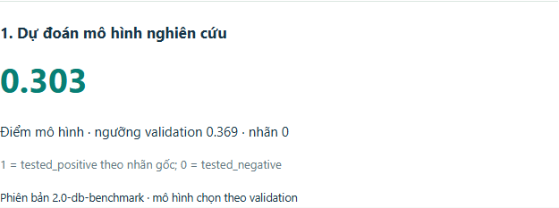

Score hiển thị ba chữ số sau dấu thập phân để dễ đọc; response JSON giữ giá trị chính xác hơn. Việc nhãn bằng 0 chỉ mô tả output phân lớp theo ngưỡng của artifact, không là kết luận “không có bệnh”. Người xem luôn có task/label_semantics và phiên bản bên cạnh score.

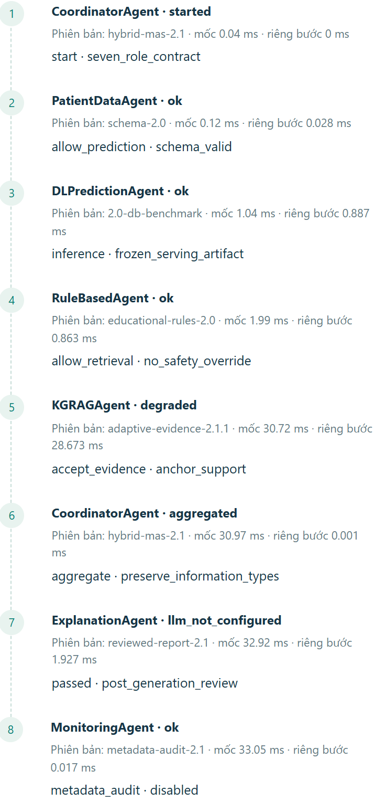

Trong cấu hình cache/template, KG/RAG mang nhãn degraded và Explanation có thể mang llm_not_configured. Monitoring vẫn hoàn tất. Trace 2.1 bổ sung duration_ms của từng call và decision; elapsed_ms vẫn là mốc tích lũy. Không cộng các mốc này để tính tổng latency.

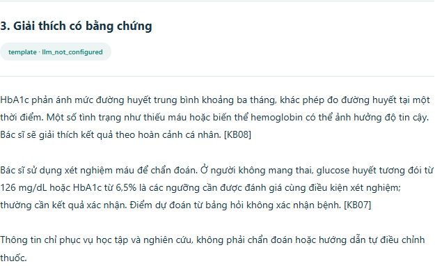

Hai vùng còn lại của giao diện cung cấp nguồn truy xuất và bất định/giới hạn. Tab So sánh mô hình đọc 24 hàng summary theo cohort; tab Knowledge Graph hiển thị snapshot thực thể/quan hệ có nguồn của corpus. Snapshot trên giao diện giúp khám phá tri thức, không phải bằng chứng rằng một kết nối Neo4j production đang hoạt động.

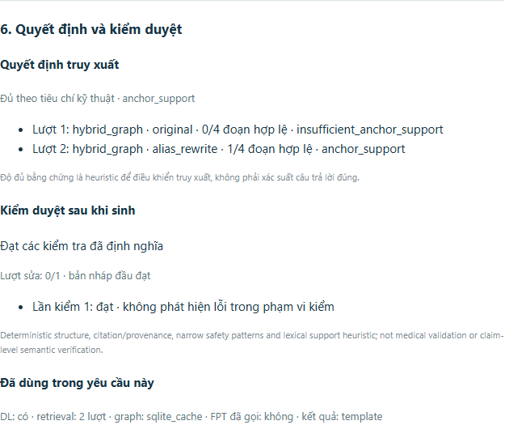

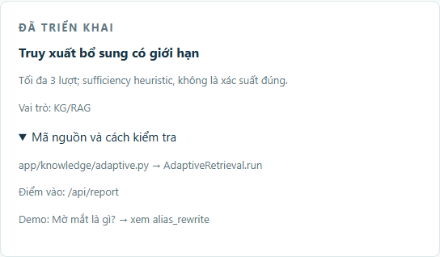

Bảng công nghệ khai báo phần đã triển khai; report ghi phần đã chạy. Ví dụ, RL có mã và dùng trong chat nhưng feature_usage.rl_policy=False ở /api/report. Registry công bố neural_embedding, LangGraph/checkpoint/resume và streaming là chưa triển khai. Cách trình bày này giúp trả lời trực tiếp “có dùng không, dùng ở đâu, chứng minh bằng gì” mà không suy từ tên thư viện hoặc hình kiến trúc.

## 7.10. Kết luận và đóng góp

DiaCare đã hiện thực một nguyên mẫu Hybrid MAS theo bảy vai trò của đặc tả. Nhánh DL nhận dữ liệu từ SQLite, có baseline cùng ba kiến trúc neural và giao thức ngăn rò rỉ. Nhánh tri thức kết nối tài liệu Web/PDF, concept graph và truy xuất có provenance. Coordinator ghép dự đoán, luật và evidence thành báo cáo có cấu trúc; Explanation diễn đạt; Monitoring cung cấp metadata truy vết. Ví dụ chạy thật chứng minh các nhánh này gặp nhau trong cùng một request, đồng thời các loại thông tin vẫn được giữ riêng.

Kết quả thực nghiệm không xác nhận DL luôn vượt mô hình cổ điển hoặc graph luôn tăng retrieval. Các trường hợp baseline cạnh tranh, Hospital khó dự đoán, Early dao động giữa seed và lỗi ranking đều được giữ trong báo cáo. Chúng chỉ ra giới hạn dữ liệu/phương pháp và giúp xác định bước cải thiện tiếp theo có căn cứ.

Bản 2.1 bổ sung mã truy xuất thích ứng và kiểm duyệt hữu hạn, thời lượng từng call, decision trace, feature_usage và registry gắn phương pháp với source. Báo cáo, notebook và hướng dẫn bảo vệ kết nối các phần này tới ca chạy có thể kiểm tra. Các trọng số phục vụ được giữ để đáp ứng yêu cầu tái sử dụng. Neo4j đã có bằng chứng cục bộ; trạng thái môi trường public cần đọc riêng theo phiên bản. Xác thực lâm sàng, kiểm định ngoài miền, kiểm chứng từng claim và đánh giá tải vẫn là công việc tương lai.


# PHỤ LỤC. HỒ SƠ KIỂM CHỨNG VÀ ĐỐI CHIẾU YÊU CẦU

## A.1. Ánh xạ đặc tả sang sản phẩm

Số trang dưới là trang vật lý của project_architecture_multiagent_diabet_v1.pdf (11 trang). “Đã có” mô tả chức năng kỹ thuật theo bằng chứng, không là chứng nhận lâm sàng. Các giả định khác đặc tả được nêu trực tiếp.

| Mục đặc tả / trang | Yêu cầu và hiện trạng | Nơi kiểm tra trong bài |
|---|---|---|
| 1.2 / tr.3 | Tái sử dụng DL: giữ hai serving model CDC/Hospital; benchmark mở rộng ở kho riêng | 1.3, 4.9; legacy-preservation.json |
| 1.2, 7.2 / tr.3,9 | KG giả định có sẵn: thực tế phải xây mới; Neo4j đã kiểm local, public dùng cache | 1.3, 5.3-5.4; DB_diabet.cypher, neo4j-verification.json |
| 2.1 / tr.3-4 | Sáu lớp: UI, API, điều phối, agent, model/knowledge, đánh giá | 2.2; app/main.py và app/static |
| 3.1-3.2 / tr.5 | Bảy vai trò, I/O và quyền ghi trạng thái, quyết định nội bộ hữu hạn | 2.1, 2.4, 2.10; roles.py, workflow.py, capabilities.py |
| 4 / tr.5-6 | M=(A,S,O,C,F), ánh xạ input/output của agent | 2.3; Context, AgentResult, ReportWorkflow |
| 5 / tr.6-7 | Workflow tuần tự; input sai phải dừng trước DL | 2.6, 6.7; test_workflow.py và request missing-feature |
| 6 / tr.7-8 | Message có request_id, agent, status, payload, evidence, model_version | 2.5; contracts.py; trace thật tại 6.7 |
| 7.1 / tr.8-9 | Kiến trúc DL, dữ liệu, tên/thứ tự feature, preprocessing, output/version, metric | Chương 3-4; metadata.json, predict.py |
| 7.2 / tr.9 | Diễn giải query, thực thể, graph, ranking, dẫn nguồn; thêm controller hữu hạn | 5.5, 5.9-5.11; retrieval.py, adaptive.py |
| 5-6 / tr.6-8 | Báo cáo tách các loại thông tin; thêm kiểm duyệt/sửa sau sinh | 6.3, 6.7-6.8; structured_report, review.py, /api/report |
| 3.1, 9 / tr.5,10 | Monitoring, kiểm thử từng thành phần và toàn hệ | 6.5, 7.3, 7.8; audit và verification |
| 8 / tr.9-10 | RL tùy chọn trong mô phỏng; không điều khiển điều trị | 6.6; policy.py, train-policy.py; tách core |
| 9 / tr.10 | Giao diện và báo cáo thực nghiệm | 7.9; notebook, API, ảnh UI và bảng benchmark |
| 10 / tr.10 | Nguồn có thể xem lại, giới hạn chẩn đoán/thuốc, nêu bất định | 1.4, 6.1-6.4, A.5; rules.py, uncertainty/conflicts |

Phần bổ sung tài liệu làm rõ lý thuyết, contract, sequence/lỗi, feature và ví dụ thực. Code 2.1 bổ sung quyết định retrieval/review, timing và registry có thể kiểm trực tiếp. Các cải tiến nội bộ vẫn theo khung bảy vai trò. Chưa có bằng chứng hoàn tất kiểm chứng ngữ nghĩa tổng quát, hệ phân tán tự chủ hoặc Neo4j production.

## A.2. Cấu trúc bàn giao

```text
notebook/project01-diacare.ipynb    Mã độc lập chạy từ trên xuống
app/ml/                           Database, dataset, training, inference
app/knowledge/                    Corpus, ontology, retrieval, generation
app/agents/                       Bảy agent, contracts, rules, workflow
app/static/                       Report, Chat, Benchmark, Graph, Knowledge, Technology
models/                           Serving weights và benchmark neural
results/benchmark/full/            72run, summary, scores, figures
results/*verification.json         Bằng chứng theo phạm vi/phiên bản
DB_diabet.cypher                  Seed graph mới có provenance
report/                           PDF, Markdown, sections, builder
bao-ve-project01.md                Câu hỏi bảo vệ và demo
.env.example                      Tên biến, không có key/password
```

## A.3. Năm câu cần trả lời ngay khi bảo vệ

Dùng mấy bộ dữ liệu? Bốn cohort độc lập cho học có giám sát; corpus Web/PDF là nguồn tri thức riêng. Không gọi 12 tài liệu là 12 dataset train DL.

Dùng mấy mô hình? Sáu loại: ba cổ điển, ba Deep Learning. Có 24 tổ hợp dataset-model,72 lượt do ba seed. Bốn serving model là bốn artifact đang được API nạp, không là bốn kiến trúc khác nhau.

Vì sao không chọn test cao nhất để deploy? Làm vậy dùng test tham gia lựa chọn và làm kết quả lạc quan. Pima/Early chọn validation; CDC/Hospital giữ artifact cũ để đúng yêu cầu tái sử dụng.

Có dùng Neo4j/LLM thật không? Neo4j local đã import/query thật và có verification; FPT gọi HTTPS thật có evidence/citation check. Render có backend nào phải đọc health/verification thực tế, không suy từ kết quả local.

Kết quả có chẩn đoán được không? Chưa. Quần thể nước ngoài, test nhỏ ở hai cohort, sigmoid chưa calibration Việt. Reviewer mới là bộ kiểm cấu trúc/nguồn/mẫu luật và lexical support, chưa chứng minh đúng y khoa. Core là nguyên mẫu học thuật có human review.

## A.4. Bảng kiểm trước khi nộp

Mở notebook và kiểm kernel mới; chọn full khi cần tái lập benchmark. Đọc kết quả full ở results, không thay bằng smoke. Kiểm PDF cover đúng tên/MSV/CT01/04, không còn tên người mẫu. Mở link demo, đối chiếu model_count/system_version; kiểm graph_backend và generation thực.

Loại .env thật, key/password, raw/database, runtime log và patient ID khỏi ZIP/Git/image. Kiểm manifest/CRC sau gói. Báo cáo kiểm thử ngày nào và phiên bản nào phải được ghi rõ; không đổi ngày của bằng chứng cũ để làm như đã chạy lại.

## A.5. Những việc chưa được chứng minh

Chưa có xác thực lâm sàng Việt Nam; chưa có external/temporal validation hay calibration production; chưa có nghiên cứu tác động chăm sóc. Chưa có benchmark tải/SLA. Chưa có đánh giá claim-level support lớn được chuyên gia chấm. SD ba seed không là uncertainty đầy đủ. Chế độ cache không là Neo4j production, citation hợp lệ không là sự thật y khoa.

## A.6. Điểm vào mã nguồn cho người kiểm tra

Contract sau trích từ app/agents/contracts.py, bỏ decorator/import để tập trung các trường. payload và evidence là object/danh sách JSON; client cần đọc status trước khi diễn giải nội dung.

```python
class AgentResult:
    request_id: str
    agent: str
    status: str
    payload: dict
    evidence: list
    model_version: str
    elapsed_ms: float
    duration_ms: float = 0.0
    decision: dict = field(default_factory=dict)
```

| Muốn kiểm tra | Điểm vào |
|---|---|
| Nhận request và mã HTTP | app/main.py: report; app/api_models.py: ReportRequest |
| Toàn bộ thứ tự điều phối | app/agents/workflow.py: ReportWorkflow.run và _finish |
| Nguồn của score, thứ tự feature | app/ml/predict.py: Predictor.predict; models/<cohort>/metadata.json |
| Luật và ưu tiên phản hồi | app/agents/rules.py: check; reporting.py: ExplanationAgent.run |
| Ranking và graph fallback | app/knowledge/retrieval.py: KnowledgeBase.retrieve, graph_evidence |
| Chính sách accept/retry/abstain | app/knowledge/adaptive.py: AdaptiveRetrieval.run |
| Prompt, HTTPS và citation gate | app/knowledge/generation.py: EvidenceGenerator.generate, validate_generated |
| Kiểm duyệt và sửa hữu hạn | app/knowledge/review.py: review_output, review_and_revise |
| Có dùng công nghệ nào, dùng ở đâu? | app/capabilities.py: FEATURES, AGENTS, inventory, usage; GET /api/capabilities |
| Tái tạo ví dụ Chương 6 | scripts/capture-report-cases.py; results/agent-upgrade-cases.json |
| Đánh giá thay đổi retrieval | scripts/evaluate-agent-upgrade.py; agent-upgrade-evaluation.json và bản v1 |
| Tái tạo bảng/sơ đồ/báo cáo | report/prepare-analysis.py, prepare-report.py, build-pdf.py |

Nguồn báo cáo và công cụ dựng được đóng gói cùng bài để có thể sửa tiếp. assets/original-cover.pdf là trang bìa gốc được giữ lại; builder thay trang đầu bằng trang này sau khi dựng nội dung. Kiểm render pixel trước/sau được dùng để xác nhận yêu cầu giữ nguyên bìa, thay vì chỉ so tên và mã sinh viên.


# TÀI LIỆU THAM KHẢO

Tài liệu kiến trúc do giảng viên cung cấp: project_architecture_multiagent_diabet_v1.pdf (11 trang,11/2026), đặc biệt mục 3-7 và 9-10. Đây là đặc tả được đối chiếu, không là kết quả đo của project.

Báo cáo project_01_CT_04_linhvtm_v2.pdf (53 trang): tham khảo cách trình bày nền tảng Agent/MAS, hợp đồng API, ví dụ và ảnh giao diện. Không sử dụng số liệu, ảnh giao diện hoặc mã của báo cáo mẫu làm kết quả DiaCare.

Nguồn Web/PDF được kiểm tra trong quá trình thực hiện; ngày tải/hash/note cụ thể lưu trong corpus và knowledge-ingestion.json. PDF Việt 2020 là nguồn lịch sử. Số liệu mô hình được tính bằng mã và dữ liệu của bài, không chép số liệu báo cáo mẫu.

1. [WHO — Diabetes fact sheet](https://www.who.int/news-room/fact-sheets/detail/diabetes)

2. [NIDDK — What Is Diabetes?](https://www.niddk.nih.gov/health-information/diabetes/overview/what-is-diabetes)

3. [NIDDK — Type 1 Diabetes](https://www.niddk.nih.gov/health-information/diabetes/overview/what-is-diabetes/type-1-diabetes)

4. [NIDDK — Type 2 Diabetes](https://www.niddk.nih.gov/health-information/diabetes/overview/what-is-diabetes/type-2-diabetes)

5. [NIDDK — Diabetes Tests & Diagnosis](https://www.niddk.nih.gov/health-information/diabetes/overview/tests-diagnosis)

6. [NIDDK — Healthy Living with Diabetes](https://www.niddk.nih.gov/health-information/diabetes/overview/healthy-living-with-diabetes)

7. [NIDDK — Low Blood Glucose (Hypoglycemia)](https://www.niddk.nih.gov/health-information/diabetes/overview/preventing-problems/low-blood-glucose-hypoglycemia)

8. [Bộ Y tế — Hướng dẫn chẩn đoán và điều trị đái tháo đường típ 2 (2020), bản do Sở Y tế Đồng Nai đăng tải](https://syt.dongnai.gov.vn/vi/van-ban/detail/V-v-trien-khai-thuc-hien-Quyet-dinh-so-5481-QD-BYT-ngay-30-12-2020-cua-Bo-truong-Bo-Y-te-4905/?download=1&id=0)

9. [Vinmec — Bệnh đái tháo đường: chế độ ăn như thế nào?](https://www.vinmec.com/vie/bai-viet/benh-dai-thao-duong-che-do-nhu-nao-vi)

10. [Vinmec — Các xét nghiệm dùng để chẩn đoán đái tháo đường type 2](https://www.vinmec.com/vie/bai-viet/cac-xet-nghiem-dung-de-chan-doan-dai-thao-duong-type-2-vi)

11. [Vinmec — Hiểu biết về đái tháo đường type 2 - Phần 1](https://www.vinmec.com/vie/bai-viet/hieu-biet-ve-dai-thao-duong-type-2-phan-1-vi)

12. [Vinmec — Dấu hiệu đái tháo đường thai kỳ và các câu hỏi thường gặp](https://www.vinmec.com/vie/bai-viet/nhung-dieu-can-biet-ve-dai-thao-duong-thai-ky-vi)

13. [UCI891. CDC Diabetes Health Indicators.](https://archive.ics.uci.edu/dataset/891/cdc+diabetes+health+indicators)

14. [Alex Teboul. Binary BRFSS2015; nguồn khai báo CC0.](https://www.kaggle.com/datasets/alexteboul/diabetes-health-indicators-dataset)

15. [UCI296. Diabetes130-US Hospitals; DOI10.24432/C5230J; CC BY4.0.](https://archive.ics.uci.edu/dataset/296/diabetes+130-us+hospitals+for+years+1999-2008)

16. [Strack và cộng sự (2014). Impact of HbA1c Measurement on Hospital Readmission Rates.](https://doi.org/10.1155/2014/781670)

17. [OpenML37. Pima; metadata licence Public, không tự gán CC0.](https://www.openml.org/d/37)

18. [OpenML. Metadata và MD5 ARFF của dataset37.](https://api.openml.org/api/v1/json/data/37)

19. [UCI529. Early Stage Diabetes Risk Prediction; DOI10.24432/C5VG8H; CC BY4.0.](https://archive.ics.uci.edu/dataset/529/early+stage+diabetes+risk+prediction+dataset)

20. [Lewis và cộng sự (2020). Retrieval-Augmented Generation for Knowledge-Intensive NLP Tasks.](https://arxiv.org/abs/2005.11401)

21. [Wooldridge và Jennings (1995). Intelligent Agents: Theory and Practice.](https://www.cs.ox.ac.uk/people/michael.wooldridge/pubs/ker95.pdf)

22. [Sutton và Barto (2018). Reinforcement Learning: An Introduction.](http://incompleteideas.net/book/the-book-2nd.html)

23. [PyTorch. Tài liệu chính thức tensor, neural network, state_dict.](https://docs.pytorch.org/docs/stable/index.html)

24. [scikit-learn. Model evaluation, Average Precision và ROC-AUC.](https://scikit-learn.org/stable/modules/model_evaluation.html)

25. [Neo4j. Python Driver Manual.](https://neo4j.com/docs/python-manual/current/)

26. [FPT Cloud AI Marketplace. API integration, gateway mkp-api.fptcloud.com và /chat/completions.](https://ai-docs.fptcloud.com/api-reference/ai-marketplace/api-reference/api-integration-multimodal-model-text-md)

27. [FastAPI. FastAPI in Containers - Docker.](https://fastapi.tiangolo.com/deployment/docker/)

28. [Render. Blueprint YAML Reference.](https://render.com/docs/blueprint-spec)

29. [Render. Deploy lifecycle and manual deploys for public Git repository URLs.](https://render.com/docs/deploys)
