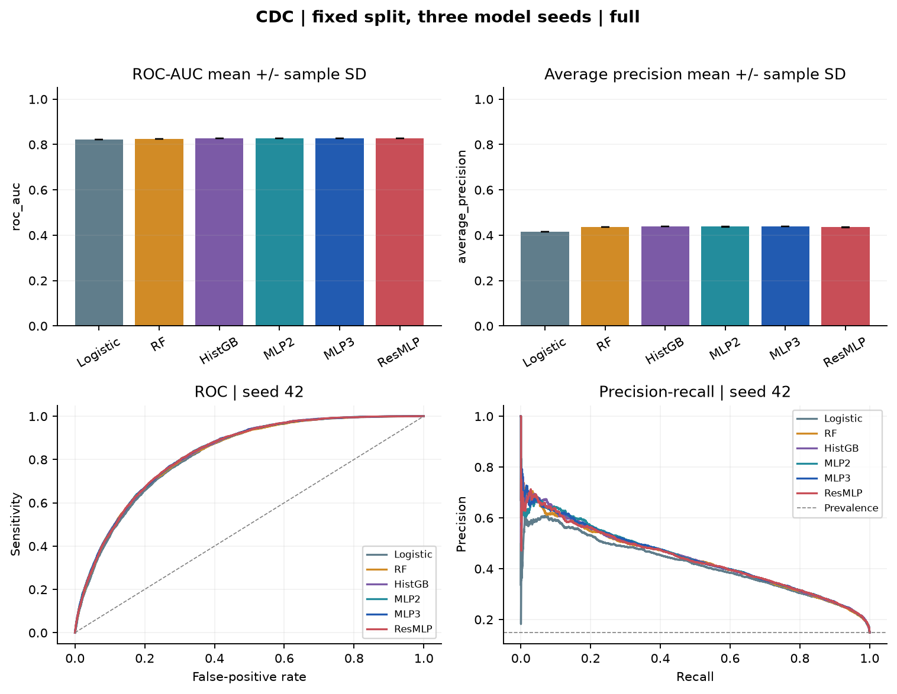
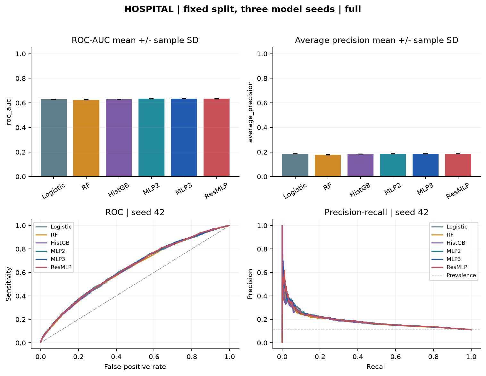
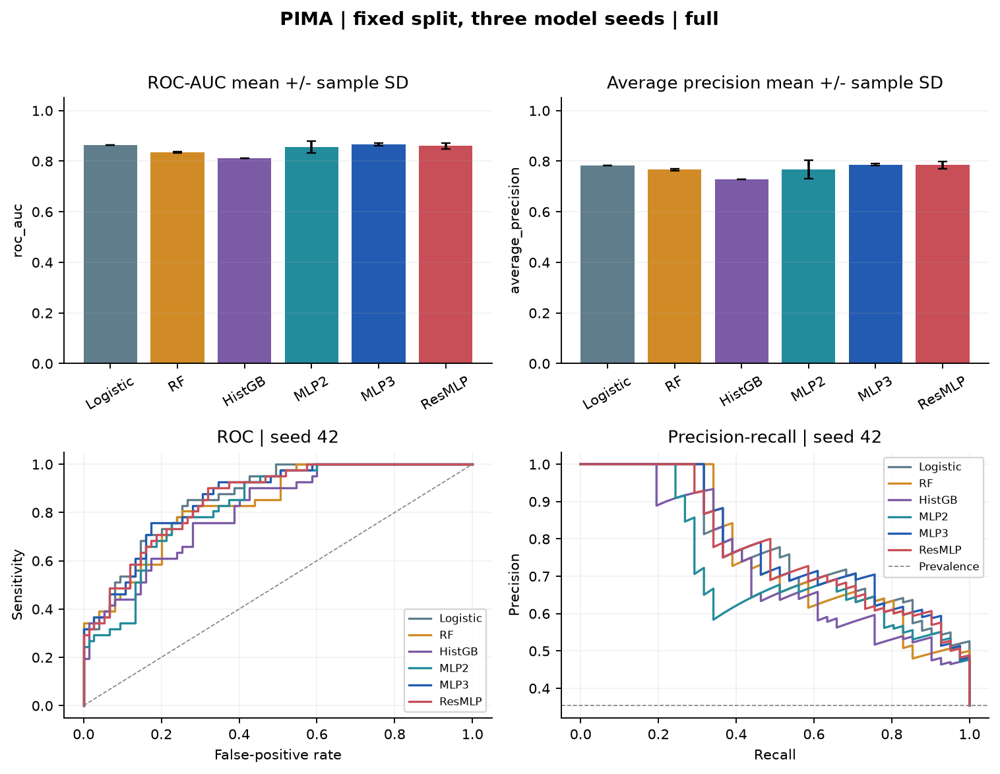
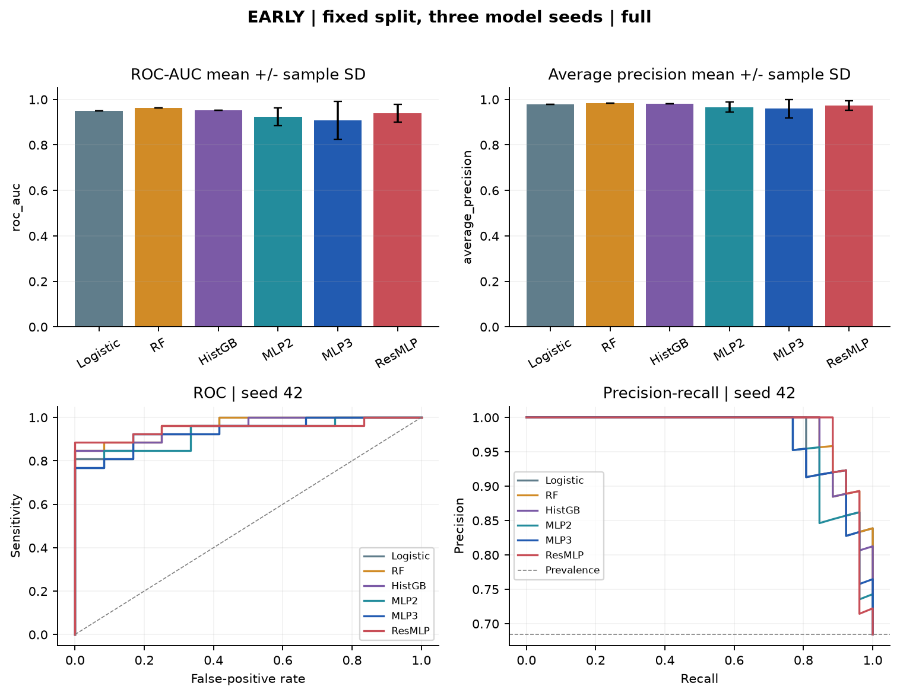

# PROJECT01 - HỆ ĐA AGENT HỖ TRỢ BỆNH ĐÁI THÁO ĐƯỜNG

Giáp Minh Hiếu - B23DCCN299 - CT01 - Nhóm04

# CHƯƠNG 1. BÀI TOÁN VÀ PHẠM VI THỰC HIỆN

## 1.1. Mục tiêu của Project01

DiaCare là nguyên mẫu học thuật về hệ đa agent hỗ trợ tìm hiểu bệnh đái tháo đường. Đề tài kết hợp hai nhánh: Knowledge Base từ Web/PDF, Knowledge Graph và RAG; dữ liệu Diabetes trong cơ sở dữ liệu để huấn luyện, so sánh Deep Learning. Báo cáo trình bày kết quả thực nghiệm và cách các thành phần phối hợp thành ứng dụng.

Tài liệu project_architecture_multiagent_diabet_v1.pdf do giảng viên cung cấp định nghĩa bảy agent cốt lõi, giao tiếp có cấu trúc và quy trình tạo báo cáo. Đây là đặc tả kiến trúc; không quy định số bộ dữ liệu hoặc mô hình. Ma trận bốn cohort, sáu loại mô hình, ba seed là phần mở rộng thực nghiệm để có so sánh rõ ràng.

Đầu vào gồm cohort, đầy đủ đặc trưng đúng schema và câu hỏi tùy chọn. Đầu ra gồm dự đoán, kết quả luật, bằng chứng truy xuất, giải thích, nguồn và giới hạn. Các thành phần được giữ riêng để người xem biết thông tin đến từ mô hình, luật hay tài liệu.

## 1.2. Kết quả chính và cách đếm

| Thành phần | Kết quả và ý nghĩa |
|---|---|
| Dữ liệu học có giám sát | 4 cohort độc lập: CDC, Hospital, Pima, Early Stage |
| Loại mô hình | 6: Logistic Regression, Random Forest, Histogram Gradient Boosting, MLP hai tầng, MLP ba tầng, Residual MLP |
| Deep Learning | 3 kiến trúc nhiều tầng ẩn; seed là lần khởi tạo, không là loại kiến trúc mới |
| Ma trận | 4 × 6 = 24 tổ hợp dataset-model; mỗi tổ hợp 3 seed, tổng 72 lượt thật |
| Tái sử dụng | Giữ nguyên artifact CDC/Hospital đã triển khai; benchmark mới lưu riêng |
| Tri thức | Web, PDF tiếng Việt và thẻ có nguồn; KG được xây dựng mới và xuất Cypher |
| Điều phối | 7 agent cốt lõi, request_id xuyên suốt, trạng thái và phiên bản |
| Sản phẩm | Notebook độc lập, FastAPI, Docker, báo cáo, hướng dẫn bảo vệ |

Hai cohort nhỏ bổ sung giúp quan sát độ nhạy khởi tạo và tác động của dữ liệu ít. Chúng không làm tăng bằng chứng kiểm định của cùng một mô hình vì nhiệm vụ, feature và quần thể khác nhau. Không cộng mọi hàng thành một tập huấn luyện chung.

## 1.3. Điều chỉnh so với giả định của kiến trúc mẫu

Kiến trúc mẫu giả định đã có DL và Neo4j KG. Hai mô hình CDC/Hospital đã tồn tại; người học xác nhận chưa có Neo4j hoặc DB_diabet.cypher. Bài thực hiện tái sử dụng DL hiện có và xây KG từ đầu. Cypher bàn giao là kết quả mới của project, không là kho tri thức có sẵn của giảng viên.

Vinmec là nguồn bài viết sức khỏe cho KB/RAG. Bài viết công khai cung cấp văn bản, không cung cấp ma trận bệnh nhân có nhãn để thay cho bốn cohort. Không gọi bài viết là dữ liệu bệnh nhân Vinmec để train DL. PDF kiến trúc 11 trang không nêu bắt buộc dùng Vinmec; nguồn này được bổ sung theo trao đổi với người học.

## 1.4. Giới hạn sử dụng

Đây là nguyên mẫu giáo dục và nghiên cứu. Điểm sigmoid chưa được hiệu chuẩn thành xác suất bệnh cá nhân tại Việt Nam. Hospital dự đoán tái nhập viện dưới 30 ngày ở người có đái tháo đường; đây không phải phát hiện bệnh mới. CDC dùng nhãn gộp tiền đái tháo đường/đái tháo đường theo nguồn binary.

Hệ thống không chẩn đoán xác nhận, kê thuốc hoặc tự điều chỉnh liều. Luật minh họa cần chuyên gia thẩm định trước khi dùng thật. RL chỉ mô phỏng cách trình bày. Citation đúng ID hoặc URL chứng minh truy vết, chưa chứng minh mọi phát biểu được nguồn hỗ trợ đầy đủ.

## 1.5. Cách kiểm chứng

Các số liệu Chương 3-4 lấy từ artifact thực. 72 lượt nằm tại results/benchmark/full; manifest nguồn, SQL và split tại results/benchmark/database-manifest.json; hash bảo toàn mô hình cũ tại results/benchmark/legacy-preservation.json. Chương 5 mô tả corpus/graph/RAG; Chương 6 mô tả luật và báo cáo; Chương 7 hướng dẫn notebook, kiểm thử và triển khai.

Bằng chứng ngày 05/11/2026 là lịch sử phiên bản cũ. Kết quả kiểm tra của phiên bản nào chỉ áp dụng cho phiên bản đó. Trạng thái bản nâng cấp phải đối chiếu verification mới nhất, không suy ra từ việc URL cũ vẫn truy cập được.


# CHƯƠNG 2. KIẾN TRÚC HYBRID MULTIAGENT SYSTEM

## 2.1. Sáu lớp hệ thống

Sáu lớp gồm giao diện; API và xử lý dữ liệu; điều phối; agent chuyên biệt; model và knowledge; đánh giá/audit. Các agent chạy trong một tiến trình Python, giao tiếp qua object có cấu trúc. Cách triển khai này hỗ trợ kiểm thử và theo dõi; chưa là agent phân tán độc lập qua message broker.


SQLite huấn luyện chứa raw/prepared và split, chỉ dùng cục bộ. SQLite cache tri thức chứa tài liệu/chunk/quan hệ công khai. Neo4j lưu graph; trọng số DL nạp từ artifact. Không huấn luyện lại tại request.

## 2.2. Bảy agent và ánh xạ mã nguồn

| Agent | Thành phần | Trách nhiệm |
|---|---|---|
| Patient Data | PatientDataAgent, roles.py | Kiểm schema, kiểu, thứ tự, miền, thiếu giá trị |
| DL Prediction | DLPredictionAgent, predict.py | Nạp model/scaler/ngưỡng; score, nhãn, metadata |
| Rule-Based | RuleBasedAgent, rules.py | Luật có lý do, cảnh báo và review flags |
| KG/RAG | KnowledgeAgent, retrieval.py | Thực thể, graph, chunk, ranking và nguồn |
| Coordinator | ReportWorkflow, workflow.py | Điều phối, dừng sớm, tổng hợp và xử lý lỗi |
| Explanation | ExplanationAgent, generation.py | Giải thích bằng FPT hoặc template có nhãn |
| Monitoring | MonitoringAgent, roles.py | Metadata, trạng thái, version và độ trễ |

Coordinator không thay thuật toán của agent khác. Prediction suy luận; KG tìm tài liệu; Explanation dùng kết quả đã có. Có thể thay retriever hoặc LLM mà không đổi schema dự đoán. Số lần message không phải số loại agent, vì Coordinator có thể phát nhiều sự kiện trong một request.

## 2.3. Hợp đồng giao tiếp

Message có request_id, agent, status, payload, evidence, model_version và elapsed_ms. Phiên bản nhận diện model hoặc agent; request_id liên kết toàn bộ cùng yêu cầu. Payload tùy chức năng, không phải chuỗi log không cấu trúc.

```json
{"request_id":"ma-tu-sinh", "agent":"DLPredictionAgent",
 "status":"ok", "payload":{"dataset":"cdc"},
 "evidence":[], "model_version":"legacy-1.0", "elapsed_ms":12.5}
```

Ví dụ minh họa cấu trúc, không phải đo độ trễ. Monitoring mặc định chỉ ghi metadata, không vector sức khỏe, câu hỏi hoặc khóa API.

## 2.4. Luồng chính và dừng sớm

API nhận cohort và feature. Coordinator tạo request_id, gọi Data. Nếu schema/giá trị sai, trả validation_error trước DL, Rule và KG. Nếu hợp lệ: DL suy luận; Rule đánh giá; KG lấy evidence; Coordinator tổng hợp; Explanation tạo báo cáo; Monitoring ghi metadata.

Luồng hữu hạn có trace. Cảnh báo nguy cấp và yêu cầu vượt phạm vi được luật ưu tiên để LLM không trì hoãn hoặc ghi đè thông báo an toàn. Điểm dự đoán nghiên cứu không phủ quyết cảnh báo luật; tài liệu giáo dục không là quan sát của cá nhân.

## 2.5. Lỗi và dự phòng

DL lỗi thì trả dependency_error, không tạo score giả. Thiếu Neo4j/kết nối lỗi thì dùng cache và nêu backend. Thiếu FPT, lỗi API hoặc citation không hợp lệ thì dùng template có nhãn. Không gọi template là output đã sinh bằng LLM.

Fallback giúp demo cục bộ, không là bằng chứng Neo4j production. Health/catalog công bố model, inventory, graph và LLM configuration; bằng chứng gọi API thật được ghi riêng với metadata an toàn.

## 2.6. Ranh giới dữ liệu và bảo mật

API không nhận SQL/Cypher tùy ý. Query graph dùng tham số. Corpus ingest trước, không tải URL tùy ý từ request. Nội dung nguồn là dữ liệu hỗ trợ, không được thực thi như chỉ thị.

FPT key và Neo4j password chỉ ở môi trường/.env bị ignore. Raw/database chứa patient_nbr phục vụ split không vào Git/image/ZIP. Artifact state_dict nạp weights_only=True; không pickle toàn bộ object mô hình. Audit ra file chỉ bật khi cấu hình rõ đường dẫn.


# CHƯƠNG 3. BỐN COHORT VÀ CƠ SỞ DỮ LIỆU HUẤN LUYỆN

## 3.1. Nguồn và nhiệm vụ

| Cohort | Dòng nguồn / sạch | Feature | Nhãn |
|---|---:|---:|---|
| CDC BRFSS 2015 | 253.680 / 226.342 | 21 | Binary gộp tiền đái tháo đường/đái tháo đường |
| Hospital 130-US | 101.766 / 101.763 | 10 | Tái nhập viện dưới 30 ngày |
| Pima | 768 / 768 | 8 | Tested positive/negative, phụ nữ Pima từ 21 tuổi |
| Early Stage | 520 / 251 | 16 | Positive/Negative, Sylhet Hospital Bangladesh |

CDC lấy từ UCI891, bản binary của Alex Teboul khai báo CC0. Hospital UCI296 và Early Stage UCI529 có CC BY 4.0. Pima lấy từ ARFF OpenML37, metadata ghi licence Public, original owner NIDDK. Không tự đổi giấy phép Pima thành CC0.

Endpoint Pima UCI cũ không tải được. UCI34 là AIM94 time-series khác, không dùng thay thế. ARFF OpenML được đối chiếu toàn bộ 768 hàng, tám feature, nhãn và thứ tự với CSV đã có; MD5 khớp metadata. URL/hash ở data/README.md và manifest.

## 3.2. CDC và Hospital

CDC loại nhóm vector có nhãn mâu thuẫn rồi giữ một bản/vector còn lại. Làm sạch trước split ngăn cùng vector qua train và test. Nhóm mâu thuẫn có thể chứa bản sao nên không cộng số duplicate và số mâu thuẫn để suy ra kích thước sạch.

Hospital loại ba dòng gender Unknown/Invalid. Split theo patient_nbr ngăn các lượt của cùng người giao train/validation/test. ID chỉ tạo nhóm, không trong X, trọng số hoặc API. Mười feature được chọn mang thông tin khi ra viện; không diễn giải là dự báo ngay lúc nhập viện. Chia nhóm chưa kiểm chứng bệnh viện mới hoặc dữ liệu tương lai.

## 3.3. Pima: zero-coded missing

Glucose, BloodPressure, SkinThickness, Insulin, BMI bằng 0 được coi là missing theo giao thức bài. Median tính chỉ trên train rồi dùng nguyên vẹn cho validation/test/inference. Pregnancies bằng 0 vẫn hợp lệ. Không xóa mọi hàng có số 0 và không lấy median toàn tập vì sẽ thay quần thể hoặc rò rỉ test.

Pima có 768 dòng, không phát hiện duplicate/conflict trong kiểm kê. Cohort chỉ gồm một nhóm phụ nữ lịch sử nên không suy rộng mặc nhiên cho nam giới, người trẻ hoặc dân số Việt.

## 3.4. Early Stage: vì sao 520 còn 251?

Nguồn 520 dòng có 269 dòng trùng hoàn toàn; sau dedup còn 251 vector, gồm 173 dương và 78 âm. Không có feature-group mâu thuẫn nhãn. Giữ 520 rồi split ngẫu nhiên dễ làm cùng vector lọt test và tăng điểm thiếu tin cậy.

Tuổi thật trong CSV 16-90, khác mô tả ngắn 20-65 trên trang nguồn. Schema dựa kiểm kê thật và ghi khác biệt. Test chỉ 38 dòng; một vài dự đoán đổi làm metric thay đáng kể, không xem AUC cao là bằng chứng mạnh về tổng quát hóa.

## 3.5. SQLite dùng thật trong huấn luyện

database.py đọc/tải CSV và lưu raw_cdc, raw_hospital, raw_pima, raw_early cùng provenance. datasets.py SELECT bảng raw để làm sạch/chia, fit median/mean/std train, rồi ghi prepared_<dataset> với split_order. load_prepared() SELECT từng split; mảng nhận từ query trực tiếp cấp mọi vòng fit.

```sql
SELECT split, COUNT(*) AS rows, SUM(target) AS positives
FROM prepared_early GROUP BY split;
SELECT Glucose, BMI, Age, target FROM prepared_pima
WHERE split='train' ORDER BY split_order LIMIT 5;
```

Benchmark không đọc NPZ cũ để giả lập database. NPZ đầu ra giữ nhãn/score hoặc hệ số nhỏ để kiểm metric. CSV dễ mở Excel; NPZ giữ nhiều mảng đúng dtype và nén. Định dạng không quyết định thuật toán.

## 3.6. Chia tập và tiền xử lý

| Cohort | Train | Validation | Test | Giao thức |
|---|---:|---:|---:|---|
| CDC | 158.439 | 33.951 | 33.952 | Vector sạch, split cố định |
| Hospital | 71.583 | 15.055 | 15.125 | Không giao nhóm bệnh nhân |
| Pima | 537 | 115 | 116 | Stratified, median train |
| Early Stage | 175 | 38 | 38 | Dedup trước stratified split |

Split seed 42; model seed 42/43/44. Đổi model seed không tạo ba test mới. Mean/std fit train và áp cùng thứ tự feature. Checkpoint chọn validation ROC-AUC; ngưỡng chọn validation F 1; đóng băng trước đo test. Không lựa mô hình phục vụ bằng test.

## 3.7. Provenance và giới hạn

Manifest lưu URL, hash, số dòng, SQL, split và thống kê. Raw/database chỉ ở máy cục bộ, bị loại khỏi phát hành. Bốn cohort khác nguồn/nhãn/quần thể, không gộp thành một nhiệm vụ và không là bốn tập external validation của một model.

Bài viết Vinmec và PDF Việt giúp truy xuất tài liệu Việt, không thay tập bệnh nhân Việt có nhãn. Trước dùng thực cần quyền dữ liệu, kiểm định ngoài miền, hiệu chuẩn, đánh giá theo nhóm và chuyên gia y tế.


# CHƯƠNG 4. DEEP LEARNING VÀ BENCHMARK SO SÁNH

## 4.1. Sáu cấu hình chốt trước

Ba mô hình cổ điển cung cấp baseline tuyến tính và phi tuyến. Ba mạng neural khảo sát độ sâu và kết nối residual trên cùng feature/split. Không thay hyperparameter theo điểm test. Seed mô hình 42,43,44 được áp cho mọi loại; bộ chia dữ liệu giữ cố định seed 42.

| ID | Kiến trúc / cấu hình full |
|---|---|
| logistic | Logistic Regression, C=1, max_iter=1000 |
| random_forest | 100 cây, max_depth=12, min_samples_leaf=5, n_jobs=2 |
| hist_gradient_boosting | 100 iteration, max_depth=6, early_stopping=False |
| mlp 2 | Input → 64 ReLU Dropout 0.15 → 32 ReLU Dropout 0.10 → 1 logit |
| mlp 3 | Input → 64 ReLU Dropout 0.15 → 32 ReLU Dropout 0.10 → 16 ReLU → 1 logit |
| resmlp | Input projection 32, hai residual block gồm hai linear 32 mỗi block, output 1 |

Mạng trả logit khi học, dùng BCEWithLogitsLoss; suy luận áp sigmoid. Residual block có shortcut cộng đầu vào với phép biến đổi rồi ReLU. Cả ba là mạng nhiều tầng ẩn; không dùng ba seed để tuyên bố có chín kiến trúc DL.

## 4.2. Ngân sách huấn luyện và lựa chọn

Adam learning_rate 0.001, weight_decay1e-5. CDC/Hospital tối đa 25 epoch, batch 2048; Pima/Early tối đa 100 epoch, batch 32. Patience 10 theo validation ROC-AUC, chỉ cập nhật checkpoint khi AUC tăng hơn1e-5. Sau nạp checkpoint tốt nhất, chọn threshold đạt F 1 cao nhất trên validation rồi mới tính score/test metric.

Ba mạng được học từ đầu trong benchmark riêng. Hai model phục vụ CDC/Hospital đã có từ phiên bản trước vẫn được tái sử dụng, không bị thay bằng model mới có test đẹp hơn. Pima/Early là cohort mới nên chọn DL phục vụ theo validation AUC trong chín run neural/cohort; không dùng test chọn.

## 4.3. Chỉ số và cách diễn giải

ROC-AUC đo thứ hạng score. AP là Average Precision theo scikit-learn, không phải diện tích hình thang PR-AUC. F1, sensitivity, specificity và accuracy được tính tại ngưỡng validation; confusion matrix theo nhãn[0,1]. Luôn đọc prevalence và always-negative baseline khi lệch lớp.

Brier là trung bình squared error score-label, chưa chứng minh hiệu chuẩn lâm sàng Việt. Mean ± SD dùng sample SD ba seed trên một split, không là khoảng tin cậy quần thể. SD0 có thể do thuật toán xác định, không chứng minh hết bất định.

<!-- BENCHMARK_START -->

<!-- pagebreak -->

## 4.4. Kết quả CDC BRFSS

Các giá trị là test mean ± SD ba seed; ngưỡng từng run chọn trên validation.

| Model | ROC-AUC | AP | F1 | Brier |
|---|---:|---:|---:|---:|
| HGB | 0,8270 ± 0,0000 | 0,4386 ± 0,0000 | 0,4767 ± 0,0000 | 0,1018 ± 0,0000 |
| Logistic | 0,8206 ± 0,0000 | 0,4156 ± 0,0000 | 0,4685 ± 0,0000 | 0,1038 ± 0,0000 |
| MLP2 | 0,8277 ± 0,0003 | 0,4382 ± 0,0011 | 0,4778 ± 0,0011 | 0,1016 ± 0,0001 |
| MLP3 | 0,8277 ± 0,0004 | 0,4385 ± 0,0006 | 0,4783 ± 0,0001 | 0,1016 ± 0,0000 |
| Random Forest | 0,8247 ± 0,0001 | 0,4352 ± 0,0004 | 0,4771 ± 0,0023 | 0,1022 ± 0,0000 |
| ResMLP | 0,8271 ± 0,0001 | 0,4358 ± 0,0013 | 0,4783 ± 0,0002 | 0,1018 ± 0,0000 |



<!-- pagebreak -->

## 4.5. Kết quả Hospital

Các giá trị là test mean ± SD ba seed; ngưỡng từng run chọn trên validation.

| Model | ROC-AUC | AP | F1 | Brier |
|---|---:|---:|---:|---:|
| HGB | 0,6296 ± 0,0000 | 0,1820 ± 0,0000 | 0,2441 ± 0,0000 | 0,0961 ± 0,0000 |
| Logistic | 0,6285 ± 0,0000 | 0,1849 ± 0,0000 | 0,2396 ± 0,0000 | 0,0961 ± 0,0000 |
| MLP2 | 0,6341 ± 0,0007 | 0,1858 ± 0,0009 | 0,2470 ± 0,0015 | 0,0959 ± 0,0000 |
| MLP3 | 0,6348 ± 0,0012 | 0,1866 ± 0,0004 | 0,2498 ± 0,0020 | 0,0958 ± 0,0000 |
| Random Forest | 0,6249 ± 0,0011 | 0,1781 ± 0,0017 | 0,2446 ± 0,0028 | 0,0963 ± 0,0001 |
| ResMLP | 0,6330 ± 0,0024 | 0,1856 ± 0,0005 | 0,2466 ± 0,0021 | 0,0959 ± 0,0000 |



<!-- pagebreak -->

## 4.6. Kết quả Pima

Các giá trị là test mean ± SD ba seed; ngưỡng từng run chọn trên validation.

| Model | ROC-AUC | AP | F1 | Brier |
|---|---:|---:|---:|---:|
| HGB | 0,8104 ± 0,0000 | 0,7280 ± 0,0000 | 0,6458 ± 0,0000 | 0,1921 ± 0,0000 |
| Logistic | 0,8624 ± 0,0000 | 0,7832 ± 0,0000 | 0,7292 ± 0,0000 | 0,1493 ± 0,0000 |
| MLP2 | 0,8550 ± 0,0229 | 0,7675 ± 0,0357 | 0,6934 ± 0,0114 | 0,1629 ± 0,0231 |
| MLP3 | 0,8653 ± 0,0049 | 0,7866 ± 0,0048 | 0,7189 ± 0,0213 | 0,1521 ± 0,0022 |
| Random Forest | 0,8357 ± 0,0026 | 0,7660 ± 0,0043 | 0,6826 ± 0,0196 | 0,1585 ± 0,0018 |
| ResMLP | 0,8608 ± 0,0117 | 0,7848 ± 0,0148 | 0,7145 ± 0,0116 | 0,1524 ± 0,0060 |



<!-- pagebreak -->

## 4.7. Kết quả Early Stage

Các giá trị là test mean ± SD ba seed; ngưỡng từng run chọn trên validation.

| Model | ROC-AUC | AP | F1 | Brier |
|---|---:|---:|---:|---:|
| HGB | 0,9519 ± 0,0000 | 0,9801 ± 0,0000 | 0,9091 ± 0,0000 | 0,0908 ± 0,0000 |
| Logistic | 0,9487 ± 0,0000 | 0,9781 ± 0,0000 | 0,9020 ± 0,0000 | 0,1036 ± 0,0000 |
| MLP2 | 0,9241 ± 0,0385 | 0,9660 ± 0,0224 | 0,8770 ± 0,0526 | 0,1679 ± 0,0682 |
| MLP3 | 0,9081 ± 0,0837 | 0,9589 ± 0,0397 | 0,8782 ± 0,0750 | 0,1632 ± 0,0683 |
| Random Forest | 0,9615 ± 0,0000 | 0,9841 ± 0,0003 | 0,9140 ± 0,0104 | 0,0921 ± 0,0011 |
| ResMLP | 0,9391 ± 0,0400 | 0,9733 ± 0,0212 | 0,9020 ± 0,0151 | 0,0855 ± 0,0307 |



<!-- BENCHMARK_END -->

## 4.8. Tổng hợp quan sát

CDC: ba mạng và HGB cho ROC-AUC gần nhau quanh 0,827; chênh lệch giữa MLP2/MLP3 rất nhỏ. Không có cơ sở kết luận độ sâu hơn luôn tốt hơn từ ba seed một split. AP quanh 0,44 cho thấy bài toán khó hơn con số accuracy riêng lẻ có thể gợi ý.

Hospital: ROC-AUC mọi mô hình chỉ quanh 0,625-0,635 và AP quanh 0,178-0,187. Mạng không giải quyết hoàn toàn bài toán tái nhập viện với mười feature hiện tại. Cần bổ sung thông tin, thiết kế thời điểm dự báo rõ và kiểm định theo thời gian/bệnh viện; không giấu kết quả thấp.

Pima: logistic có ROC-AUC 0,8624; MLP3 trung bình 0,8653±0,0049, MLP2 dao động lớn hơn. Đây là ví dụ baseline đơn giản vẫn cạnh tranh trên dữ liệu bảng nhỏ. Không chọn architecture vì test cao nhất rồi trình bày như lựa chọn có trước.

Early: Random Forest có ROC-AUC trung bình 0,9615, nhưng test chỉ 38 dòng. Các mạng dao động đáng kể giữa seed, MLP3 SD khoảng 0,0837. AUC cao ở một cohort nhỏ không chứng minh tốt hơn CDC/Hospital, vì nhãn/quần thể/test khác nhau.

## 4.9. Tái sử dụng artifact và chi phí

11 artifact mô hình/kết quả cũ của CDC/Hospital được đối chiếu SHA256 và giữ nguyên. serving CDC/Hospital dùng model_version legacy-1.0; Pima/Early dùng 2.0-db-benchmark. Pima chọn MLP2 seed 42 theo validation AUC 0,8387; Early chọn ResMLP seed 42 theo validation AUC 0,9744. Đây là lựa chọn validation, khác bảng test mean/SD.

72 run được thực thi thật trên CPU Linux với Python 3.12.16, torch 2.15.0+cpu, NumPy 2.5.4, pandas 3.1.1, scikit-learn 1.9.1. Tổng các thời gian fit+evaluate ghi theo run là 145,588 giây. Đây không gồm mọi thời gian tải nguồn, build container và kiểm thử.

Lượt đầu đã hoàn thành 54 run nhưng bước copy artifact Pima gặp lỗi cập nhật timestamp trên Windows bind-mount. Sửa copy 2 thành copyfile chỉ sao nội dung, xác minh hash/nhãn 54 run, rồi chạy tiếp 18 run Early. Giá trị 23,449 giây của invocation resume không phải thời gian train 72 run. execution-history.json lưu rõ hai pha.

## 4.10. Artifact và khả năng tái lập

Mỗi run giữ config, seed, checkpoint/history khi phù hợp, SQL source/hash, threshold, metric và score validation/test. Neural weights lưu state_dict; logistic giữ coefficient/intercept trong NPZ. Cây RF/HGB không đóng gói để tránh artifact lớn; cần refit bằng cùng config/seed/data để tái tạo model, còn score test đã lưu để tính lại metric.

Các hình so sánh biểu diễn metric theo cohort. Báo cáo không tạo leaderboard gộp AUC của bốn nhiệm vụ. Đánh giá thêm bootstrap, calibration, temporal/external validation và kiểm định khác biệt là hướng phát triển, chưa được tuyên bố đã làm.


# CHƯƠNG 5. KNOWLEDGE GRAPH, WEB/PDF VÀ RAG

## 5.1. Corpus thực và nguồn Việt Nam

Corpus hiện có 12 tài liệu tải thật:11 Web gồm 7 WHO/NIDDK và 4 Vinmec, cùng 1 PDF tiếng Việt 77 trang do Sở Y tế Đồng Nai đăng tải. Ngoài ra có 14 record chỉ tham chiếu URL và 24 thẻ biên soạn có nguồn. Tổng 340 chunk đã bao gồm các thẻ; không cộng 24 lần nữa và không gọi 26 record là 26 tài liệu tải thành công.

Vinmec bổ sung nội dung tiếng Việt về chế độ ăn, xét nghiệm chẩn đoán type 2, tổng quan type 2 và thai kỳ. Bốn trang được tải HTTP 200, lưu hash, URL cuối, ngày tải và nhãn cập nhật hiển thị. Bài viết là evidence giáo dục, không là dữ liệu bệnh nhân gán nhãn hoặc dataset có giấy phép mở đã xác minh.

PDF là tài liệu hướng dẫn type 2 lịch sử năm 2020, bản tải từ website Sở Y tế Đồng Nai. File có 77 trang, SHA256 `305fc9c51d54418f5798e7691d59f94d24545e0dd728945e2225794730694486`. Không tuyên bố đây là hướng dẫn mới nhất. Số trang, văn bản trích và metadata giúp xác định nguồn khi trả kết quả.

## 5.2. Ingestion và provenance

Luồng ingestion tải nguồn → xác định HTML/PDF → bỏ phần giao diện khi trích HTML hoặc đọc text từng trang PDF → chia chunk có ngữ cảnh → gắn nguồn/hash/page → nhận diện concept → lưu corpus → tạo graph và Cypher. Corpus được chuẩn bị trước, app không cần tải lại tài liệu lúc startup.

Raw cache không phát hành; JSON corpus giữ phần văn bản dùng trong thực nghiệm và metadata. Cần tôn trọng quyền nội dung của nhà xuất bản, trích dẫn nguồn và không xem nguồn công khai đồng nghĩa dữ liệu mở để tái phân phối không giới hạn.

Nguồn CDC về ketoacidosis có lần tải HTTPError được ghi failures; không tính là tải thành công. Một số URL PDF cũ chuyển hướng lỗi nên không dùng làm bằng chứng đã ingest. Với cache cũ không có HTTP metadata, retrieved_at được ghi theo timestamp cache, không bịa thời gian HTTP ban đầu.

## 5.3. Schema graph

Graph có 34 Concept,26 Document và 340 Chunk, tổng 400 node. Document gồm 12 downloaded và 14 reference-only. HAS_CHUNK nối tài liệu và đoạn; MENTIONS nối chunk với concept. Có 2160 MENTIONS tự nhận diện từ alias, khác với 19 quan hệ chuyên môn có rule và đoạn nguồn.

19 quan hệ chuyên môn gồm 3 IS_A,1 REQUIRES,3 RISK_ASSOCIATION,5 MAY_HAVE_SYMPTOM,4 MAY_HAVE_COMPLICATION và 3 DIAGNOSED_USING. Mỗi relation có evidence_chunk_id, document_id, URL, page và phương pháp kiểm mẫu trong văn bản. Đây là đồ thị kiến thức giáo dục, không là đồ thị chẩn đoán cá nhân hay causal discovery.

DB_diabet.cypher đặt unique constraint cho Concept/Document/Chunk, dùng MERGE để import lặp không nhân node/edge. Tham chiếu source từ relation giúp truy ngược đến đoạn thực thay vì triple không có dẫn chứng. File seed không chứa mật khẩu hoặc khóa.

## 5.4. Neo4j thật và cache offline

Neo4j Community 5.26 được chạy cục bộ bằng Docker riêng. Seed đã import; kiểm node/edge, idempotence và đối chiếu cache thực. Kết quả có 400 node và 2545 edge ở corpus này. Tập quan hệ gồm HAS_CHUNK, MENTIONS, MEDICAL_RELATION và SUPPORTS nên tổng edge không chỉ là 19.

Knowledge Agent query graph bằng tham số và lấy chunk liên quan; không cho người dùng chạy Cypher tùy ý. Khi thiếu Neo4j, cache SQLite trả bằng chứng công khai và trạng thái sqlite_cache/degraded. Neo4j local đã kiểm không đồng nghĩa Render có kết nối graph production; cần URI/user/password của instance truy cập được từ Render nếu muốn chế độ đó.

## 5.5. Ba phương pháp retrieval

Lexical dùng word TF-IDF unigram/bigram. Semantic dùng Latent Semantic Analysis với TruncatedSVD 32 trên TF-IDF; đây không phải neural embedding hoặc mô hình ngôn ngữ đã huấn luyện thêm. Hybrid_graph kết hợp word 0,50, character TF-IDF 0,25, LSA 0,25 và boost nhỏ cho chunk/concept graph liên quan. Alias Việt/Anh giúp nối truy vấn với ontology.

Mọi variant đều có prior cố định +0,045 cho curated card khi word score>0,03; lexical và semantic trong bảng cũng bao gồm prior này. Các kết quả có id, title, text, URL, document_id, page, retrieval_method, graph_backend, matched_entities và graph_paths. Score là điểm xếp hạng trong retriever, không là xác suất độ đúng. Threshold hạn chế kết quả không liên quan nhưng không bảo đảm luôn từ chối đúng.

## 5.6. Đánh giá retrieval và lỗi

Bộ 30 câu phát triển cũ gồm 22 câu có thẻ gold và 8 câu ngoài phạm vi. Để so sánh, dùng cùng 22 gold thẻ; cách chấm nghiêm này có thể bỏ qua chunk mới tương đương nội dung. Không xem đây là holdout y khoa độc lập vì thẻ và câu hỏi đã được dùng trong phát triển.

| Phương pháp | Recall@1 | Recall@3 | MRR@3 |
|---|---:|---:|---:|
| Lexical | 0,9545 | 1,0000 | 0,9773 |
| LSA semantic | 0,5909 | 0,8636 | 0,7121 |
| Hybrid graph | 0,9091 | 1,0000 | 0,9470 |

Hybrid graph không thắng lexical ở Recall@1 trong bộ này. Giá trị của graph là cấu trúc thực thể, đường quan hệ và provenance; cải thiện chất lượng retrieval cần đánh giá thêm. Không che kết quả semantic yếu hoặc dùng câu hỏi mới để chỉnh ranking rồi gọi holdout.

Ca Q22 trong phiên bản cũ đã có thẻ phù hợp ở hạng 2, nhưng giải thích ngắn lấy nguồn tổng quát hạng 1. Lỗi này cho thấy Recall@3 cao không đủ chứng minh câu trả lời cuối đúng trọng tâm. knowledge-verification.json giữ từng kết quả; các câu mới kiểm nguồn bổ sung có ghi phạm vi riêng.

Tám truy vấn mới chưa tune kiểm đúng tên tài liệu Vinmec có lexical Recall@1=0,0000, Recall@3=0,8750, MRR@3=0,4167; semantic=0,2500/0,5000/0,3750; hybrid=0,2500/0,5000/0,3542. Gold hẹp này có thể không chấp nhận thẻ hoặc bài khác vẫn liên quan. Không xem đây là clinical benchmark; các lỗi được giữ để thấy hạn chế retrieval.

## 5.7. FPT Cloud và grounded generation

Explanation Agent dùng HTTPS Chat Completions với Bearer key và model người dùng cấu hình. Gateway AI Marketplace đã xác minh là https://mkp-api.fptcloud.com, full endpoint /chat/completions. Không tự thêm /v 1 vì gateway này có route theo tài liệu nhà cung cấp; base và full URL là hai cách cấu hình thay thế.

Prompt chỉ gửi câu hỏi, evidence giới hạn, kết quả mô hình đã chọn trường và rule. Không gửi toàn bộ raw feature/patient ID. LLM được yêu cầu trả JSON chứa answer và citation_ids, mỗi đoạn gắn [ID], không thêm URL hoặc chẩn đoán/kê liều. Request có timeout, giới hạn token, không theo redirect để tránh gửi Bearer key sang đích khác.

Validator kiểm cấu trúc, ID thuộc evidence, citation inline khớp danh sách và không có URL mới. Validator không kiểm chứng ngữ nghĩa từng claim và không thay chuyên gia. Không có evidence thì từ chối; thiếu cấu hình/lỗi API/JSON/citation thì template có nhãn. Bằng chứng API thực chỉ ghi status/model/usage/citation, không khóa. Lượt gọi thực đã tạo câu trả lời có citation KB08 và đoạn PDF trang 19 trong 4,78 giây; usage 1612 prompt token và 388 completion token, gồm 256 reasoning token. Đây là số đo một request, không là benchmark latency hoặc kiểm chứng đúng y khoa. Kết quả nằm tại results/fpt-api-verification.json.

## 5.8. Giới hạn của RAG hiện tại

Corpus nhỏ và không bảo đảm bao phủ mọi câu hỏi. PDF lịch sử cần ngày/phiên bản rõ; nhiều nguồn có thể khác ngữ cảnh. Concept graph dùng alias và rule lexical nên có thể nhận diện thiếu hoặc dư. LSA nhỏ không có năng lực ngữ nghĩa như embedding hiện đại; ngôn ngữ Việt/Anh và câu hỏi dài có thể giảm thứ hạng.

Chưa có hội đồng lâm sàng chấm claim-level support trên tập lớn, chưa đánh giá đầy đủ prompt injection hoặc thay đổi nguồn theo thời gian. Số citation hợp lệ không là tỷ lệ đúng y khoa. Hướng tiếp theo là bộ hỏi đáp độc lập có người thẩm định, kiểm nguồn/phiên bản và đo riêng retrieval, groundedness, refusal, latency/cost.


# CHƯƠNG 6. LUẬT, BÁO CÁO CÓ CẤU TRÚC VÀ RL MÔ PHỎNG

## 6.1. Vai trò của Rule-Based Agent

Rule Agent áp dụng điều kiện minh bạch và trả rule_id, severity, reason, source. Nó tách cảnh báo an toàn khỏi score DL và khỏi nội dung RAG. Điều kiện nhập glucose kiểm kiểu, số hữu hạn, đơn vị và miền. Chuỗi số, boolean, NaN/Infinity hoặc giá trị ngoài miền không được im lặng ép thành input hợp lệ.

Luật cảnh báo xử lý tín hiệu nguy cấp và ranh giới thuốc/liều. Nội dung này phục vụ minh họa nghiên cứu, cần người có chuyên môn duyệt trước dùng thật. Người xem phải đọc lý do và nguồn của luật; không xem luật là chẩn đoán đã xác nhận.

## 6.2. Review flags vận hành

Nếu score cách threshold mô hình không quá 0,05, hệ thống gắn near_model_threshold để lưu ý độ ổn định phân lớp. Đây là quy tắc vận hành, không là ngưỡng y khoa. Nó không tương đương uncertainty Bayesian hoặc khoảng tin cậy.

Nếu model trả nhãn nghiên cứu dương, hệ thống gắn positive_research_label và nhắc đọc nhiệm vụ/giới hạn. Nhãn dương Hospital chỉ liên quan tái nhập viện, không thể diễn giải là phát hiện bệnh mới. Nếu thiếu evidence hoặc knowledge dependency degraded, report bổ sung review flag tương ứng.

## 6.3. Báo cáo và bất định

Báo cáo có prediction, rule_results, retrieved_evidence, explanation, sources, review_flags, limitations và clinical_use=False. Thiết kế giữ riêng các luồng thông tin để không trộn một đoạn giáo dục với nhận định về cá nhân.

Bất định gồm độ nhạy gần threshold, giới hạn quần thể, dữ liệu nhỏ, sigmoid chưa hiệu chuẩn và dependency dự phòng. Ba seed benchmark đo biến thiên khởi tạo trên cùng split, không cung cấp interval cho score của một người. Báo cáo không tạo con số confidence khi chưa có phép ước lượng tương ứng.

Kết quả model và rule có thể khác mục đích: một score thấp không bác bỏ cảnh báo triệu chứng, tài liệu tổng quát không xác nhận feature bệnh nhân. Xung đột hoặc thiếu bằng chứng cần người có chuyên môn xem lại; không lấy biểu quyết giữa ba nguồn để kết luận bệnh. Cảnh báo có ưu tiên trình bày trước giải thích thông thường.

## 6.4. Explanation Agent và việc xem nguồn

Explanation nhận output đã tổng hợp, không tự sửa model hoặc threshold. FPT được dùng khi cấu hình hợp lệ và phản hồi qua kiểm citation; template được dùng khi thiếu cấu hình hoặc lỗi. Trạng thái generation cho biết đường đi thực tế.

Người dùng có thể xem source title, URL và page của PDF để kiểm chứng. Thẻ biên soạn mang source_type khác tài liệu tải thật. Đường graph cho biết concept và evidence, không tự tạo một chuỗi suy luận lâm sàng đáng tin cậy cho mọi người.

## 6.5. Monitoring và audit

Metadata audit gồm request_id, status, duration_ms, danh sách agent/status/model_version/elapsed_ms. Mặc định không ghi file; AUDIT_LOG_PATH bật ghi JSONL metadata. Audit không ghi patient feature, câu hỏi hoặc API key. Trace trong phản hồi vẫn giúp xem agent nào chạy, bị bỏ qua hoặc degraded.

Không công bố log có ID bệnh nhân. Cấu hình logger của hạ tầng là phạm vi riêng cần rà trước khi mở cho sử dụng thật. Bài hiện chưa có hệ phân quyền bệnh viện, quản trị hồ sơ hoặc lưu trữ dữ liệu khám chữa bệnh.

## 6.6. RL là phần mở rộng tùy chọn

Đặc tả cho phép bỏ RL trong bản đầu. Project giữ mô-đun Q-learning mô phỏng từ phiên bản trước để minh họa chọn kiểu trình bày. Đây là one-step contextual bandit với gamma=0, bốn trạng thái và ba hành động; không có bệnh nhân thật hay phần thưởng sức khỏe.

Thực nghiệm lịch sử dùng seed 299, 4.000 episode. Greedy policy khớp rubric ở 4/4 state; reward trung bình 500 episode cuối 0,844. Những số này chỉ phản ánh rubric synthetic đã thiết kế. Không gọi là hiệu quả điều trị, cá nhân hóa thuốc hoặc giảm biến chứng.

Core bảy agent không phụ thuộc RL để dự đoán hoặc truy xuất. Nếu mở rộng RL sau này, cần mô phỏng riêng và đánh giá chính sách có ràng buộc trước mọi ứng dụng thực; không cho policy tự kê đơn, đổi liều hoặc điều khiển chăm sóc người thật.


# CHƯƠNG 7. TÁI LẬP, NOTEBOOK, KIỂM THỬ VÀ TRIỂN KHAI

## 7.1. Notebook là lối chạy chính

Notebook chứa mã trực tiếp trong ô, chạy từ trên xuống trong kernel mới, không import module Python cục bộ của project. Script builder chỉ dùng bảo trì. Luồng gồm môi trường, schema/nguồn, CSV→SQLite→SELECT, benchmark/biểu đồ, serving model tái sử dụng, KB/graph/RAG, bảy agent, demo/API.

Full chạy ngân sách đầy đủ; smoke giảm seed/epoch/cây để kiểm luồng, không thay số đo full. Output ở thư mục riêng, không ghi đè serving model hoặc báo cáo. Dữ liệu tải thật/cache phải có provenance; model nhúng để reuse không thay việc fit benchmark trên nguồn thật.

## 7.2. Tái chạy bằng module khi bảo trì

Các lệnh dưới tương đương thao tác trong notebook, dùng khi phát triển ứng dụng. Chạy từ thư mục Project01; không bắt buộc người học chạy chúng để xem notebook.

```powershell
python scripts/prepare-database.py
python scripts/run-benchmark.py --mode full --seeds 42 43 44 --reuse-prepared-db
python scripts/ingest-knowledge.py --help
python scripts/load-neo4j.py --help
python -m compileall -q app scripts tests report
python -m pytest tests -q
```

Ingestion/Neo4j dùng thông tin kết nối môi trường; không đặt key/password trực tiếp trong câu lệnh được đưa lên Git. Refit cây cần cùng dữ liệu, preprocessing, seed và config. Phiên bản thư viện hoặc nền tảng khác có thể làm sai số số học và thời gian thay đổi.

## 7.3. Các lớp bằng chứng

Kiểm mô hình cần tính lại metric từ y/score, kiểm hash weights, threshold validation, scaler train-only, split/nhóm không giao và bảo toàn serving model cũ. Kiểm MAS cần request_id, thứ tự agent, dừng sớm, lỗi dependency, báo cáo và không ghi dữ liệu nhạy cảm. Kiểm KG cần import/query Neo4j thật, counts, idempotence, provenance và cache parity.

Kiểm notebook cần chạy kernel mới trong thư mục không có source app; không chỉ kiểm JSON hoặc syntax. Kiểm Docker cần build đúng source cuối, gọi API/model/KB và kiểm health. Kiểm public cần chờ deploy live rồi gọi HTTPS, đối chiếu version/commit; việc localhost đạt không thay bằng chứng public.

55/55 pytest và 13/13 HTTP ghi ngày 05/11/2026 là bằng chứng lịch sử phiên bản đầu. Bộ 30 câu phát triển và 11 ca an toàn lịch sử không phải bộ clinical validation. Bản nâng cấp thay schema, retrieval, API và UI nên cần kết quả kiểm tra mới; đối chiếu file verification mới nhất khi nộp.

Bản nâng cấp đạt 102 pytest ở lượt kiểm cuối. Kiểm độc lập tính lại 72 run/144 bộ metric, 36 checkpoint, 24 summary và 11 hash legacy. Bằng chứng nằm tại results/pytest-verification-v2.json và báo cáo tester.

Bản nâng cấp đã kiểm giao diện desktop/mobile thực với 24 kiểm tra: bốn form model, tám message luồng thường, sáu hàng benchmark/cohort, 34 node/19 relation, 26 document metadata, 24 thẻ, chat và năm tab không tràn ngang/lỗi JavaScript. Footprint ứng dụng đo khoảng 302 MiB trong môi trường kiểm; không là bảo đảm mọi tải. Notebook bàn giao có 61 ô/51 ô mã, gồm 25 ô mô-đun inline. Bản cuối chạy full trong kernel mới với nguồn cache thật đã kiểm hash: 72 lượt fit, 80 kiểm tra ML và 68 kiểm tra API đạt, 211,575 giây, không có source app cục bộ đi kèm. Một lượt full trước đó tải nguồn thật đạt trong 339,18 giây. Hai thời gian toàn luồng này không thay tổng fit từng run 145,588 giây của benchmark báo cáo; cache và phiên bản execution được ghi rõ trong notebook-verification.json.

## 7.4. Docker và cấu hình FPT

Image chứa model/corpus và không train tại startup. Một worker Uvicorn hạn chế nhân bản bộ nhớ; OMP_NUM_THREADS=2 giới hạn CPU thread. SQLite cache dựng lại dưới APP_DATA_DIR=/tmp/diacare. Raw/database và notebook-output không trong image.

FPT_API_KEY, FPT_MODEL và FPT_API_URL cấu hình bằng biến môi trường. Gateway AI Marketplace đã kiểm endpoint HTTPS https://mkp-api.fptcloud.com/chat/completions. FPT_BASE_URL là lựa chọn thay thế; full URL được ưu tiên. Key thật không xuất hiện trong notebook/PDF/repository. HTTP 200 xác nhận kết nối chưa đủ để chứng minh câu trả lời grounded; cần thêm kiểm citation/evidence của output thật.

## 7.5. Render và trạng thái phiên bản

Demo tại https://diacare-mas-hieugm299.onrender.com, API docs tại /docs và readiness tại /health. Dịch vụ hiện có dùng Docker Free Singapore, repo HieuGM/PTHTTM_PTIT nhánh main, service `srv-dbm5dfgu01pc738ercq0`. Root Directory trống; Dockerfile và build context trỏ thư mục `project01_CT_04_HieuGM.299`.

Bản nâng cấp chuyển live lúc 14:40:42 ngày 06/11/2026 theo giờ Việt Nam, commit `1d08d9ba7bc1d757ee856268f671ca035399a7b8`, deploy `dep-dbmo7ne7bikc73bj5rv0`. Kiểm public HTTPS cuối đạt 30/30, gồm suy luận bốn model, corpus/graph/benchmark và sinh câu trả lời FPT thật. Lượt trước đạt 29/30 vì một câu FPT dùng template fallback; giữ nguyên tại results/render-http-attempts.json. Chạy lại cùng câu hỏi/bộ kiểm đạt 30/30, không xóa lỗi ban đầu. Đây là kiểm chức năng theo lượt, không bảo đảm LLM luôn thành công. Kết quả cuối ở results/render-http-verification.json, metadata ở results/render-deployment.json.

Dịch vụ dùng public Git URL nên cần manual deploy theo commit mới sau push; deploy do đổi environment ở commit cũ không được tính là bản nâng cấp. FPT Environment đã cấu hình riêng trên Render, không ship .env. Free có thể ngủ; lần mở đầu chậm không tự chứng minh lỗi model.

Neo4j Docker cục bộ không truy cập từ Render bằng localhost. Muốn live graph production cần URI accessible và credential riêng; khi thiếu dùng sqlite_cache/degraded có nhãn. Không tạo thêm tài nguyên trả phí. Live của ứng dụng không chứng minh đã có Neo4j production hoặc kiểm định lâm sàng.

## 7.6. Kịch bản demo bảo vệ

Mở bảng benchmark, chọn lần lượt bốn cohort và giải thích khác nhiệm vụ. Trên report, chọn CDC và feature mặc định minh họa; đọc task, score, threshold, version. Nhập câu hỏi về chế độ ăn hoặc xét nghiệm, mở evidence Vinmec/PDF và trace để chỉ ra KG/RAG/Explanation.

Thử thiếu feature hoặc nhập ngoài miền: Data từ chối trước DL. Thử yêu cầu kê liều: luật giới hạn phản hồi. Tắt FPT hoặc Neo4j có chủ đích trong môi trường cục bộ để xem nhãn fallback; không giả định fallback chính là dịch vụ ngoài đang chạy. Khi demo LLM thật, dùng câu hỏi công khai và không cung cấp hồ sơ nhận dạng.

## 7.7. Hướng phát triển

Ưu tiên bộ câu hỏi độc lập có thẩm định chuyên môn, đánh giá claim-level support, nguồn mới và prompt injection; so sánh retriever với neural embedding phù hợp tiếng Việt. Với ML, thêm external/temporal validation, calibration và phân tích nhóm. Với hệ thống, đo tải/RAM/latency/cost, rate limit và hạ tầng log có chính sách rõ.

Không mở rộng số model chỉ để tăng số lượng khi chưa có giả thuyết so sánh. Ma trận hiện tại hữu hạn, có baseline và ba neural architecture, cho thấy cả kết quả tốt và yếu. Giá trị của bài là pipeline tái lập, không rò rỉ, provenance và ranh giới nghiên cứu được thể hiện trong sản phẩm.


# PHỤ LỤC. HỒ SƠ KIỂM CHỨNG VÀ ĐỐI CHIẾU YÊU CẦU

## A.1. Ánh xạ đặc tả sang sản phẩm

| Yêu cầu từ kiến trúc | Sản phẩm |
|---|---|
| Tái sử dụng DL | models/cdc, models/hospital; legacy-preservation.json |
| Patient validation, dừng sớm | PatientDataAgent, ReportWorkflow, /api/report |
| KG Neo4j và RAG | corpus/ontology, DB_diabet.cypher, neo4j_backend.py |
| Contract có trạng thái/version | AgentResult, Context.emit, messages và request_id |
| Báo cáo prediction/rule/evidence riêng | structured_report và ExplanationAgent |
| Monitoring | Metadata audit; mặc định không ghi file/patient data |
| Đánh giá thành phần và hệ | 72 run, retrieval checks, Neo4j proof, pytest, notebook/API |
| RL tùy chọn | One-step contextual bandit mô phỏng, tách core |

## A.2. Cấu trúc bàn giao

```text
notebook/project01-diacare.ipynb    Mã độc lập chạy từ trên xuống
app/ml/                           Database, dataset, training, inference
app/knowledge/                    Corpus, ontology, retrieval, generation
app/agents/                       Bảy agent, contracts, rules, workflow
app/static/                       Report, Chat, Benchmark, Graph, Knowledge
models/                           Serving weights và benchmark neural
results/benchmark/full/            72run, summary, scores, figures
results/*verification.json         Bằng chứng theo phạm vi/phiên bản
DB_diabet.cypher                  Seed graph mới có provenance
report/                           PDF, Markdown, sections, builder
bao-ve-project01.md                Câu hỏi bảo vệ và demo
.env.example                      Tên biến, không có key/password
```

## A.3. Năm câu cần trả lời ngay khi bảo vệ

Dùng mấy bộ dữ liệu? Bốn cohort độc lập cho học có giám sát; corpus Web/PDF là nguồn tri thức riêng. Không gọi 12 tài liệu là 12 dataset train DL.

Dùng mấy mô hình? Sáu loại: ba cổ điển, ba Deep Learning. Có 24 tổ hợp dataset-model,72 lượt do ba seed. Bốn serving model là bốn artifact đang được API nạp, không là bốn kiến trúc khác nhau.

Vì sao không chọn test cao nhất để deploy? Làm vậy dùng test tham gia lựa chọn và làm kết quả lạc quan. Pima/Early chọn validation; CDC/Hospital giữ artifact cũ để đúng yêu cầu tái sử dụng.

Có dùng Neo4j/LLM thật không? Neo4j local đã import/query thật và có verification; FPT gọi HTTPS thật có evidence/citation check. Render có backend nào phải đọc health/verification thực tế, không suy từ kết quả local.

Kết quả có chẩn đoán được không? Chưa. Quần thể nước ngoài, test nhỏ ở hai cohort, sigmoid chưa calibration Việt, RAG chỉ có kiểm citation cơ bản. Core là nguyên mẫu học thuật có human review.

## A.4. Bảng kiểm trước khi nộp

Mở notebook và kiểm kernel mới; chọn full khi cần tái lập benchmark. Đọc kết quả full ở results, không thay bằng smoke. Kiểm PDF cover đúng tên/MSV/CT01/04, không còn tên người mẫu. Mở link demo, đối chiếu model_count/system_version; kiểm graph_backend và generation thực.

Loại .env thật, key/password, raw/database, runtime log và patient ID khỏi ZIP/Git/image. Kiểm manifest/CRC sau gói. Báo cáo kiểm thử ngày nào và phiên bản nào phải được ghi rõ; không đổi ngày của bằng chứng cũ để làm như đã chạy lại.

## A.5. Những việc chưa được chứng minh

Chưa có xác thực lâm sàng Việt Nam; chưa có external/temporal validation hay calibration production; chưa có nghiên cứu tác động chăm sóc. Chưa có benchmark tải/SLA. Chưa có đánh giá claim-level support lớn được chuyên gia chấm. SD ba seed không là uncertainty đầy đủ. Chế độ cache không là Neo4j production, citation hợp lệ không là sự thật y khoa.


# TÀI LIỆU THAM KHẢO

Tài liệu kiến trúc do giảng viên cung cấp: project_architecture_multiagent_diabet_v1.pdf (11 trang,11/2026). Đây là đặc tả được đối chiếu, không là kết quả đo của project.

Nguồn Web/PDF được kiểm tra trong quá trình thực hiện; ngày tải/hash/note cụ thể lưu trong corpus và knowledge-ingestion.json. PDF Việt 2020 là nguồn lịch sử. Số liệu mô hình được tính bằng mã và dữ liệu của bài, không chép số liệu báo cáo mẫu.

1. [WHO — Diabetes fact sheet](https://www.who.int/news-room/fact-sheets/detail/diabetes)

2. [NIDDK — What Is Diabetes?](https://www.niddk.nih.gov/health-information/diabetes/overview/what-is-diabetes)

3. [NIDDK — Type 1 Diabetes](https://www.niddk.nih.gov/health-information/diabetes/overview/what-is-diabetes/type-1-diabetes)

4. [NIDDK — Type 2 Diabetes](https://www.niddk.nih.gov/health-information/diabetes/overview/what-is-diabetes/type-2-diabetes)

5. [NIDDK — Diabetes Tests & Diagnosis](https://www.niddk.nih.gov/health-information/diabetes/overview/tests-diagnosis)

6. [NIDDK — Healthy Living with Diabetes](https://www.niddk.nih.gov/health-information/diabetes/overview/healthy-living-with-diabetes)

7. [NIDDK — Low Blood Glucose (Hypoglycemia)](https://www.niddk.nih.gov/health-information/diabetes/overview/preventing-problems/low-blood-glucose-hypoglycemia)

8. [Bộ Y tế — Hướng dẫn chẩn đoán và điều trị đái tháo đường típ 2 (2020), bản do Sở Y tế Đồng Nai đăng tải](https://syt.dongnai.gov.vn/vi/van-ban/detail/V-v-trien-khai-thuc-hien-Quyet-dinh-so-5481-QD-BYT-ngay-30-12-2020-cua-Bo-truong-Bo-Y-te-4905/?download=1&id=0)

9. [Vinmec — Bệnh đái tháo đường: chế độ ăn như thế nào?](https://www.vinmec.com/vie/bai-viet/benh-dai-thao-duong-che-do-nhu-nao-vi)

10. [Vinmec — Các xét nghiệm dùng để chẩn đoán đái tháo đường type 2](https://www.vinmec.com/vie/bai-viet/cac-xet-nghiem-dung-de-chan-doan-dai-thao-duong-type-2-vi)

11. [Vinmec — Hiểu biết về đái tháo đường type 2 - Phần 1](https://www.vinmec.com/vie/bai-viet/hieu-biet-ve-dai-thao-duong-type-2-phan-1-vi)

12. [Vinmec — Dấu hiệu đái tháo đường thai kỳ và các câu hỏi thường gặp](https://www.vinmec.com/vie/bai-viet/nhung-dieu-can-biet-ve-dai-thao-duong-thai-ky-vi)

13. [UCI891. CDC Diabetes Health Indicators.](https://archive.ics.uci.edu/dataset/891/cdc+diabetes+health+indicators)

14. [Alex Teboul. Binary BRFSS2015; nguồn khai báo CC0.](https://www.kaggle.com/datasets/alexteboul/diabetes-health-indicators-dataset)

15. [UCI296. Diabetes130-US Hospitals; DOI10.24432/C5230J; CC BY4.0.](https://archive.ics.uci.edu/dataset/296/diabetes+130-us+hospitals+for+years+1999-2008)

16. [Strack và cộng sự (2014). Impact of HbA1c Measurement on Hospital Readmission Rates.](https://doi.org/10.1155/2014/781670)

17. [OpenML37. Pima; metadata licence Public, không tự gán CC0.](https://www.openml.org/d/37)

18. [OpenML. Metadata và MD5 ARFF của dataset37.](https://api.openml.org/api/v1/json/data/37)

19. [UCI529. Early Stage Diabetes Risk Prediction; DOI10.24432/C5VG8H; CC BY4.0.](https://archive.ics.uci.edu/dataset/529/early+stage+diabetes+risk+prediction+dataset)

20. [Lewis và cộng sự (2020). Retrieval-Augmented Generation for Knowledge-Intensive NLP Tasks.](https://arxiv.org/abs/2005.11401)

21. [Wooldridge và Jennings (1995). Intelligent Agents: Theory and Practice.](https://www.cs.rhul.ac.uk/~mike/pubs/ker95.pdf)

22. [Sutton và Barto (2018). Reinforcement Learning: An Introduction.](http://incompleteideas.net/book/the-book-2nd.html)

23. [PyTorch. Tài liệu chính thức tensor, neural network, state_dict.](https://docs.pytorch.org/docs/stable/index.html)

24. [scikit-learn. Model evaluation, Average Precision và ROC-AUC.](https://scikit-learn.org/stable/modules/model_evaluation.html)

25. [Neo4j. Python Driver Manual.](https://neo4j.com/docs/python-manual/current/)

26. [FPT Cloud AI Marketplace. API integration, gateway mkp-api.fptcloud.com và /chat/completions.](https://ai-docs.fptcloud.com/api-reference/ai-marketplace/api-reference/api-integration-multimodal-model-text-md)

27. [FastAPI. FastAPI in Containers - Docker.](https://fastapi.tiangolo.com/deployment/docker/)

28. [Render. Blueprint YAML Reference.](https://render.com/docs/blueprint-spec)

29. [Render. Deploy lifecycle and manual deploys for public Git repository URLs.](https://render.com/docs/deploys)
