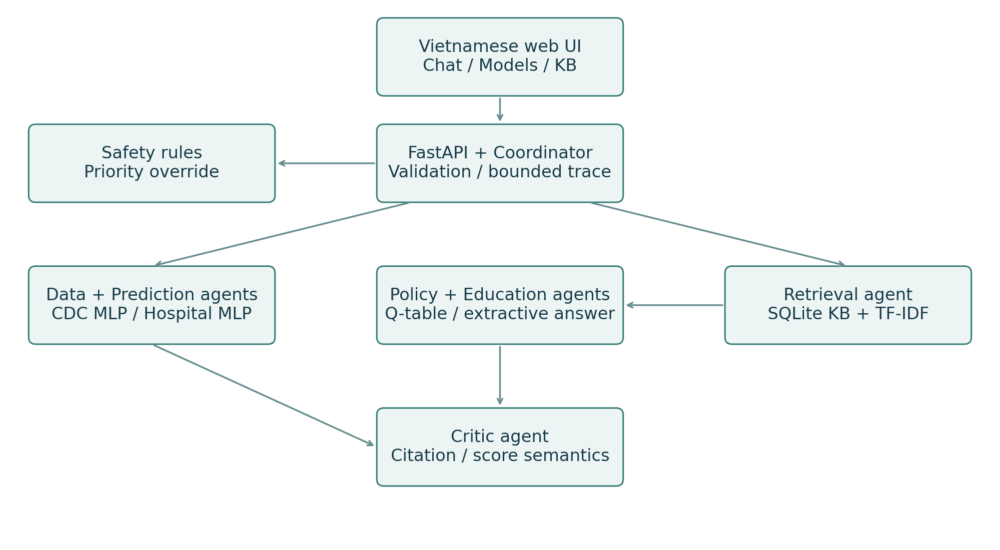
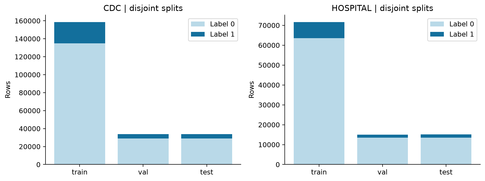
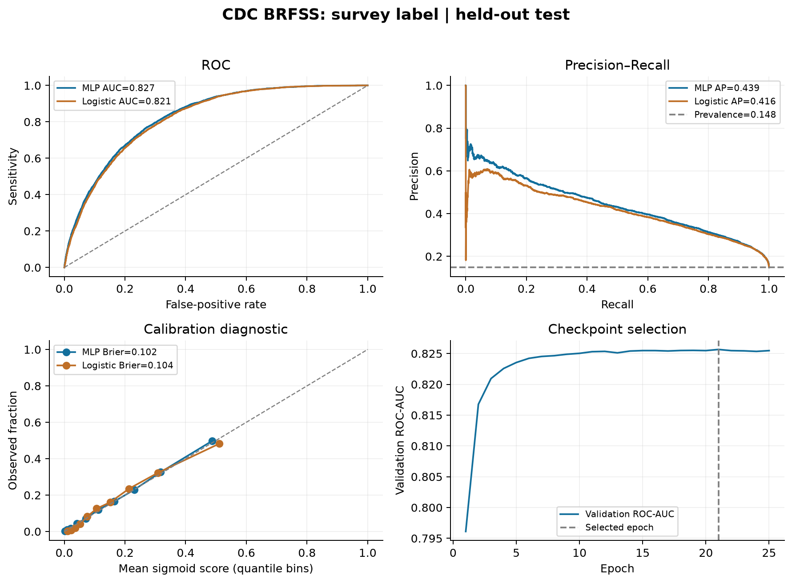
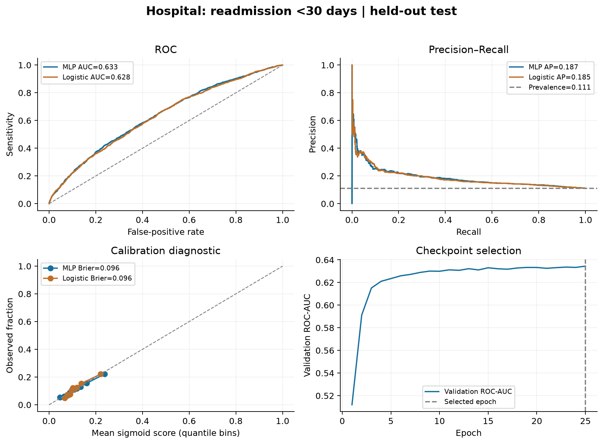

# PROJECT 01 - HỆ ĐA AGENT HỖ TRỢ BỆNH ĐÁI THÁO ĐƯỜNG

Giáp Minh Hiếu — B23DCCN299 — CT01 — Nhóm 04

# CHƯƠNG 1. GIỚI THIỆU ĐỀ TÀI

## 1.1. Bối cảnh và bài toán

Thông tin về đái tháo đường nằm ở nhiều nguồn: hồ sơ khám chữa bệnh, khảo sát sức khỏe, hướng dẫn chuyên môn và tài liệu giáo dục người bệnh. Một hệ thống chỉ đưa ra điểm dự đoán sẽ khó giải thích điểm đó có ý nghĩa gì. Một chatbot chỉ trả lời bằng văn bản cũng không tự bảo đảm đã dùng đúng nguồn hoặc nhận biết trường hợp ngoài phạm vi. Đề tài kết hợp mô hình học sâu, cơ sở tri thức và các vai trò Agent để mỗi thành phần thực hiện một nhiệm vụ có thể kiểm tra.

Project xây dựng DiaCare MAS, ứng dụng học tập tiếng Việt với hai chức năng chính. Chức năng hỏi đáp truy xuất thông tin từ kho tri thức có nguồn. Chức năng phân tích tiếp nhận bộ biến đầu vào theo đúng schema của một trong hai dataset, chạy MLP đã huấn luyện và hiển thị ý nghĩa nhãn, điểm mô hình, ngưỡng cùng dấu vết xử lý. Các cảnh báo từ quy tắc được xử lý trước nhánh hỏi đáp thông thường.

Hai nguồn dữ liệu lớn được sử dụng là CDC Diabetes Health Indicators với 253.680 bản ghi khảo sát và Diabetes 130-US Hospitals với 101.766 lượt điều trị nội trú. Chúng không phải dữ liệu Việt Nam và không cùng nhãn. Bộ thứ nhất phân loại trạng thái tiền đái tháo đường/đái tháo đường được ghi nhận trong khảo sát; bộ thứ hai phân loại tái nhập viện trong 30 ngày ở các lượt điều trị của người bệnh tiểu đường. Do vậy, thực nghiệm so sánh MLP với baseline trong từng dataset, không coi hai tập là kiểm định ngoại viện của nhau.

## 1.2. Mục tiêu

Mục tiêu kỹ thuật thứ nhất là hình thành quy trình dữ liệu có nguồn, chống rò rỉ, huấn luyện thật và lưu trọng số để suy luận. Mục tiêu thứ hai là tổ chức KB tiếng Việt với mã thẻ và liên kết gốc, kết hợp truy xuất với tạo câu trả lời trích xuất. Mục tiêu thứ ba là hiện thực điều phối đa vai trò có thông điệp, quy tắc ưu tiên và giới hạn bước. Mục tiêu thứ tư là đóng gói API và giao diện thành một ứng dụng có thể chạy độc lập bằng Docker.

Mục tiêu đánh giá gồm đo phân loại trên tập kiểm tra giữ riêng; kiểm tra truy xuất và khả năng từ chối bằng bộ câu hỏi có nhãn; kiểm thử dữ liệu nhập, dẫn nguồn, cảnh báo và suy luận từ trọng số thật. Thành công về kỹ thuật không đồng nghĩa hiệu quả lâm sàng. Dữ liệu lịch sử của Hoa Kỳ và bộ câu hỏi tự biên soạn chỉ hỗ trợ đánh giá trong phạm vi nghiên cứu của project.

## 1.3. Sản phẩm và phạm vi

| Sản phẩm | Nội dung thực hiện |
|---|---|
| Dữ liệu | Hai dataset công khai, nguồn và hash, báo cáo làm sạch/chia tập |
| Deep Learning | Hai MLP ba lớp ẩn, trọng số đã huấn luyện, Logistic và majority baseline |
| Cơ sở tri thức | 24 thẻ tiếng Việt, 19 URL nguồn, SQLite |
| Truy xuất và trả lời | TF-IDF, top-k, trả lời trích xuất có ID nguồn |
| Multi-Agent | Bảy vai trò chuyên trách cùng Coordinator, trace có giới hạn |
| Rule và RL | Cảnh báo/giới hạn theo luật; Q-learning một bước cho cách trình bày |
| Demo | FastAPI, giao diện web responsive, Dockerfile, cấu hình Render |
| Bằng chứng | JSON/NPZ kết quả, biểu đồ, kiểm thử và hướng dẫn tái lập |

Hệ thống không thu thập họ tên người bệnh, mã hồ sơ, địa chỉ hoặc số điện thoại. Các câu hỏi và giá trị nhập chỉ đi qua bộ nhớ của request. SQLite dùng để tổ chức thẻ tri thức, không lưu nội dung hỏi đáp hay hồ sơ sức khỏe. Mã nguồn không chứa khóa API và không cần dịch vụ LLM trả phí để hoạt động mặc định.

## 1.4. Cấu trúc báo cáo

Báo cáo đi từ cơ sở Agent và kiến trúc, tới thiết kế dữ liệu, Deep Learning, KB/truy xuất, điều phối và Rule/RL. Phần thực nghiệm trình bày số đo và lỗi còn tồn tại. Phần triển khai ghi lệnh chạy cùng ranh giới giữa bản Docker đã kiểm tra và cấu hình cloud cần tài khoản thực. Phụ lục cung cấp schema, API và kịch bản demo.


# CHƯƠNG 2. HỆ ĐA AGENT VÀ KIẾN TRÚC

## 2.1. Agent và hệ đa Agent

Agent là một thành phần nhận quan sát, duy trì trạng thái liên quan và chọn hành động để thực hiện một mục tiêu trong môi trường. Trong project, môi trường là request hỏi đáp hoặc phân tích dữ liệu; hành động là kiểm tra luật, truy xuất thẻ, chọn cách trình bày, chạy mô hình hoặc xác minh cấu trúc dẫn nguồn. Tính tự chủ của các vai trò được giới hạn bằng nhiệm vụ và điều kiện chuyển tiếp rõ ràng.

Hệ đa Agent tổ chức nhiều vai trò chuyên trách cùng giải quyết một nhiệm vụ chung. Cách tổ chức này giúp phân tách mục tiêu: SafetyAgent ưu tiên cảnh báo, RetrievalAgent ưu tiên bằng chứng liên quan, PredictionAgent ưu tiên suy luận đúng mô hình, còn CriticAgent kiểm tra cấu trúc và phạm vi đầu ra. Coordinator quyết định luồng chuyển thông điệp và dừng khi đã có kết quả.

Hiện thực của project là điều phối xác định trong một tiến trình Python, không phải mạng Agent độc lập phân tán hoặc LLM tự lập kế hoạch. Các vai trò được biểu diễn qua các hàm công cụ và thông điệp trong context. Việc tách vai trò có lợi cho truy vết và kiểm thử, nhưng bản thân số lượng tên Agent không chứng minh cải thiện chất lượng so với một pipeline tương đương. Đánh giá lợi ích nhân quả của MAS cần ablation với cùng công cụ, dữ liệu và ngân sách.

## 2.2. Vai trò và giao thức phối hợp

| Vai trò | Đầu vào | Hành động và đầu ra |
|---|---|---|
| SafetyAgent | Câu hỏi, glucose tùy chọn, đơn vị | Phát hiện cảnh báo/ngoài phạm vi; có thể dừng luồng |
| DataAgent | Tên dataset, dictionary đặc trưng | Kiểm tra đủ trường, kiểu số, miền và mã hóa |
| PredictionAgent | Vector đã xác thực | Chuẩn hóa theo train và suy luận MLP |
| RetrievalAgent | Câu hỏi tiếng Việt | Trả top-k thẻ, điểm và nguồn |
| PolicyAgent | Có/không bằng chứng, yêu cầu độ chi tiết | Chọn abstain/brief/detail từ Q-table |
| EducationAgent | Thẻ đã chọn, kiểu trình bày | Ghép văn bản của một hoặc hai thẻ, giữ ID |
| CriticAgent | Dự thảo hoặc điểm mô hình | Kiểm tra ID/URL hoặc nhắc đúng ý nghĩa điểm |
| Coordinator | Request và kết quả các vai trò | Điều phối, giới hạn bước và trả trace |

Thông điệp có các trường sender, receiver, kind, detail và elapsed_ms. Context được tạo mới cho từng request, chứa câu hỏi trong bộ nhớ và danh sách trace; mỗi trace có tối đa tám thông điệp. Không có vòng lặp Agent không giới hạn. Nếu vượt ngân sách, hệ thống phát sinh lỗi thay vì tiếp tục gọi công cụ.

<!-- pagebreak -->

## 2.3. Kiến trúc tổng quan



Lớp giao diện dùng HTML, CSS và JavaScript, trao đổi JSON với FastAPI. API khởi tạo KB, policy và metadata mô hình khi ứng dụng bắt đầu. Dữ liệu huấn luyện không nằm trong image triển khai; suy luận chỉ cần hai state_dict, thống kê scaler và metadata. Cơ sở tri thức được đóng gói từ JSON có kiểm soát phiên bản rồi ghi vào SQLite ở thư mục runtime.

Nhánh hỏi đáp đi qua SafetyAgent trước. Nếu có cảnh báo khẩn hoặc yêu cầu kê đơn, Coordinator trả lời theo quy tắc và dẫn nguồn. Nếu được phép, RetrievalAgent tạo vector câu hỏi, tìm bằng chứng và chuyển cho PolicyAgent. EducationAgent ghép nội dung trích xuất; CriticAgent chỉ chấp nhận các mã thẻ đã có và liên kết HTTPS. Nhánh này không gọi LLM và không phát sinh kiến thức mới ngoài thẻ đã chọn.

Nhánh phân tích dùng DataAgent xác thực schema rồi gọi PredictionAgent. Vector được chuẩn hóa bằng mean/std fit trên train, qua mạng và sigmoid để thu điểm. Ngưỡng phân loại đã được chọn bằng validation trong quá trình huấn luyện. CriticAgent gắn lại ý nghĩa nhiệm vụ và giới hạn sử dụng. Điểm của nhánh CDC và Hospital không được gộp thành một điểm nguy cơ chung.

## 2.4. Thiết kế cơ sở dữ liệu và tài nguyên

Bảng SQLite cards gồm id làm khóa chính, title, content và url. Mỗi lần khởi động, nội dung được đồng bộ lại từ cards.json; kết nối được đóng sau khi ghi hoặc đọc để tránh giữ khóa file trên Windows. Vector TF-IDF được xây dựng trong RAM từ cùng danh sách thẻ, nên ID truy xuất và bản ghi DB có thể đối chiếu được.

Tài nguyên mô hình được cache trong tiến trình. Đối tượng Predictor tải state_dict với weights_only=True, đặt model.eval và chạy trong inference_mode. Thống kê scaler nằm trong metadata JSON, tránh pickle đối tượng tiền xử lý. Predictor kiểm tra toàn bộ đặc trưng; không âm thầm bổ sung các trường người dùng chưa nhập. Các giá trị mặc định trên giao diện là dữ liệu minh họa thao tác và có thông báo rõ.

## 2.5. Thiết kế lỗi và quyền riêng tư

API từ chối dataset không hợp lệ, trường thừa/thiếu, số ngoài khoảng, mã phân loại không nguyên, kiểu boolean/string và giá trị NaN/Infinity. Phản hồi lỗi validation chỉ nêu vị trí và loại lỗi, không phản chiếu nguyên văn dữ liệu sức khỏe. JavaScript hiển thị đầu ra bằng textContent, tránh diễn dịch câu hỏi thành HTML.

Ứng dụng không có chức năng quản lý hồ sơ bệnh nhân, đăng nhập, điều trị hoặc ghi đơn. Khi triển khai công khai, cần đặt sau HTTPS của nhà cung cấp, bổ sung giới hạn lưu lượng và theo dõi tải nếu mở rộng sử dụng. Đó là yêu cầu vận hành tiếp theo, không phải tính năng đã kiểm chứng trong demo cục bộ.


# CHƯƠNG 3. DỮ LIỆU VÀ GIAO THỨC THỰC NGHIỆM

## 3.1. Lựa chọn dữ liệu

Ưu tiên của đề là dataset đủ lớn và có thể là dữ liệu Việt Nam. Khảo sát nguồn WHO cho thấy STEPS Việt Nam 2021 có 4.435 bản ghi và có điều kiện truy cập/sử dụng riêng. Project chưa tải hoặc huấn luyện bộ này. Một cổng dữ liệu đặt ở Việt Nam không tự khiến dữ liệu BRFSS thành dữ liệu người Việt. Hai tập chính vì thế được chọn theo khả năng tiếp cận công khai, quy mô và quyền tái sử dụng rõ ràng.

| Thuộc tính | CDC BRFSS | Diabetes 130-US Hospitals |
|---|---|---|
| Nguồn | UCI 891; bản gốc Alex Teboul/BRFSS 2015 | UCI 296; dữ liệu bệnh viện 1999–2008 |
| Quy mô gốc | 253.680 bản ghi, 21 biến đầu vào | 101.766 lượt nội trú, metadata nguồn 47 biến |
| Biến chọn | Toàn bộ 21 biến khảo sát | 10 biến dễ nhập, có ở thời điểm ra viện |
| Nhãn dương | Tiền đái tháo đường hoặc đái tháo đường gộp | readmitted bằng <30 |
| Giấy phép | CC0 theo metadata tác giả Kaggle | CC BY 4.0 theo UCI |
| Đơn vị chia tập | Vector đặc trưng duy nhất sau xử lý | Nhóm patient_nbr |

Tệp CDC có sẵn trong bài trước được đối chiếu với CSV UCI sau khi bỏ ID và quy đổi kiểu số; kết quả nội dung tương ứng. Hash tệp đầu vào, cấu hình và kích thước thực sau xử lý được ghi trong results/data-manifest.json. Script fetch-data.py có thể tải lại từ hai URL chính thức mà không cần khóa API. Dữ liệu gốc Hospital có định danh giả của encounter và patient, chỉ dùng patient_nbr để chia nhóm; chúng không là đầu vào mô hình hoặc nội dung image triển khai.

## 3.2. Đặc trưng CDC

Các biến gồm tăng huyết áp, cholesterol, kiểm tra cholesterol, BMI, hút thuốc, đột quỵ, bệnh tim, vận động, ăn trái cây/rau, uống nhiều rượu, tiếp cận chăm sóc, rào cản chi phí, sức khỏe tổng quát/tinh thần/thể chất, khó đi lại, giới tính, nhóm tuổi, học vấn và thu nhập. Phần lớn biến là mã phân loại, không phải phép đo liên tục. Age là mã nhóm 1–13; không được nhập tuổi thật 65 vào trường này. GenHlth là thang 1–5, MentHlth/PhysHlth là số ngày 0–30.

Diabetes_binary bằng 1 gộp cả tiền đái tháo đường và đái tháo đường của biến thể CDC nhị phân đang dùng. Vì nhãn phản ánh khảo sát cắt ngang, không được diễn giải đầu ra là xác suất một người hiện chưa mắc sẽ phát bệnh trong tương lai. Mô hình cũng không dùng glucose hay HbA1c xét nghiệm để xác nhận chẩn đoán.

## 3.3. Đặc trưng Hospital

Mười đặc trưng được chọn gồm time_in_hospital, num_lab_procedures, num_procedures, num_medications, number_outpatient, number_emergency, number_inpatient, number_diagnoses, AgeGroup và Gender. AgeGroup là nhóm tuổi 1–10 từ [0–10) đến [90–100); Gender được mã hóa 0 nữ, 1 nam theo hai giá trị có đủ mẫu trong nguồn. Ba dòng có gender không hợp lệ cho schema này bị loại, làm tập còn 101.763 lượt.

Các biến như số ngày nằm viện và số thuốc trong lượt điều trị chỉ có đầy đủ khi ra viện. Vì vậy thời điểm dự đoán được xác định là lúc ra viện; mô hình không đại diện sàng lọc khi mới nhập viện. Thu gọn đặc trưng làm biểu mẫu dễ sử dụng nhưng bỏ qua nhiều thông tin bệnh học; đây là một nguyên nhân cần khảo sát khi hiệu năng còn hạn chế, không phải kết luận nhân quả từ một thí nghiệm.

## 3.4. Làm sạch và chống rò rỉ

CDC có 24.206 dòng trùng hoàn toàn. Ngoài ra có 5.218 dòng thuộc các nhóm cùng đặc trưng nhưng nhãn xung đột. Quy trình loại nhóm xung đột và giữ một vector đặc trưng duy nhất ở các nhóm còn lại, thu 226.342 mẫu. Hai số trên có phần giao nhau, không được cộng rồi trừ trực tiếp từ quy mô gốc. Cách làm thay đổi phân phối so với dữ liệu nguồn; hiệu năng chỉ áp dụng cho tập đã xử lý như mô tả.

CDC được chia phân tầng 70/15/15 với seed 42 sau xử lý trùng. Hospital dùng chia nhóm theo patient_nbr, bảo đảm một người không xuất hiện đồng thời ở train, validation và test. Các ID không nằm trong vector X. Scaler chỉ fit trên train; cả validation và test dùng lại mean/std đó. Các biến đã chọn không có dữ liệu thiếu sau kiểm tra, nên không cần imputation.



| Dataset | Train | Validation | Test | Giao nhóm giữa tập |
|---|---|---|---|---|
| CDC | 158.439 | 33.951 | 33.952 | 0 vector đặc trưng trùng |
| Hospital | 71.583 | 15.055 | 15.125 | 0 patient trùng |

Hospital có 50.060 người trong train, 10.727 trong validation và 10.728 trong test sau lọc. Đánh giá test trên lượt nội trú không tương đương đánh giá mỗi người một phiếu; người có nhiều lượt trong cùng tập vẫn có thể tạo phụ thuộc. Chưa tính khoảng tin cậy có bootstrap theo người, nên không tuyên bố khác biệt nhỏ giữa mô hình là có ý nghĩa thống kê.

## 3.5. Thiết kế so sánh

Trong mỗi dataset, MLP và Logistic Regression được huấn luyện trên cùng train, dùng cùng validation/test. Baseline luôn dự đoán âm được bổ sung để chỉ ra ảnh hưởng mất cân bằng. Checkpoint MLP được chọn theo ROC-AUC validation, ngưỡng nhị phân theo F1 validation và được cố định trước khi đo test. Không chọn mô hình, ngưỡng hoặc epoch bằng kết quả test.

Các chỉ số chính là ROC-AUC, Average Precision (AP), F1, sensitivity, specificity, precision, Brier và ma trận nhầm lẫn. AP trong báo cáo là average_precision_score, không tự đổi tên thành diện tích PR nội suy hình thang. Accuracy được giữ để tham khảo nhưng không làm tiêu chí chính: dự đoán toàn âm vẫn có accuracy cao khi nhãn dương hiếm.


# CHƯƠNG 4. MÔ HÌNH DEEP LEARNING

## 4.1. Kiến trúc và hàm học

Mỗi dataset sử dụng một mạng MLP gồm ba lớp ẩn 64, 32 và 16 nút, ReLU giữa các lớp và một đầu ra logit. Đầu vào có 21 chiều với CDC và 10 chiều với Hospital. Mạng được hiện thực bằng PyTorch; các tham số đã học được lưu thành state_dict độc lập với dữ liệu huấn luyện. Đầu ra sigmoid nằm trong khoảng 0–1 nhưng không tự bảo đảm là xác suất được hiệu chuẩn trong quần thể người dùng mới.

Biểu diễn mạng là hợp các phép biến đổi tuyến tính và phi tuyến: vector chuẩn hóa đi qua Linear–ReLU, Linear–ReLU, Linear–ReLU rồi Linear. Số tham số của CDC là 4.033, Hospital là 3.329. Mạng nhiều lớp đáp ứng thành phần Deep Learning của project; không thay mạng bằng một hàm điểm tự đặt hoặc kết quả dự đoán giả.

Loss là binary cross-entropy trên logits. Adam sử dụng learning rate 0,001, weight decay 0,00001 và batch size 2.048. Ngân sách tối đa 25 epoch, patience 5 theo ROC-AUC validation, seed 42. Lượt chạy hiện tại cả hai mô hình thực hiện 25 epoch; checkpoint tốt nhất được khôi phục trước khi đo test. Môi trường huấn luyện được lưu trong environment.json, gồm Python 3.14.6, PyTorch CPU 2.14.0, NumPy 2.4.6 và scikit-learn 1.9.0 trên Windows.

## 4.2. Tiền xử lý và lựa chọn ngưỡng

Mỗi đặc trưng được chuẩn hóa z-score bằng mean và standard deviation của train. Với biến mã phân loại có thứ tự, đây là một lựa chọn đơn giản cho demo; coi khoảng cách giữa các mã là tương đương có thể tạo giả định mạnh. Một hướng cải thiện là dùng one-hot hoặc embedding cho biến không thứ tự, giữ nguyên split để so sánh.

Mặc định ngưỡng 0,5 có thể không tối ưu F1 khi nhãn mất cân bằng. Quy trình chọn ngưỡng bằng validation riêng, sau đó lưu trong metadata. Ngưỡng MLP CDC là khoảng 0,233954; Hospital khoảng 0,134504. Các ngưỡng này không phải mốc y khoa hoặc ngưỡng triển khai đã được bệnh viện chấp nhận. Tối ưu F1 cũng không đại diện mọi chi phí âm tính giả/dương tính giả.

Logistic Regression là baseline tuyến tính trên cùng dữ liệu chuẩn hóa. Baseline always-negative minh họa rằng accuracy cao chưa đủ để nhận diện lớp dương. Không có tìm kiếm siêu tham số quy mô lớn hoặc nhiều seed cho hai MLP này, nên không kết luận kiến trúc đã tối ưu.

<!-- pagebreak -->

## 4.3. Kết quả CDC



| Mô hình | ROC-AUC | AP | F1 | Sensitivity | Specificity | Brier |
|---|---|---|---|---|---|---|
| MLP | 0,8274 | 0,4393 | 0,4782 | 0,6368 | 0,8215 | 0,1017 |
| Logistic | 0,8206 | 0,4156 | 0,4685 | 0,6551 | 0,8015 | 0,1038 |
| Luôn âm | 0,5000 | 0,1482 | 0,0000 | 0,0000 | 1,0000 | 0,1482 |

Test CDC có 33.952 mẫu, gồm 5.030 mẫu dương. MLP có 23.758 true negative, 5.164 false positive, 1.827 false negative và 3.203 true positive. Sensitivity khoảng 63,68% cho thấy mô hình vẫn bỏ sót nhiều nhãn dương. Precision khoảng 38,28% phản ánh phần đáng kể dự đoán dương không khớp nhãn nguồn.

MLP cải thiện ROC-AUC và AP so với Logistic trong lượt đo này, trong khi sensitivity ở ngưỡng F1 đã chọn thấp hơn Logistic. Do đó không thể tóm tắt rằng MLP tốt hơn ở mọi tiêu chí. Chênh lệch AUC khoảng 0,0068 chưa được đánh giá khoảng tin cậy hoặc kiểm định cặp. Baseline luôn âm đạt accuracy 85,18%, cao hơn accuracy MLP 79,41%, nhưng sensitivity bằng 0; đây là lý do phải đọc nhiều chỉ số cùng nhau.

<!-- pagebreak -->

## 4.4. Kết quả Hospital



| Mô hình | ROC-AUC | AP | F1 | Sensitivity | Specificity | Brier |
|---|---|---|---|---|---|---|
| MLP | 0,6334 | 0,1869 | 0,2505 | 0,4090 | 0,7688 | 0,0958 |
| Logistic | 0,6285 | 0,1849 | 0,2396 | 0,4734 | 0,6914 | 0,0961 |
| Luôn âm | 0,5000 | 0,1107 | 0,0000 | 0,0000 | 1,0000 | 0,1107 |

Test Hospital gồm 15.125 lượt điều trị của 10.728 người. ROC-AUC MLP khoảng 0,6334 và AP khoảng 0,1869 thể hiện năng lực phân biệt còn khiêm tốn. MLP vượt baseline Logistic một khoảng nhỏ ở các chỉ số chính được chọn nhưng chưa đủ căn cứ nói có lợi ích lâm sàng, giảm tái nhập viện hoặc dùng được cho quyết định phân bổ chăm sóc.

Các đặc trưng thu gọn, dữ liệu cũ, phân bố bệnh viện và nhiều yếu tố chưa quan sát có thể ảnh hưởng kết quả. Cần thêm nghiên cứu có kiểm soát trước khi kết luận nguyên nhân. Đặc biệt, mô hình này dự báo readmission của một lượt ra viện chứ không phát hiện một người có tiểu đường hay không. Giao diện giữ hai nhánh riêng và luôn trình bày label_semantics.

## 4.5. Suy luận, tái lập và giới hạn

Predictor kiểm tra tên dataset, tập trường, miền giá trị và mã nguyên, tạo vector theo thứ tự metadata, chuẩn hóa rồi gọi mạng. Test parity đối chiếu 30 dòng mỗi dataset giữa kết quả tính lúc đánh giá và trọng số được nạp mới; score phải khớp trong sai số số học cho phép. Các ví dụ trong example-predictions.json lấy từ tập test thật, đã loại ID, dùng để minh họa kỹ thuật chứ không là hồ sơ người dùng.

Các file NPZ dự đoán test lưu y_true và score để dựng lại metric; JSON ghi cấu hình, thời gian, checkpoint và protocol. Không cần huấn luyện lại mỗi lần chạy web. Việc tái huấn luyện trên máy khác có thể làm thay đổi số học/thời gian; khi thay kết quả phải dựng lại bảng/hình thay vì sửa con số trong báo cáo bằng tay.

Chưa có calibration hậu nghiệm, kiểm định theo nhóm tuổi/giới, khảo sát độ lệch phân phối hoặc dữ liệu bệnh nhân Việt Nam. MLP không được dùng để loại trừ cấp cứu, thay xét nghiệm, tính liều thuốc hoặc xác nhận chẩn đoán. Các giới hạn này gắn trực tiếp với ý nghĩa nhãn và phạm vi bằng chứng của dữ liệu, không chỉ là chú thích ở cuối trang.


# CHƯƠNG 5. KNOWLEDGE BASE VÀ TRUY XUẤT TĂNG CƯỜNG TRẢ LỜI

## 5.1. Xây dựng Knowledge Base

KB gồm 24 thẻ biên soạn bằng tiếng Việt, dựa trên 19 URL từ WHO, NIDDK, CDC, NHS và nguồn chuyên môn Việt Nam. Mỗi thẻ chứa id, title, text, topics, source_title, url và retrieved_at. Văn bản là phần tóm tắt phục vụ học tập; không sao chép nguyên sách hoặc tự nhận đã đọc hướng dẫn điều trị đầy đủ nếu mới xác minh trang giới thiệu.

Các nhóm nội dung gồm khái niệm, típ 1/típ 2/thai kỳ, triệu chứng, yếu tố nguy cơ, xét nghiệm, HbA1c, phòng ngừa, dinh dưỡng, vận động, thuốc, hạ đường huyết, nhiễm toan ceton, theo dõi, biến chứng, bàn chân, thận, mắt, tài liệu Việt Nam và nguồn dữ liệu mô hình. Mã thẻ cho phép kiểm tra đầu ra đang dùng đúng văn bản nào, nguồn nào và ngày thu thập nào.

Kho thẻ đặt trong app/knowledge/cards.json là nguồn có kiểm soát phiên bản. Khi khởi động, ứng dụng đồng bộ các thẻ sang SQLite để minh họa thành phần DB của kiến trúc và phục vụ kiểm kê. Tài liệu không được tải tự động lại từ web trong mỗi câu hỏi; khả năng cập nhật phụ thuộc việc rà soát phiên bản KB. retrieved_at không đồng nghĩa tài liệu còn là phác đồ mới nhất cho mọi trường hợp.

## 5.2. Quy trình truy xuất

Câu hỏi và văn bản thẻ được chuyển về chữ thường, bỏ dấu để giảm khác biệt khi người dùng gõ tiếng Việt không dấu, giữ chữ số để phân biệt típ 1 và típ 2. TF-IDF dùng unigram và bigram, sublinear term frequency. Vector thẻ được chuẩn hóa L2; tích vô hướng giữa vector câu hỏi và thẻ tương ứng độ tương đồng cosine trong không gian này.

Mỗi request lấy tối đa ba thẻ có điểm từ 0,09 trở lên. Ngoài ngưỡng điểm, một kiểm tra phạm vi chủ đề giúp hạn chế câu hỏi hoàn toàn không liên quan. Ngưỡng và từ khóa là tham số kỹ thuật của demo, chưa được tối ưu trên tập kiểm định độc lập. Điểm tương đồng không là xác suất câu trả lời đúng và không tự chứng minh câu hỏi có thể trả lời.

TF-IDF phù hợp với KB nhỏ, chạy CPU và không cần tải embedding lớn. Hạn chế chính là phụ thuộc từ vựng, nhạy với cách diễn đạt và không suy luận được câu hỏi đa bước. Có thể nghiên cứu dense retrieval, reranking và GraphRAG ở bước sau, nhưng phải đo cùng giao thức và bộ câu hỏi tách riêng để đánh giá lợi ích.

## 5.3. Tạo câu trả lời dựa trên bằng chứng

Sau truy xuất, PolicyAgent chọn abstain, brief hoặc detail. Với brief, EducationAgent lấy một thẻ; detail có thể lấy hai thẻ. Văn bản được ghép trực tiếp với mã nguồn dạng [KBxx], sau đó danh sách URL đi kèm để người dùng mở tài liệu. CriticAgent kiểm tra ID thuộc KB và URL dùng HTTPS trước khi Coordinator trả kết quả.

Đây là pipeline truy xuất tăng cường trả lời theo hướng trích xuất. Bản chạy mặc định không có LLM, không fine-tune và không đo chất lượng sinh văn bản của mô hình ngôn ngữ. Vì vậy kết quả có nguồn không được trình bày như đánh giá một hệ RAG sinh tự do. Cách trích xuất giảm nguy cơ tự tạo claim mới nhưng vẫn có thể chọn sai thẻ hoặc trả lời quá tổng quát.

Quan hệ với RAG nằm ở nguyên tắc lấy bằng chứng bên ngoài thành phần trả lời, giữ thông tin nguồn và kiểm soát khi không đủ chứng cứ. Muốn chuyển sang generation bằng LLM cần bổ sung provider, prompt chỉ dùng context, kiểm tra claim–citation, xử lý prompt injection, chi phí và bộ đánh giá khác. Những thành phần đó chưa là kết quả thực nghiệm của project.

## 5.4. Đánh giá truy xuất và khả năng trả lời

Bộ phát triển có 30 câu tự biên soạn: 22 câu có nguồn mong đợi, 8 câu yêu cầu tính liều/kê đơn, dữ liệu thời gian thực, nội dung ngoài lĩnh vực hoặc bịa bằng chứng. Mỗi câu có expected_ids, answerable và kind. Bộ này là kiểm thử chức năng nhỏ được dùng trong quá trình phát triển, không phải benchmark độc lập, kiểm định chuyên gia y tế hoặc bằng chứng an toàn lâm sàng.

| Phép đo | Kết quả | Mẫu số và ý nghĩa |
|---|---|---|
| Recall@1 | 21/22 = 95,45% | Nguồn mong đợi đứng đầu với câu có đáp án |
| Recall@3 | 22/22 = 100% | Nguồn mong đợi nằm trong top 3 |
| MRR@3 | 0,97727 | Trung bình nghịch đảo hạng nguồn đúng |
| Quyết định trả lời/từ chối | 30/30 | Phân loại khả năng trả lời trên bộ phát triển |
| Từ chối câu âm | 8/8 | Gồm cả rule boundary và thiếu bằng chứng |
| Nguồn mong đợi được trích trong câu trả lời | 21/22 | Khác Recall@3 vì brief chỉ chọn một thẻ |

Ở Q22 về tiền đái tháo đường, KB24 nằm hạng 2 nhưng câu trả lời ngắn chọn KB01 tổng quát ở hạng 1. Truy xuất top 3 thành công không bảo đảm phần trả lời dùng nguồn cụ thể nhất. Lỗi này được giữ trong system-evaluation.json và báo cáo để tránh đồng nhất chất lượng truy xuất với chất lượng câu trả lời.

Các giá trị trên có thể tăng cao vì corpus nhỏ và câu hỏi được viết sau khi biết phạm vi KB. Chưa có đánh giá người dùng, nhiều cách viết không dấu/lỗi chính tả, câu hỏi dài có phủ định phức tạp, đa bệnh hoặc xung đột tài liệu. Những hạn chế đó quan trọng hơn việc làm tròn chỉ số thành 100%.

## 5.5. Ví dụ tương tác

Câu hỏi “HbA1c là gì?” đi qua kiểm tra phạm vi, truy xuất thẻ xét nghiệm, chọn brief và trả đoạn tóm tắt cùng nguồn NIDDK. Câu hỏi về điều chỉnh liều insulin dừng ở SafetyAgent, không chạy nhánh giáo dục thông thường. Câu hỏi về cổ phiếu hoặc địa chỉ phòng khám đang mở cửa không được thay bằng một đoạn y tế bất kỳ chỉ vì có vài từ trùng.

Khi không có bằng chứng, ứng dụng trả trạng thái insufficient_evidence và nêu phạm vi hiện có. Khi yêu cầu vượt phạm vi, trạng thái boundary đi kèm lý do trong trace. Nhờ phân biệt các trạng thái này, người dùng và người chấm có thể quan sát lý do hệ thống dừng thay vì chỉ nhìn một câu trả lời cuối.


# CHƯƠNG 6. ĐIỀU PHỐI, RULE VÀ REINFORCEMENT LEARNING

## 6.1. Điều phối có giới hạn

Coordinator có hai luồng rõ ràng. Luồng hỏi đáp gọi các vai trò Safety, Retrieval, Policy, Education và Critic theo thứ tự. Luồng phân tích gọi Data, Prediction và Critic. Mỗi lần chuyển đều ghi sender, receiver, kind, mô tả ngắn và thời gian đã trôi qua. Tám thông điệp là giới hạn cứng; không có Agent tự gọi lại không kiểm soát.

Các vai trò không trao đổi hồ sơ giữa những request khác nhau. Context mới được tạo cho từng lượt; không có bộ nhớ hội thoại dài hạn hoặc suy diễn từ những câu trước. Người dùng cần nhập đầy đủ đặc trưng mỗi lần phân tích. Thiết kế này làm demo dễ tái lập và giảm dữ liệu lưu trữ nhưng chưa hỗ trợ quản lý điều trị liên tục.

## 6.2. Hệ quy tắc

Quy tắc xử lý cảnh báo dựa trên triệu chứng được mô tả và glucose nhập tùy chọn, tách biệt hoàn toàn với score MLP. Hệ thống quy đổi mmol/L sang mg/dL bằng hệ số 18,0182. Đường huyết dưới 70 mg/dL kích hoạt cảnh báo hạ đường huyết; giá trị từ 300 mg/dL kích hoạt cảnh báo cần chú ý khẩn, đặc biệt khi kéo dài hoặc kèm dấu hiệu nặng. Đây là hướng dẫn giáo dục dựa trên tài liệu, không phải các ngưỡng duy nhất để chẩn đoán hoặc loại trừ cấp cứu.

Các cụm như bất tỉnh, co giật, khó thở, hôn mê hoặc không nuốt được có thể dừng hỏi đáp thông thường. Logic có kiểm tra một số từ phủ định ngay trước triệu chứng và phân biệt câu hỏi kiến thức với mô tả cá nhân hiện tại. Đây vẫn là xử lý ngôn ngữ bằng luật; không bao phủ hết cách nói tiếng Việt, không thể bảo đảm độ nhạy/specificity lâm sàng và không thay hệ thống phân loại cấp cứu chuyên môn.

| Nhóm quy tắc | Hành vi |
|---|---|
| Dấu hiệu nguy hiểm | Khuyên tìm trợ giúp cấp cứu, không cho đồ ăn/nước khi không nuốt an toàn |
| Glucose thấp | Nhắc xử trí theo kế hoạch đã được nhân viên y tế hướng dẫn và tìm hỗ trợ nếu nặng |
| Glucose cao | Nhắc liên hệ y tế, chú ý DKA và không bỏ qua triệu chứng |
| Kê đơn/điều chỉnh thuốc | Từ chối tính liều hoặc thay đổi thuốc cá nhân |
| Bịa nguồn hoặc bỏ qua bằng chứng | Không thực hiện yêu cầu tạo thông tin giả |
| Vị trí/lịch mở cửa trực tiếp | Nêu chưa có công cụ và dữ liệu tương ứng |
| Dinh dưỡng định lượng cá nhân | Không tự tính gram/kcal khi thiếu đánh giá lâm sàng |

Các quy tắc cảnh báo được áp dụng trước policy học. Q-table không có quyền bỏ qua hoặc giảm mức cảnh báo; MLP cũng không tham gia quyết định có cần cảnh báo hay không. Thiết kế này tránh dùng một mô hình khảo sát cắt ngang làm công cụ đánh giá tình huống cấp tính mà dữ liệu huấn luyện không bao phủ.

## 6.3. Thiết kế Q-learning

RL trong project là một contextual bandit một bước, được huấn luyện bằng cập nhật Q-learning với gamma bằng 0. Môi trường có bốn trạng thái, tạo từ hai biến nhị phân: đã có bằng chứng phù hợp hay chưa, và người dùng có yêu cầu giải thích chi tiết hay không. Ba hành động là abstain, brief và detail.

Reward là rubric kỹ thuật tự thiết kế: hành động đúng kiểu trình bày nhận +1; sai nhận -1; trả lời khi không có bằng chứng bị phạt -3. Với trạng thái không có bằng chứng, mục tiêu là abstain. Với bằng chứng có sẵn, câu hỏi ngắn chọn brief và câu yêu cầu giải thích chọn detail. Reward không dùng kết cục sức khỏe, tuân thủ điều trị hoặc sự hài lòng người bệnh thật.

Huấn luyện dùng seed 299, 4.000 episode, learning rate 0,15 và epsilon giảm từ 1 xuống tối thiểu 0,08. Công thức cập nhật là Q(s,a) ← Q(s,a) + α[r − Q(s,a)] vì bài toán kết thúc sau một hành động. Script train-policy.py ghi Q-table, số lần thăm từng state–action và reward trung bình 500 episode cuối.

## 6.4. Kết quả và cách diễn giải RL

Sau huấn luyện, greedy policy chọn đúng hành động theo rubric ở 4/4 trạng thái. Kết quả này chỉ chứng minh thuật toán học được bảng thưởng đơn giản trong môi trường mô phỏng. Nó không cho biết việc thêm RL tốt hơn điều kiện if/else tương đương, không chứng minh cải thiện hiểu biết và không phải học tăng cường điều trị.

Với môi trường nhỏ, triển khai điều kiện trực tiếp có thể đơn giản hơn. RL được đưa vào để minh họa mối liên hệ state–action–reward và cách tích hợp policy đã học dưới các ràng buộc cố định. Mở rộng hợp lý trong tương lai là thu phản hồi đồng thuận về cách trình bày/chủ đề giáo dục, đánh giá offline và bảo vệ quyền riêng tư; không mở rộng sang tối ưu liều thuốc bằng dữ liệu mô phỏng của demo.

## 6.5. Kiểm thử phối hợp

Kiểm thử riêng bao gồm 11 tình huống cảnh báo, chuyển đổi đơn vị, phủ định triệu chứng, câu hỏi giáo dục, yêu cầu điều chỉnh thuốc và thứ tự ưu tiên luật. Các trường hợp đều đạt sau sửa lỗi được phát hiện trong quá trình phát triển. Bộ test kiểm tra cả trace không vượt tám bước và chỉ dẫn nguồn tồn tại trong KB.

Các test đạt là bằng chứng về hợp đồng phần mềm trong những trường hợp đã viết. Chưa có đánh giá độc lập đủ lớn để ước lượng xác suất bỏ sót nguy hiểm. Cần tiếp tục ghi nhận lỗi thật và mở rộng kiểm thử theo cách diễn đạt mới, thay vì coi một danh sách test ngắn là bảo đảm an toàn.


# CHƯƠNG 7. KIỂM THỬ, DEMO VÀ TRIỂN KHAI

## 7.1. Kiểm thử phần mềm

Bộ pytest gồm 55 trường hợp và chạy với hai mô hình đã huấn luyện thật. Các nhóm kiểm tra gồm truy xuất, thông điệp Agent, giới hạn bước, nguồn trích dẫn, schema mô hình, nạp trọng số mới, tính ổn định score, điều kiện cảnh báo và các phản hồi HTTP lỗi. Không dùng mock mô hình hoặc thay mạng bằng hàm điểm cố định để làm test đạt.

Trong quá trình kiểm thử, ba lỗi kỹ thuật đã được phát hiện và sửa. Kết nối SQLite không tự đóng khi chỉ dùng context manager của sqlite3 gây khóa file trên Windows; bản sửa dùng closing và commit rõ ràng. Pydantic có thể ép boolean hoặc chuỗi số sang float trước khi Predictor nhận dữ liệu; bản sửa dùng strict numeric types. Phản hồi lỗi chứa NaN/Infinity có thể lỗi serialize JSON; handler mới chỉ trả vị trí, loại và thông điệp lỗi, không phản chiếu input.

Lượt kiểm tra cuối đạt 55/55, còn một cảnh báo deprecation của thư viện TestClient không làm test thất bại. Kiểm thử mô hình riêng đối chiếu score từ state_dict với dự đoán test đã lưu, kiểm tra scaler dùng đúng train và xác nhận tập nhóm không giao nhau. Thành công các test là bằng chứng triển khai đúng hợp đồng phần mềm ở những trường hợp đã xét, không bảo đảm mọi cách diễn đạt hoặc tình huống y tế đều được xử lý đúng.

## 7.2. Kịch bản demo

Kịch bản thứ nhất mở trang Trợ lý kiến thức và hỏi “HbA1c là gì?”. Người xem kiểm tra phần trả lời, ID nguồn, URL NIDDK và trace qua các vai trò. Tiếp theo thử câu hỏi ngoài chủ đề để quan sát insufficient_evidence, rồi yêu cầu kê đơn để thấy boundary và lý do dừng.

Kịch bản thứ hai nhập glucose theo mg/dL hoặc mmol/L cùng câu hỏi giáo dục, quan sát quy tắc cảnh báo nếu dưới ngưỡng. Có thể dùng tình huống thử nghiệm có mô tả dấu hiệu nguy hiểm để thấy safety_override chạy trước policy. Đây là dữ liệu kiểm thử giao diện, không phải thông tin của một người bệnh thật.

Kịch bản thứ ba vào Phân tích dữ liệu, chọn CDC, kiểm tra 21 trường và cách mã hóa rồi chạy MLP. Đầu ra gồm risk_score, threshold, predicted_class, label_semantics và trace. Đổi sang Hospital để quan sát schema 10 biến và nhãn tái nhập viện; không diễn giải score Hospital thành mức độ tiểu đường. Cuối cùng xóa một trường hoặc nhập giá trị ngoài miền qua API để xác nhận HTTP422.

## 7.3. Giao diện và API

Giao diện có ba khu vực: Trợ lý kiến thức, Phân tích dữ liệu và Kho tri thức. Menu bên cạnh thể hiện thông tin sinh viên. Các thẻ nguồn giữ liên kết gốc; khối trace mô tả từng bước thay vì chỉ hiện tên Agent. CSS có bố cục thay đổi theo chiều rộng, form từ ba cột xuống một cột khi màn hình nhỏ.

| Endpoint | Phương thức | Mục đích |
|---|---|---|
| / | GET | Giao diện demo |
| /health | GET | Tình trạng sẵn sàng, mô hình và kiểm kê KB |
| /api/catalog | GET | Metadata, schema và thông tin bộ bài |
| /api/knowledge | GET | Các thẻ tri thức và nguồn |
| /api/chat | POST | Hỏi đáp, glucose tùy chọn, đơn vị |
| /api/predict | POST | Phân loại theo dataset và vector đầu vào |
| /api/results | GET | Một số kết quả tổng hợp được phép công bố |
| /docs | GET | Tài liệu tương tác OpenAPI |

Các endpoint và frontend được phục vụ cùng origin; JavaScript không nhúng secret, không gửi thông tin sang dịch vụ LLM. App không yêu cầu mở dữ liệu cá nhân để chạy demo. Bản giao diện desktop được xem trực tiếp trong Edge, còn kiểm thử chức năng hệ thống được thực hiện bằng API. Chưa có đánh giá người dùng hoặc kiểm thử giao diện tự động trên mọi trình duyệt/thiết bị.

## 7.4. Đóng gói Docker

Dockerfile dựa trên Python3.12 slim và cài dependency có khóa phiên bản. Image chỉ sao chép app, models và results, không sao chép raw dataset hoặc các split dùng huấn luyện. Ứng dụng chạy bằng user không phải root, một worker Uvicorn, đọc cổng từ PORT và đặt SQLite ở thư mục runtime có quyền ghi. Không cần GPU, khóa API hoặc train lại lúc khởi động.

Từ thư mục project, chạy các lệnh:

```powershell
docker build -t diacare-hieugm299:1.0 .
docker run -d --name diacare-demo -p 127.0.0.1:8000:8000 diacare-hieugm299:1.0
python scripts/verify-deployment.py --url http://127.0.0.1:8000
```

Một worker giúp giảm việc nhân đôi model/index. Số thread CPU được giới hạn trong container. SQLite được dựng lại từ JSON nguồn nên không cần persistent disk để giữ KB. Cách này phù hợp demo có nội dung tĩnh; không phải thiết kế lưu hồ sơ người bệnh hoặc đồng bộ chỉnh sửa KB giữa nhiều replica.

## 7.5. Triển khai cloud và giới hạn bằng chứng

Gói có render.yaml với runtime Docker, healthCheckPath /health và biến APP_DATA_DIR. Cấu hình dành cho một repository riêng chứa nội dung project ở root. Với monorepo cần đặt Root Directory tương ứng. Quy trình tạo service, kiểm tra tài nguyên và lệnh xác minh endpoint được ghi trong DEPLOY.md, dựa trên tài liệu Blueprint chính thức của Render.

Bản Docker đã được build từ đúng Dockerfile và chạy trên Docker Engine 29.9.2 trong môi trường Linux WSL2 riêng. Cả 13 kiểm tra HTTP đạt, gồm frontend/tài nguyên tĩnh, kiểm kê KB, suy luận hai mô hình, từ chối input thiếu, trả lời có nguồn, ưu tiên cảnh báo và xử lý NaN. Container báo healthy; một quan sát lúc nhàn rỗi sau kiểm tra ghi khoảng 254,9 MiB RAM, không phải benchmark tải. docker-verification.json giữ thời điểm, image ID và từng kết quả.

Cloud là bước triển khai riêng: cần tài khoản/kết nối repository và phải kiểm tra endpoint sau deploy. Project chưa có URLcloud công khai được tạo trong phiên làm việc này; không dùng một URL dự kiến làm bằng chứng hệ thống đã phục vụ Internet.

## 7.6. Kết luận và hướng phát triển

Project hiện thực đầy đủ luồng dữ liệu lớn đến mô hình đã huấn luyện, suy luận có schema, KB có nguồn, trả lời trích xuất, điều phối đa vai trò, Rule và minh họa RL. Các kết quả cho thấy MLP có thể học tín hiệu trong hai nhiệm vụ, nhưng mức phân biệt tái nhập viện còn hạn chế; pipeline hỏi đáp vẫn có thể chọn nguồn chưa cụ thể nhất.

Hướng tiếp theo là đánh giá nhiều seed, khoảng tin cậy theo người, calibration và fairness; mở rộng đặc trưng Hospital có kiểm soát thời điểm quan sát; xin quyền dùng và kiểm định trên dữ liệu Việt Nam. Với KB cần rà soát chuyên môn, mở rộng bộ câu hỏi độc lập và kiểm tra phủ định, đa bệnh, mức độ cụ thể. Tích hợp LLM chỉ nên thực hiện sau khi có giao thức kiểm tra claim–citation và đo riêng chất lượng sinh, không suy từ kết quả trích xuất hiện tại.

Ứng dụng được bàn giao ở mức demo học tập có thể chạy lại, không tự nhận là thiết bị y tế, công cụ kê đơn hoặc hệ thống quản lý điều trị đã được xác thực. Mọi mở rộng ứng dụng thực tế cần quy trình đánh giá phù hợp với dữ liệu, người dùng và mục đích triển khai.


# PHỤ LỤC. TÁI LẬP VÀ HỢP ĐỒNG DỮ LIỆU

## A.1. Chạy trực tiếp

Các lệnh sau chạy từ chính thư mục project. requirements-lock.txt ghi môi trường Linux của image; môi trường huấn luyện Windows được lưu riêng để đối chiếu.

```powershell
python -m pip install -r requirements.txt -c requirements-lock.txt
python -m uvicorn app.main:app --host 127.0.0.1 --port 8000
python -m pytest tests -q
python tests/evaluate-system.py
```

Không cần raw dataset để suy luận. Muốn huấn luyện lại, dùng fetch-data.py, prepare-data.py và train-models.py theo README-models.md. Sau huấn luyện cần chạy plot-model-results.py, kiểm thử và dựng lại báo cáo. Không chỉnh kết quả bằng tay để giữ nguyên một con số cũ.

## A.2. Ví dụ JSON hỏi đáp

```json
{
  "question": "HbA1c là gì?",
  "glucose": null,
  "unit": "mg/dL"
}
```

Phản hồi có answer, status, sources, trace, policy_action và generation. Với trả lời có nguồn, generation bằng extractive. Với luật ưu tiên, generation bằng rule. Trường sources chứa ID/title/url; elapsed_ms là thời gian từ đầu request tới thông điệp, không phải thời gian riêng của toàn bộ model hoặc benchmark latency.

## A.3. Ví dụ JSON phân tích

```json
{
  "dataset": "hospital",
  "features": {
    "time_in_hospital": 4,
    "num_lab_procedures": 40,
    "num_procedures": 1,
    "num_medications": 15,
    "number_outpatient": 0,
    "number_emergency": 0,
    "number_inpatient": 1,
    "number_diagnoses": 8,
    "AgeGroup": 7,
    "Gender": 1
  }
}
```

Đây là input minh họa kỹ thuật tự nhập, không phải hồ sơ bệnh nhân. Nên lấy schema đầy đủ từ /api/catalog thay vì tự suy ý nghĩa biến. Trường CDC Age hoặc Hospital AgeGroup phải nhập mã nhóm đúng phạm vi, không phải số tuổi trực tiếp. Kết quả luôn có clinical_use bằng false và score_semantics giải thích điểm sigmoid.

## A.4. Danh sách tài nguyên

| Nhóm tệp | Vai trò |
|---|---|
| models/cdc và models/hospital | State_dict, metadata, baseline tham chiếu |
| models/presentation-policy.json | Q-table và cấu hình bandit |
| results/data-manifest.json | Quy mô, hash và giao thức chia tập |
| results/*-training.json | Cấu hình, lịch sử loss, validation, test |
| results/*-test-predictions.npz | Nhãn và dự đoán để tính lại metric |
| results/system-evaluation.json | Từng câu hỏi, hạng nguồn và quyết định |
| results/model-tests.json | Kiểm chứng score, scaler và đầu vào |
| results/docker-verification.json | Kiểm tra HTTP của container đã chạy |
| report/sections và builders | Nguồn báo cáo có thể chỉnh và dựng lại |

Tệp raw Hospital không được đưa vào gói nộp hoặc image vì không cần cho demo và chứa định danh giả dùng chia nhóm. Có script tải từ nguồn chính thức để tái lập. Manifest gói nộp ghi SHA256 cho các tệp đã đóng gói, tự loại chính manifest để tránh tự tham chiếu.


# TÀI LIỆU THAM KHẢO

Các nguồn web được kiểm tra trong quá trình thực hiện ngày 05/11/2026; từng thẻ KB giữ retrieved_at riêng. Trọng số và kết quả đo do mã project tạo, không lấy số liệu của bài mẫu.

1. [WHO — Diabetes](https://www.who.int/news-room/fact-sheets/detail/diabetes)

2. [NIDDK — Type 1 Diabetes](https://www.niddk.nih.gov/health-information/diabetes/overview/what-is-diabetes/type-1-diabetes)

3. [NIDDK — Type 2 Diabetes](https://www.niddk.nih.gov/health-information/diabetes/overview/what-is-diabetes/type-2-diabetes)

4. [NIDDK — Gestational Diabetes](https://www.niddk.nih.gov/health-information/diabetes/overview/what-is-diabetes/gestational)

5. [NIDDK — Symptoms & Causes of Diabetes](https://www.niddk.nih.gov/health-information/diabetes/overview/symptoms-causes)

6. [NIDDK — Diabetes Tests & Diagnosis](https://www.niddk.nih.gov/health-information/diabetes/overview/tests-diagnosis)

7. [NIDDK — Healthy Living with Diabetes](https://www.niddk.nih.gov/health-information/diabetes/overview/healthy-living-with-diabetes)

8. [NIDDK — Insulin, Medicines, & Other Diabetes Treatments](https://www.niddk.nih.gov/health-information/diabetes/overview/insulin-medicines-treatments)

9. [CDC — Treatment of Low Blood Sugar](https://www.cdc.gov/diabetes/treatment/treatment-low-blood-sugar-hypoglycemia.html)

10. [NHS — Low blood sugar (hypoglycaemia)](https://www.nhs.uk/conditions/low-blood-sugar-hypoglycaemia/)

11. [CDC — Diabetic Ketoacidosis](https://www.cdc.gov/diabetes/about/diabetic-ketoacidosis.html)

12. [NIDDK — Managing Diabetes](https://www.niddk.nih.gov/health-information/diabetes/overview/managing-diabetes)

13. [NIDDK — Diabetes & Foot Problems](https://www.niddk.nih.gov/health-information/diabetes/overview/preventing-problems/foot-problems)

14. [NIDDK — Diabetic Kidney Disease](https://www.niddk.nih.gov/health-information/diabetes/overview/preventing-problems/diabetic-kidney-disease)

15. [NIDDK — Diabetic Eye Disease](https://www.niddk.nih.gov/health-information/diabetes/overview/preventing-problems/diabetic-eye-disease)

16. [Cục Quản lý Khám chữa bệnh — Hướng dẫn chẩn đoán và điều trị đái tháo đường típ 2](https://daithaoduong.kcb.vn/huong-dan-chan-doan-va-dieu-tri-dai-thao-duong-tip-2)

17. [UCI. CDC Diabetes Health Indicators. DOI 10.24432/C53919.](https://archive.ics.uci.edu/dataset/891/cdc+diabetes+health+indicators)

18. [UCI. Diabetes 130-US Hospitals 1999–2008. DOI 10.24432/C5230J; CC BY 4.0.](https://archive.ics.uci.edu/dataset/296/diabetes+130-us+hospitals+for+years+1999-2008)

19. [NIDDK — Insulin Resistance & Prediabetes](https://www.niddk.nih.gov/health-information/diabetes/overview/what-is-diabetes/prediabetes-insulin-resistance)

20. [Alex Teboul. Diabetes Health Indicators Dataset, BRFSS 2015; CC0.](https://www.kaggle.com/datasets/alexteboul/diabetes-health-indicators-dataset)

21. [WHO. Viet Nam STEPS 2021, VNM_2021_STEPS_v01; nguồn khảo sát, chưa tải/huấn luyện trong project.](https://extranet.who.int/ncdsmicrodata/index.php/catalog/948/study-description)

22. [Lewis và cộng sự (2020). Retrieval-Augmented Generation for Knowledge-Intensive NLP Tasks.](https://arxiv.org/abs/2005.11401)

23. [Wooldridge và Jennings (1995). Intelligent Agents: Theory and Practice.](https://www.cs.rhul.ac.uk/~mike/pubs/ker95.pdf)

24. [Sutton và Barto (2018). Reinforcement Learning: An Introduction, 2nd edition.](http://incompleteideas.net/book/the-book-2nd.html)

25. [PyTorch. Tài liệu chính thức về tensor, neural network và state_dict.](https://docs.pytorch.org/docs/stable/index.html)

26. [scikit-learn. Model evaluation và định nghĩa Average Precision/ROC-AUC.](https://scikit-learn.org/stable/modules/model_evaluation.html)

27. [FastAPI. FastAPI in Containers - Docker.](https://fastapi.tiangolo.com/deployment/docker/)

28. [Render. Blueprint YAML Reference.](https://render.com/docs/blueprint-spec)
